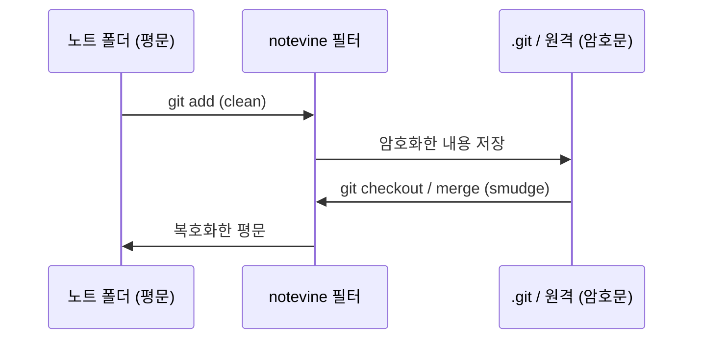
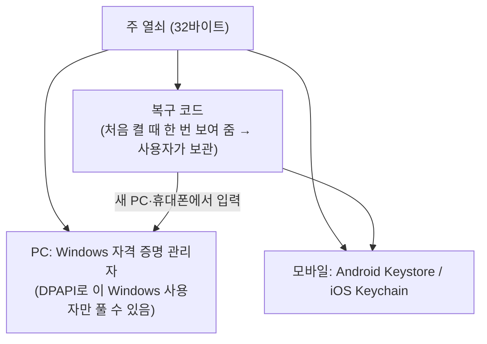

# Git 공유 노트 암호화 검토

- 상태: 구현됨 (2026-11-11, 브랜치 feature/git-encryption)
- 작성일: 2026-11-11
- 질문: Git으로 노트를 공유할 때, Git에 올라가는 파일은 모두 암호화하고 내려받으면 복호화해서 보여 줄 수 있는가
- 결론: **가능하다.** 다만 "무엇까지 숨길지"에 따라 방법과 비용이 크게 달라진다. 노트 **내용**만 숨기면 되면 Notevine 안에 넣을 수 있는 크기의 작업이고, **파일·폴더 이름**까지 숨기려면 훨씬 큰 작업이 된다.

## 1. 지금 구조

`src-tauri/src/backup.rs`는 PC에 설치된 Git을 직접 실행한다.

- 지금은 원격에 노트가 **평문으로** 올라간다. 원격 저장소를 볼 수 있는 사람(호스팅 업체 포함)은 내용을 읽을 수 있다.
- 보안을 위해 신뢰하지 않은 저장소에서는 Git을 실행하지 않는다(`require_trust`). 저장소 설정의 필터·훅이 명령을 실행할 수 있기 때문이다. 아래 방법들은 모두 이 "필터"를 쓰므로, **Notevine이 직접 넣은 필터만** 쓰도록 해야 한다.

## 2. 방법 비교

| 방법 | 원리 | 숨겨지는 것 | 드러나는 것 | Windows | 판단 |
| --- | --- | --- | --- | --- | --- |
| **A. Notevine 내장 필터 (권장)** | Git의 clean/smudge 필터를 `notevine.exe`가 맡음. 올릴 때 암호화, 받을 때 복호화 | 노트·첨부 **내용** | 파일·폴더 이름, 대략적 크기, 고친 시각, 커밋 메시지 | 추가 설치 없음 | 구현 가능, 중간 규모 |
| B. git-crypt / transcrypt | 같은 필터 방식의 외부 도구 | 내용 | A와 같음 | 별도 설치(git-crypt는 GPG, transcrypt는 bash·openssl) | 사용자가 따로 설치·설정해야 해 비권장 |
| C. git-remote-gcrypt | 원격 저장소 **전체**를 GPG로 암호화 | 내용 + 이름 + 구조 전부 | 저장소 크기, 올린 시각 | bash·GPG 필요, 실사용 사례 적음(추정) | 이름까지 숨겨야 할 때만 |
| D. 앱이 암호화 사본을 따로 관리 | 노트 폴더와 별도로 "암호화 사본" 저장소를 만들어 동기화 | 내용 + 이름 | 파일 개수·크기 | 추가 설치 없음 | 충돌 처리·이름 변경을 모두 새로 만들어야 해 큼 |

## 3. 권장안 A의 동작

- `.gitattributes`에 `* filter=notevine diff=notevine merge=notevine`을 넣고, `.git/config`에 `filter.notevine.process = notevine --git-filter`를 등록한다. Git은 "한 번 띄워 계속 쓰는" 필터 프로토콜(`filter.<이름>.process`)을 지원하므로 파일마다 프로그램을 새로 띄우지 않는다.
- 노트 폴더(작업 폴더)에는 늘 평문이 있으므로 앱·검색·MCP는 지금과 똑같이 동작한다.

### 3.1 반드시 함께 풀어야 할 문제

| 문제 | 왜 생기나 | 해결 |
| --- | --- | --- |
| 바꾸지 않은 파일도 매번 바뀐 것으로 보임 | 보통 암호화는 같은 내용도 매번 다른 암호문을 만든다 | **결정적 암호화**(같은 열쇠·같은 내용이면 같은 암호문). AES-SIV처럼 내용에서 IV를 만드는 방식을 쓴다 |
| 두 PC가 같은 노트를 고치면 합칠 수 없음 | Git은 암호문끼리 합치려다 항상 충돌한다. 지금 백업은 merge로 두 PC를 합친다 | **merge 드라이버**를 넣는다: 세 버전을 복호화 → 평문으로 합치기 → 다시 암호화 |
| 차이 보기가 의미 없음 | 암호문끼리 비교됨 | `diff.notevine.textconv`로 복호화해 비교 |
| 다른 PC에서 처음 받을 때 암호문이 보임 | 필터 설정과 열쇠가 없는 상태로 checkout되면 | 앱에 "암호화된 노트 폴더 받기"를 두어: 받기만 하고(checkout 안 함) → 필터 등록 → 열쇠 입력 → checkout |
| 열쇠를 잃으면 원격 사본을 못 읽음 | 복구 수단이 없음 | 처음 켤 때 **복구 코드**를 보여 주고 보관하게 함. PC에서는 Windows 자격 증명(DPAPI)에 보관 |
| 이미 올라간 평문 이력 | 예전 커밋은 그대로 평문 | 암호화를 켤 때 **새 저장소로 시작**하거나 이력을 다시 쓰도록 안내(원격의 옛 이력 삭제는 사용자가 직접) |
| 저장소가 빨리 커짐 | 암호문은 압축·차이 저장이 거의 안 됨 | 노트는 작아 영향이 작음(추정). 큰 첨부가 자주 바뀌면 커짐 |

### 3.2 열쇠 공유

- 열쇠는 무작위 32바이트. 다른 PC에는 **복구 코드**로 넘긴다. (암호 문구로 열쇠를 감싸는 방식은 쓰지 않기로 했다. 8.4)
- 열쇠는 Git에 절대 올리지 않는다. 감싼 열쇠 파일을 올리는 방식은 암호 문구가 약하면 뚫려서 채택하지 않았다.
- 공유 상대를 빼려면 열쇠를 바꾸고 전체를 다시 암호화해야 한다(그 사람이 받아 둔 옛 사본은 막을 수 없음).

## 4. 드러나는 정보 (권장안 A)

- **파일·폴더 이름과 구조**: `업무/인사/○○○ 면담.md` 같은 이름이 그대로 보인다. 위키 링크(`[[노트]]`)가 이름에 기대므로 이름 암호화는 A로는 어렵다.
- 대략적인 파일 크기, 고친 시각, 커밋 수
- 커밋 메시지: 지금 백업 메시지에 노트 제목이 들어가지 않도록 일반 문구로 고정해야 한다.

이름까지 숨겨야 하면 방법 C나 D가 필요하다. 이 경우 비용이 몇 배로 커진다(추정).

## 5. 작업 규모 (추정)

| 단계 | 내용 | 규모 |
| --- | --- | --- |
| 1 | 암호화 핵심: 결정적 암호화, 열쇠 생성·보관(DPAPI), 복구 코드 | 중 |
| 2 | `notevine --git-filter`: 필터 프로세스 프로토콜(clean/smudge), textconv | 중 |
| 3 | merge 드라이버(복호화 → `git merge-file` → 재암호화)와 충돌 안내 | 중 |
| 4 | 설정 화면: 암호화 켜기, 열쇠 내보내기·가져오기, "암호화된 노트 폴더 받기" | 중 |
| 5 | 테스트: 두 PC 동기화, 충돌, 열쇠 없는 PC, 첨부(바이너리), 줄바꿈(CRLF) | 중 |

새 기능이므로 버전은 가운데 자리(0.4.0)가 된다.

## 6. 정해야 할 것

1. ~~파일·폴더 이름이 드러나도 되는가?~~ → **내용만 암호화한다** (2026-11-11 사용자 결정). 폴더·노트 이름은 드러난다. 이름까지 숨기면 암호화 사본과 동기화 엔진이 필요해 2~3배 커진다(추정).
2. ~~누구와 공유하나?~~ → **나만 쓰는 여러 PC 사이**, 그리고 **앱(보류 중인 모바일 앱)도 포함** (2026-11-11 사용자 답). 다른 사람에게 열쇠를 넘기거나 회수하는 기능은 필요 없다.
3. ~~이미 원격에 올라간 평문 이력~~ → **새 저장소로 시작한다** (2026-11-11 사용자 결정). 옛 원격 저장소는 사용자가 직접 지운다.
4. 열쇠를 잃었을 때 원격 사본을 포기해도 되는가(복구 코드 보관을 사용자 책임으로 둘지).

## 8. 암호화 방식과 열쇠 보관 (제안)

### 8.1 암호화 방식

| 항목 | 제안 | 이유 |
| --- | --- | --- |
| 알고리즘 | **AES-256-SIV** (RFC 5297, 결정적 AEAD) | 같은 열쇠·같은 내용이면 같은 암호문 → 고치지 않은 노트가 바뀐 것으로 보이지 않음. 내용을 바꾸면 알아챔(변조 감지). 표준이라 모바일에서도 구현할 라이브러리가 있음(추정) |
| 열쇠 | 무작위 32바이트 **주 열쇠** 하나. 실제 암호화 열쇠(64바이트)는 HKDF-SHA256으로 주 열쇠에서 만든다 | 용도별 열쇠를 나눌 수 있고, 주 열쇠만 보관하면 됨 |
| 파일 형식 | `NVENC` 표시 + 형식 버전 + 열쇠 식별값 + 암호문 | 암호화된 파일인지, 어느 열쇠인지 바로 알 수 있음. 형식이 바뀌어도 구분 가능 |
| 저장소 표시 파일 | 저장소 맨 위 `.notevine-crypt`: 형식 버전과 **열쇠 확인값**(열쇠에서 만든 값, 열쇠 자체가 아님) | 새 PC에서 받기 전에 입력한 열쇠가 맞는지 확인 |
| 암호화하지 않는 것 | `.gitattributes`, `.gitignore`, `.notevine-crypt` | Git과 앱이 저장소를 다루는 데 필요한 설정 파일 |

같은 내용이 같은 암호문이 된다는 것은, 두 파일 내용이 같은지는 원격에서도 알 수 있다는 뜻이다. 노트에서는 받아들일 만한 정도로 본다.

### 8.2 열쇠 보관

| 보관 위치 | 들어가는 것 | 들어가지 않는 곳 |
| --- | --- | --- |
| Windows 자격 증명 관리자 | 주 열쇠 **하나**(모든 노트 폴더가 함께 씀, 2026-11-11 사용자 결정) | 노트 폴더, `.git`, Git 원격, 앱 설정 파일 |
| 사용자 | **복구 코드**: 주 열쇠를 사람이 옮겨 적을 수 있게 바꾼 글자(그룹으로 나눈 문자열). QR 코드는 구현하지 않음 | — |

- 복구 코드는 열쇠 그 자체라서, 무작위로 맞힐 수 없다. 대신 **잃어버리면 원격 사본은 영영 못 읽는다.** 이 PC의 노트 폴더(평문)는 남으므로, 새 열쇠로 다시 시작할 수는 있다.
- 복구 코드는 비밀번호 관리자에 넣거나 종이에 적어 두도록 안내한다.
- 노트 폴더(저장소)는 GitHub 저장소 하나씩이지만 **열쇠는 하나를 함께 쓴다**. 복구 코드 하나로 모든 노트 폴더를 받을 수 있고, 대신 그 열쇠가 새면 모든 폴더가 열린다. 두 번째 노트 폴더부터는 암호화를 켤 때 이 PC에 있는 열쇠를 그대로 쓴다.

### 8.3 켜는 단위

- **노트 폴더(저장소) 단위로만 켜고 끈다** (2026-11-11 사용자 결정). 켜면 그 노트 폴더 안의 모든 파일(위 설정 파일 3개 빼고)을 암호화한다.
- 한 노트 폴더 안에서 하위 폴더별로 고르는 기능은 만들지 않는다. 노트를 옮기다 평문 폴더로 들어가면 평문으로 올라가고, 한 번 올라간 평문은 되돌릴 수 없기 때문이다. 나누고 싶으면 노트 폴더를 나눈다.

### 8.4 하지 않기로 한 것

- **암호 문구(비밀번호)로 감싼 열쇠 파일을 저장소에 함께 올리는 방식**: 새 기기에서 비밀번호만 치면 되어 편하지만, 원격 저장소를 가진 사람이 비밀번호를 무한히 대입해 볼 수 있다. 비밀번호가 약하면 뚫린다. 나만 쓰는 기기 몇 대라면 복구 코드로 충분해서 넣지 않는다. 필요해지면 나중에 Argon2id로 감싸는 방식으로 추가할 수 있다.

## 7. 결정에 따른 설계 방향 (2026-11-11)

- **암호화 형식을 Git 필터와 떼어 따로 정한다.** 모바일 앱은 Git 프로그램과 필터를 쓸 수 없고, 자기 안의 Git 처리(예: libgit2·isomorphic-git 계열, 추정)로 저장소를 다룬다. 그래서 파일 앞머리(형식 표시·버전), 암호 알고리즘(결정적 AEAD, 예: AES-SIV), 열쇠 만드는 법을 문서로 고정하고, PC(필터)와 모바일 앱이 같은 형식을 각자 구현한다.
- 같은 형식으로 쓰고 읽는지 확인할 **공통 시험 자료**(평문·열쇠·기대 암호문 묶음)를 저장소에 두고, PC와 앱 테스트가 모두 이것을 통과하게 한다.
- 열쇠는 한 사람의 여러 기기에만 퍼지면 된다. 새 기기에는 **복구 코드(QR 코드는 만들지 않음, 모바일 앱 때 검토)**로 열쇠를 옮긴다. 공유 상대 추가·제거 기능은 만들지 않는다.
- 모바일 앱 자체는 여전히 보류다. 지금은 형식만 모바일에서도 구현할 수 있게 정하고, 앱 구현은 앱 작업을 다시 시작할 때 한다.

## 9. 구현 중 추가로 정한 것 (2026-11-11)

- **하위 `.gitattributes` 검사**: 커밋 전에, 하위 폴더의 `.gitattributes`(또는 같은 효과의 설정)가 암호화 필터를 끄는지 본다. 끄는 파일이 있으면 평문이 올라가지 않도록 백업을 멈추고 아무것도 바꾸지 않으며 "암호화되지 않는 파일이 있어 백업을 멈췄습니다: …"로 파일을 알린다(8.3의 "평문 폴더로 들어가면 평문으로 올라간다"는 위험을 막는 장치).
- **원격 확인**: 원격에 다른 브랜치만 있거나 기본 브랜치를 찾을 수 없으면 이 암호화 저장소로 보지 않고 거부한다. 평문 이력이 있거나 열쇠 확인값이 다른 원격도 거부한다. "Git 저장소에서 받기"도 기본 브랜치를 찾지 못하면 받지 않고, 실패하면 받다 만 폴더를 지운다.
- **시험용 열쇠 훅**: 디버그 빌드에서만 시험이 열쇠를 직접 넣을 수 있는 훅이 있고, 릴리스 빌드에는 들어가지 않는다.
- 형식 명세는 `docs/암호화-형식.md`에 있다.
- **QR 코드는 만들지 않았다.** 복구 코드를 글자로 입력하는 것만 구현했고, QR은 모바일 앱 작업 때 다시 검토한다.
