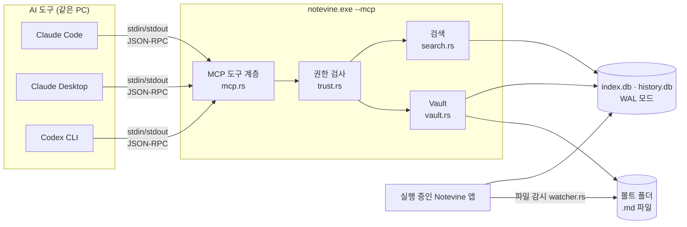

# Notevine MCP 서버 개발 계획서

2026-11-10 (초안, 같은 날 8장 확정·구현. 구현 현황은 9장)

> Claude Code, Claude Desktop, Codex 같은 AI 도구가 Notevine 볼트의 노트를 검색하고, 읽고, (허용하면) 쓰게 하는 MCP(Model Context Protocol) 서버를 Notevine에 넣는다.

## 1. 개요

### 1.1 목적

지금 Notevine의 AI 기능은 **앱 안에서 AI를 부르는** 방향이다(`src-tauri/src/ai.rs`, `ai_api.rs`). 이 계획은 반대 방향, 곧 **앱 밖의 AI 도구가 Notevine 볼트를 쓰는** 통로를 연다. 사용자는 Claude Code에서 코딩이나 문서 작업을 하다가 "업무일지에서 지난주 결정 사항 찾아 줘", "이 조사 내용을 새 노트로 남겨 줘"처럼 요청할 수 있다.

### 1.2 범위

| 구분 | 내용 |
| --- | --- |
| 포함 | stdio MCP 서버, 읽기 도구 5종, 쓰기 도구 3종, 볼트별 권한 설정 화면, 연결 안내(설정 명령 복사), 사용자 매뉴얼 보강 |
| 제외 | HTTP(원격) 전송, Notevine AI 패널의 MCP 클라이언트 기능(방향 2), 노트 삭제·이름 변경·이동 도구, 첨부 파일(PDF·이미지) 내용 전달 |

### 1.3 설계 원칙

1. **포트를 열지 않는다.** stdio 전송만 지원한다. 같은 PC에서 사용자가 등록한 AI 도구만 서버를 실행할 수 있다.
2. **기본은 꺼짐, 켜도 읽기 전용.** 볼트마다 사용자가 직접 켜야 하고, 쓰기는 따로 한 번 더 허용해야 한다.
3. **권한은 볼트 밖에 둔다.** `trust.rs`의 원칙대로, 볼트 폴더 안의 파일이 MCP 허용 여부를 정할 수 없다. 권한은 앱 설정 폴더의 `vault-trust.json`에 둔다.
4. **모든 쓰기는 되돌릴 수 있다.** 기존 `save_note` 경로로 저장해 버전 기록(`history.db`)과 검색 색인을 함께 갱신한다. 덮어쓰기 충돌은 기존처럼 충돌 사본으로 남긴다.
5. **앱 코드를 다시 쓰지 않는다.** 볼트·검색·기록 로직은 기존 Rust 함수를 그대로 부른다.

## 2. 아키텍처

### 2.1 구성



### 2.2 실행 방식: 같은 실행 파일에 `--mcp` 하위 명령

`notevine.exe --mcp [--vault <경로>]`로 실행하면 창을 띄우지 않고 MCP 서버로만 동작한다.

| 방식 | 장점 | 단점 |
| --- | --- | --- |
| **같은 exe + `--mcp` (채택)** | 설치·업데이트가 그대로, 경로 하나만 안내 | `main.rs`에서 Tauri 시작 전에 분기해야 함 |
| 별도 exe(`notevine-mcp.exe`) | 앱과 완전히 분리 | Tauri `externalBin` 번들 설정·서명·업데이트를 따로 관리 |

반드시 지킬 구현 조건:

- **Tauri 시작 전에 분기한다.** `lib.rs:81`의 `tauri_plugin_single_instance`가 먼저 돌면, 두 번째 실행으로 보고 인자를 기존 창에 넘긴 뒤 종료해 버린다. `main.rs`에서 인자에 `--mcp`가 있으면 `notevine_lib::mcp::serve()`를 부르고 `run()`은 부르지 않는다.
- **릴리스 빌드는 GUI 서브시스템**(`main.rs`의 `windows_subsystem = "windows"`)이다. 콘솔은 없지만 부모 프로세스가 파이프로 넘긴 stdin/stdout은 그대로 쓸 수 있다(추정). 1단계에서 Claude Code·Claude Desktop 양쪽으로 실제 동작을 먼저 확인한다.
- **stdout은 MCP 메시지 전용.** 로그·경고는 모두 stderr로 보낸다. `println!`이 섞이면 통신이 깨지므로 `mcp.rs`에서는 사용을 금지하고 테스트로 막는다.

### 2.3 볼트 선택

1. `--vault <경로>`가 있으면 그 폴더에 고정한다.
2. 없으면 앱의 최근 볼트 목록(`recent.rs`)에서 가장 최근 볼트를 열고, **도구를 부를 때마다 다시 확인해** 앱에서 다른 볼트를 열었으면 그 볼트로 옮긴다(색인 갱신을 새로 시작하고, 그 도구의 답 앞에 바뀐 사실과 이전 경로·hash가 맞지 않는다는 안내를 붙인다). 설정 화면의 연결 명령은 이 방식(`--vault` 없음)으로 안내한다.
3. 어느 쪽이든 그 볼트에 MCP가 허용돼 있지 않으면 시작 시 오류를 stderr에 쓰고, 모든 도구 호출에 "Notevine 설정에서 이 볼트의 AI 도구 연결을 켜 주세요"를 돌려준다.

볼트는 `Vault::open_placed`로 연다. 클라우드 드라이브 안의 볼트는 DB를 드라이브 밖에 두므로(`drive.rs`), 앱과 **같은 배치 규칙과 같은 `local_base`**를 써야 같은 `index.db`·`history.db`를 본다. 개발 빌드는 `.dev` 설정 폴더를 쓰는 규칙(`lib.rs`의 `config_dir`)도 그대로 따른다.

### 2.4 앱과 동시 실행

| 대상 | 방식 | 판단 |
| --- | --- | --- |
| `index.db`, `history.db` | 둘 다 WAL 모드 + `busy_timeout 5초`(`index.rs:168-169`, `history.rs:95`) | 두 프로세스 동시 접근 가능. 부하 시험으로 확인 |
| 노트 파일 | MCP 쓰기는 임시 파일 후 이름 바꾸기(`write_note`) | 앱의 `watcher.rs`가 외부 변경으로 감지하고 `on_external_change`가 기록 |
| 편집 중인 노트 | 앱은 저장 시 해시를 비교해 충돌 사본을 만듦(`save_note`) | 사용자 편집 내용이 사라지지 않음 |
| 앱이 꺼져 있을 때 | MCP 서버가 직접 색인·기록 갱신 | 앱을 다시 열면 그대로 반영 |

## 3. MCP 도구 명세

### 3.1 읽기 도구 (MCP를 켜면 사용 가능)

| 도구 | 입력 | 출력 | 감쌀 함수 |
| --- | --- | --- | --- |
| `list_notes` | `folder?` (기본: 볼트 전체), `depth?` | 폴더·노트 트리 (경로, 수정 시각) | `Vault::tree` (`vault.rs:231`) |
| `read_note` | `path` | 본문(Markdown), 속성(frontmatter) | `Vault::read_note` (`vault.rs:279`), `parse.rs` |
| `search_notes` | `text[]`, `tags[]`, `props[]`, `date?`, `limit?` | 경로, 제목, 일치 부분(snippet) | `search::search` (`search.rs:138`), `SearchQuery` 그대로 |
| `get_backlinks` | `path` | 이 노트를 링크한 노트와 해당 줄 | `Vault::backlinks` (`vault.rs:603`) |
| `get_note_history` | `path`, `limit?` | 저장 시점 목록(시각, 출처) | `history.rs` |

### 3.2 쓰기 도구 (쓰기를 따로 허용해야 사용 가능)

| 도구 | 입력 | 동작 | 감쌀 함수 |
| --- | --- | --- | --- |
| `create_note` | `folder`, `name?`, `content` | 새 노트 생성. 이름이 겹치면 번호를 붙임 | `Vault::create_note` (`vault.rs:450`) |
| `append_to_note` | `path`, `content`, `heading?` | 노트 끝(또는 지정 제목 아래)에 덧붙임 | `read_note` + `save_note` |
| `update_note` | `path`, `content`, `expected_hash` | 노트 전체 교체. `read_note`가 준 해시와 다르면 거부 | `save_note` (`vault.rs:323`) |

- 쓰기 도구는 모두 `save_note`를 거쳐 버전 기록에 **출처 "AI 도구(MCP)"**로 남긴다. `history.rs`의 `Origin`에 값을 하나 추가한다.
- 삭제·이름 변경·이동은 1차 범위에서 뺀다. 링크 일괄 수정(`rename`의 `update_links`)까지 얽혀 되돌리기가 어렵기 때문이다.

### 3.3 공통 제한

| 항목 | 값(초안) | 근거 |
| --- | --- | --- |
| 한 노트 최대 반환 길이 | 40,000자, 넘으면 "(이하 생략)" | `ai.rs`의 `FILE_CAP`과 맞춤 |
| 검색 결과 최대 | 기본 20건, 최대 100건 | AI 컨텍스트 낭비 방지 |
| 경로 | 볼트 기준 상대 경로만, `..`·절대 경로 거부 | `Vault::abs`의 볼트 밖 검사 재사용 |
| 숨김 폴더 | `.app/`, `.git/`, `.trash` 등 접근 거부 | 앱 내부 데이터 보호 |
| 제외 폴더 | 사용자가 지정한 폴더는 목록·검색·읽기에서 모두 숨김 | 개인 노트 보호 (4.1) |

## 4. 권한과 설정 화면

### 4.1 권한 모델

`vault-trust.json`의 `VaultTrust`에 항목을 더한다.

```json
{
  "mcp": {
    "enabled": false,
    "write": false,
    "excluded": ["개인", "일기"]
  }
}
```

| 상태 | 읽기 도구 | 쓰기 도구 |
| --- | --- | --- |
| 꺼짐 (기본) | 거부 | 거부 |
| 켜짐 | 허용 (제외 폴더 빼고) | 거부 |
| 켜짐 + 쓰기 허용 | 허용 | 허용 (제외 폴더 빼고) |

MCP 서버는 도구를 호출할 때마다 `vault-trust.json`을 다시 읽는다. 앱에서 연결을 끄면 서버를 다시 시작하지 않아도 바로 막힌다.

### 4.2 설정 화면 (설정 > AI > 외부 AI 도구 연결)

```
┌ 외부 AI 도구 연결 (MCP) ───────────────────────────┐
│ [ ] 이 볼트를 AI 도구에 연결                        │
│     [ ] 노트 만들기·고치기도 허용                    │
│                                                     │
│ 연결하지 않을 폴더   [개인] [일기] [+ 추가]          │
│                                                     │
│ 연결 방법                                           │
│  Claude Code   claude mcp add notevine -- "C:\…\notevine.exe" --mcp  [복사] │
│  Claude Desktop 설정 파일에 넣을 내용                                   [복사] │
│                                                     │
│ 최근 AI 도구 활동                                   │
│  14:32  search_notes  "회의"                        │
│  14:33  create_note   업무일지/2026-11-10.md        │
└─────────────────────────────────────────────────────┘
```

- 실행 파일 경로와 볼트 경로를 채운 설정 명령을 만들어 복사 단추로 준다.
- **최근 활동**은 볼트 밖 앱 설정 폴더의 `mcp-activity.log`에 최근 200건만 남긴다. 노트 본문은 남기지 않고 도구 이름·경로·검색어만 남긴다.

## 5. 구현 계획

### 5.1 파일 변경

| 파일 | 변경 |
| --- | --- |
| `src-tauri/Cargo.toml` | 공식 Rust MCP SDK `rmcp` 추가 (버전은 1단계에서 확정), 비동기 런타임 의존성 확인 |
| `src-tauri/src/main.rs` | `--mcp` 인자 분기 |
| `src-tauri/src/mcp.rs` (신규) | 서버 시작, 도구 정의, 권한 검사, 활동 기록 |
| `src-tauri/src/trust.rs` | `VaultTrust`에 `mcp` 항목, 저장·조회 명령 |
| `src-tauri/src/history.rs` | `Origin`에 MCP 출처 추가 |
| `src-tauri/src/lib.rs` | `mcp` 모듈 공개, 설정 화면용 Tauri 명령 등록 |
| `src/` (설정 화면) | 4.2의 연결 설정 화면 |
| `docs/사용자매뉴얼.md` | 연결 방법, 권한, 되돌리는 방법 |
| `docs/요구사항정의서.md` | `FR-MCP-01`~ 요구사항 추가 |

### 5.2 단계와 일정 (1인 + AI, 약 5일, 추정)

| 단계 | 기간 | 내용 | 완료 기준 |
| --- | --- | --- | --- |
| 1. 뼈대 | 0.5일 | `rmcp` 확정, `--mcp` 분기, `list_notes` 하나만 구현 | 릴리스 빌드로 Claude Code·Claude Desktop에서 `list_notes` 호출 성공 |
| 2. 읽기 도구 | 1일 | 3.1의 5종, 공통 제한(3.3) | 단위 테스트 통과, 볼트 밖 경로 차단 확인 |
| 3. 권한 | 0.5일 | `vault-trust.json` 연동, 제외 폴더 | 꺼짐/켜짐/쓰기 허용 세 상태 테스트 통과 |
| 4. 쓰기 도구 | 1일 | 3.2의 3종, 기록 출처 추가 | 앱 실행 중 MCP로 쓴 노트가 앱에 바로 보이고 기록에서 복원 가능 |
| 5. 설정 화면 | 1일 | 4.2 화면, 명령 복사, 최근 활동 | 화면에서 끄면 다음 호출부터 거부 |
| 6. 마무리 | 1일 | 동시 실행 부하 시험, 매뉴얼, 릴리스 빌드 | 아래 6장 시험 모두 통과 |

## 6. 테스트

| 구분 | 내용 |
| --- | --- |
| 단위 (Rust) | 도구별 정상·오류 입력, 경로 탈출(`../`, 절대 경로, 숨김 폴더), 제외 폴더, 길이 제한, 권한 상태별 거부 |
| 프로토콜 | 테스트에서 `notevine --mcp`를 자식 프로세스로 띄워 `initialize` → `tools/list` → `tools/call` 왕복. stdout에 JSON-RPC 이외의 출력이 없는지 확인 |
| 동시 실행 | 앱이 켜진 상태에서 MCP로 100회 연속 쓰기 → `database is locked` 오류 0건, 앱 화면에 반영 |
| 충돌 | 앱에서 편집 중인 노트를 MCP로 `update_note` → 사용자 편집이 충돌 사본으로 보존 |
| 드라이브 볼트 | OneDrive/Google Drive 안의 볼트에서 앱과 MCP가 같은 `index.db`를 쓰는지 확인 |
| 실사용 | Claude Code, Claude Desktop, Codex CLI 각각에서 연결 → 검색 → 노트 작성 |

## 7. 리스크와 대응

| 리스크 | 영향 | 대응 |
| --- | --- | --- |
| 노트 내용에 숨은 지시문(프롬프트 인젝션)을 AI가 따름 | 상 | 쓰기는 별도 허용, 삭제 도구 없음, 모든 쓰기는 기록에서 복원 가능. 매뉴얼에 위험 안내 |
| 개인 노트가 AI 서비스로 전송됨 | 상 | 기본 꺼짐, 볼트별 허용, 제외 폴더, 최근 활동 기록 |
| GUI 서브시스템 exe에서 stdio가 동작하지 않음 | 중 | 1단계에서 먼저 확인. 안 되면 별도 콘솔 exe(`externalBin`)로 전환 |
| single-instance 플러그인이 `--mcp` 실행을 가로챔 | 중 | `main.rs`에서 Tauri 시작 전에 분기 (2.2) |
| 두 프로세스의 DB 동시 쓰기 잠금 | 중 | WAL + busy_timeout, 부하 시험. 필요하면 MCP 쪽 재시도 |
| `rmcp` SDK의 API 변경 | 하 | 버전 고정, `mcp.rs` 안에만 의존을 가둠 |
| 앱 설치 경로가 업데이트 때 바뀌어 연결이 끊김 | 하 | 설정 화면이 매번 현재 경로로 명령을 만들어 줌 |

## 8. 결정 사항 (2026-11-10 제안대로 확정)

| 항목 | 결정 | 비고 |
| --- | --- | --- |
| 쓰기 도구를 1차에 넣을지 | 넣는다 (별도 허용) | 빼면 일정 1일 단축 |
| `update_note`(전체 교체) 제공 여부 | 제공하되 `expected_hash` 필수 | 덧붙이기만 허용하는 안도 가능 |
| 여러 볼트 동시 제공 | 1차는 서버 하나에 볼트 하나 | 볼트마다 서버를 따로 등록 |
| 대상 버전 | v0.1.x 다음 배포 (추정) | 모바일 앱은 보류 중이라 일정 충돌 없음 |
| 첨부 파일 텍스트(PDF·hwpx) 제공 | 2차 | `filetext.rs` 재사용 가능 |

## 9. 구현 현황 (2026-11-10)

1~6단계를 하루에 구현했다. 계획과 달라진 점은 다음과 같다.

| 항목 | 계획 | 실제 | 이유 |
| --- | --- | --- | --- |
| MCP SDK | `rmcp` 크레이트 | 쓰지 않고 JSON-RPC를 `mcp.rs`에 직접 구현 (`initialize`·`ping`·`tools/list`·`tools/call`, 프로토콜 2025-06-18·2025-03-26·2024-11-05) | 앱의 다른 코드처럼 동기식으로 두어 비동기 런타임 의존을 늘리지 않음. stdio 서버에 필요한 메시지가 적음 |
| 숨김 대상 | 제외 폴더, 숨김 폴더 | 여기에 `#비공개` 노트 추가 | 앱 AI 기능(FR-AI-03)과 같은 원칙. 검색은 인덱스가 늦어도 파일 내용으로 다시 확인 |
| 연결 안내 | Claude Code·Claude Desktop | Codex CLI 추가. Claude Code는 `--scope user`로 모든 프로젝트에서 쓰게 함 | |
| 활동 기록 | `mcp-activity.log` | `mcp-activity.jsonl` (한 줄에 JSON 하나, 200줄) | 화면에서 노트 폴더별로 걸러 보여 주기 쉬움 |
| 요구사항 ID | `FR-MCP-01`~ | FR-MCP-01~06 (`docs/요구사항정의서.md` 3.12) | |

**바뀐 파일**: `src-tauri/src/mcp.rs`(신규), `main.rs`(`--mcp` 분기), `lib.rs`, `trust.rs`(`McpGrant`), `vault.rs`(`save_note_from`·`create_note_from`), `history.rs`(`Origin::Mcp`), `src/components/Settings.tsx`(외부 AI 도구 연결), `HistoryPanel.tsx`("AI 도구" 표시), `api.ts`, `App.css`, `i18n/en.json`, `docs/요구사항정의서.md`, `docs/사용자매뉴얼.md`(10.7).

**시험**

| 구분 | 결과 |
| --- | --- |
| Rust 단위 테스트 (`mcp::tests` 13개 포함) | 전체 통과 |
| 프런트엔드 테스트·타입 검사 | 전체 통과 |
| 릴리스 exe를 실제 파이프로 구동 (권한 꺼짐→켜짐 즉시 반영, #비공개·제외 폴더 숨김, 쓰기 권한, 해시 확인 고치기, 히스토리 출처, 볼트 밖 경로 거부, stdout 오염 없음, 정상 종료) | 13개 항목 모두 통과. 처음 시험에서 새 노트 폴더의 첫 검색이 빈 결과를 주는 결함(시작 시 색인 작업과 경쟁)을 찾아, 색인을 쓰는 도구가 첫 색인을 기다리게 고침 |

**남은 확인**

- Claude Code·Claude Desktop·Codex 실제 앱에 등록해 쓰는 시험 (6장 "실사용")
- 앱이 켜진 채로 MCP 연속 쓰기 부하 시험, 드라이브 볼트에서 같은 DB를 쓰는지 확인 (6장 "동시 실행"·"드라이브 볼트")
