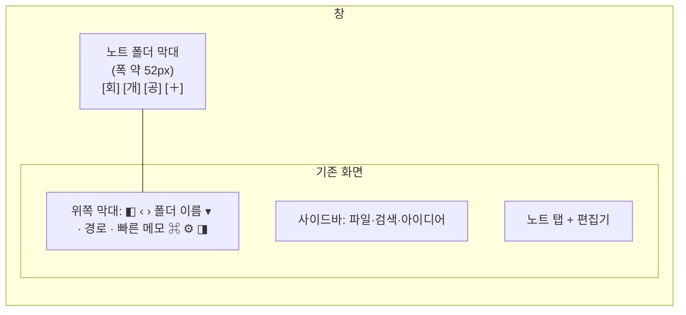

# 노트 폴더 막대 설계 (여러 노트 폴더를 열어 두고 오가기)

작성일: 2026-11-09 · 관련 요구사항: FR-VLT-07(여러 노트 폴더 등록·전환), FR-VLT-02, FR-VLT-10

## 1. 왜 만드나

지금은 노트 폴더를 한 번에 하나만 쓸 수 있다. 다른 폴더로 가려면 위쪽 폴더 이름 ▾ 메뉴에서 "노트 폴더 바꾸기…"를 눌러 시작 화면으로 돌아간 뒤 다시 골라야 한다. 사용자는 자주 쓰는 폴더 몇 개(예: 회사 노트, 개인 노트)를 계속 열어 두고 클릭 한 번에 오가고 싶어 한다.

성공 기준: 열어 둔 폴더 사이를 클릭 한 번(또는 단축키)으로 오가고, 돌아왔을 때 마지막으로 보던 노트와 스크롤 위치가 그대로 있다.

## 2. 목표 / 하지 않을 것

**목표**
- 창 맨 왼쪽에 "노트 폴더 막대"를 두고, 열어 둔 폴더를 단추로 보여 준다.
- 단추 클릭 또는 Ctrl+1~9로 폴더를 바꾼다.
- 폴더를 바꿨다 돌아오면 노트 탭, 마지막 노트, 스크롤 위치가 그대로다.
- 막대의 폴더 목록과 순서는 앱을 껐다 켜도 남는다.

**하지 않을 것**
- 두 폴더를 나란히 보기, 폴더마다 창 따로 띄우기 (사용자가 필요 없다고 함).
- 단추 글자(첫 글자) 바꾸기, 아이콘·색 지정 (사용자가 필요 없다고 함).
- 보고 있지 않은 폴더를 뒤에서 계속 지켜보기, "바뀜" 표시(노란 점).
- 닫기 전 확인 창 (사용자가 필요 없다고 함).

**실패로 볼 것 (돌아가도 안 되는 것)**
- 폴더를 바꿀 때 쓰던 내용이 저장되지 않고 사라진다.
- 폴더 A의 스크롤 위치·탭이 폴더 B에 섞여 나온다(같은 상대 경로의 노트가 있을 때).
- 막대에서 닫았더니 노트나 `.app` 폴더가 지워진다.

## 3. 화면

- 막대는 창의 맨 왼쪽, 위쪽 막대보다 바깥에 세로로 꽉 차게 둔다. 그 오른쪽은 지금 화면 그대로다.
- 막대는 노트 폴더가 하나라도 열려 있을 때(메인 화면)만 보인다. 시작 화면에는 없다.
- 왼쪽 사이드바를 닫아도(Ctrl+\) 막대는 그대로 보인다.
- 단추: 둥근 사각형, 폴더 이름의 첫 글자(첫 글자가 이모지·숫자여도 그대로 첫 글자). 지금 보고 있는 폴더는 보라색(--accent)으로 채우고 왼쪽에 작은 표시 막대를 붙인다. 다크 테마는 기존 토큰을 따른다.
- 마우스를 올리면 말풍선: 폴더 전체 이름, 경로, 단축키(앞 9개만, 예: Ctrl+2).
- 맨 아래 ＋ 단추: 폴더 추가.
- 폴더가 많아 막대를 넘치면 막대 안에서 세로로 스크롤한다. ＋는 목록 바로 아래에 둔다.
- 시안: 브레인스토밍 때 보여 준 `folder-rail-final.html`(왼쪽 끝 막대, 앱 실제 색).

## 4. 동작

### 4.1 폴더 바꾸기
- 단추를 누르거나 Ctrl+N(N=1~9, 막대 위에서부터 N번째)을 누르면 그 폴더로 바꾼다. 지금 폴더의 단추면 아무 일도 하지 않는다.
- 바꾸는 순서: 편집 중인 내용 저장(flush) → 지금 폴더 닫기 → 누른 폴더 열기. 즉 백엔드는 지금처럼 **한 번에 한 폴더만 연다**. "열어 둔다"는 것은 막대 목록과 화면 상태를 기억한다는 뜻이다.
- 열 때는 지금 FR-VLT-02와 같이 그 폴더에 저장된 노트 탭·마지막 노트를 되살린다(`workspace` 그대로 사용).
- 앱이 켜져 있는 동안은 폴더별로 화면 상태를 메모리에 기억했다가 돌아올 때 되살린다.
  - 노트마다의 스크롤 위치·커서 (`Editor.tsx`의 `viewMemory`). 지금은 노트 상대 경로만 키로 써서 폴더끼리 섞이므로 **폴더 경로 + 노트 경로**로 키를 바꾼다.
  - 탭 배열 전체(탭마다의 앞/뒤 이동 기록 `Tab.back/forward` 포함), 지금 탭, 닫은 탭 목록(`closedTabs`), 나란히 보기(`splitPath`), 표·PDF·캔버스 보기, 펼쳐 둔 사이드바 폴더(`expanded`).
  - AI 패널(`aiStore.ts`)의 대화와 수정 제안도 폴더별로 따로 둔다. **다른 폴더의 제안이 지금 폴더의 같은 경로 노트에 적용되는 일이 없어야 한다**(2장 실패 조건).
  - 폴더에 묶이지 않는 앱 전체 상태(읽기 모드, 패널 열림·폭, 테마 등)는 지금처럼 하나로 둔다.
- 열려 있는 대화상자(설정, 빠른 메모, 확인 창 등)가 있을 때는 Ctrl+1~9가 동작하지 않는다(기존 `noModal` 규칙). 막대 클릭은 대화상자가 막고 있으므로 따로 처리할 필요 없다.
- 폴더를 확인·여는 동안(네트워크 폴더는 오래 걸릴 수 있음) 누른 단추에 "여는 중" 표시를 하고, 그사이 다른 단추나 Ctrl+N을 누르면 **마지막에 누른 것**으로 간다(시작 화면의 "확인 중…"과 같은 규칙). 여는 동작이 겹쳐 실행되지 않게 한 줄로 세운다.
- 앱을 껐다 켜면 스크롤 위치는 기억하지 않는다(지금과 같음). 노트 탭과 마지막 노트는 되살아난다.
- 단축키 Ctrl+1~9는 명령 레지스트리(`appCommands.ts`)에 명령으로 넣어 명령 팔레트에도 보이게 한다. 편집기 안에서도 동작해야 한다. 지금 Ctrl+1~9는 앱·편집기 어디에도 쓰이지 않는다(2026-11-09 확인). 단축키 바꾸기(FR-UI-05)는 지금처럼 폴더별 설정(`VaultConfig.keybindings`)을 따른다. 즉 폴더 A에서 바꾼 단축키는 폴더 A에서만 적용된다(다른 단축키와 같은 규칙).

### 4.2 폴더 추가 (＋)
- ＋를 누르면 지금 시작 화면과 같은 내용(최근 노트 폴더 목록, 폴더 선택, Google Drive·OneDrive 버튼)을 보여 준다. 지금 폴더는 아직 닫지 않는다.
- 폴더를 고르면 막대 맨 아래에 추가하고 그 폴더로 바꾼다. 이미 막대에 있는 폴더면 추가하지 않고 그 폴더로 바꾸기만 한다.
- 취소하면 보던 폴더 그대로 돌아간다.
- 위쪽 폴더 이름 ▾ 메뉴의 "노트 폴더 바꾸기…"는 "노트 폴더 더 열기…"로 바꾸고 ＋와 같이 동작한다. 명령 팔레트의 "노트 폴더 바꾸기"(`vault.switch`)도 같은 동작으로 바꾼다.
- ＋, "노트 폴더 더 열기…", 시작 화면에서 고른 폴더는 막대에 없으면 맨 아래에 추가한다.
- **탐색기 연결 프로그램(FR-VLT-10)으로 연 경우는 막대에 추가하지 않는다** (4.7 잠깐 연 폴더).

### 4.7 잠깐 연 폴더 (탐색기에서 연 파일)
- 탐색기 연결 프로그램으로 파일을 열었을 때:
  - 그 파일이 **막대에 있는 폴더**의 파일이면 그 폴더로 바꾸고 파일을 연다.
  - **막대에 없는 노트 폴더**의 파일이거나, 노트 폴더가 아닌 곳의 파일이라 "이 폴더를 노트 폴더로 열까요?"에 "열기"를 고른 경우(묻는 규칙은 FR-VLT-10 그대로): 그 폴더를 **잠깐 연 폴더**로 열고 파일을 보여 준다. 막대 목록(저장 파일)에는 넣지 않는다. "취소"면 아무것도 바뀌지 않는다.
- 잠깐 연 폴더는 보고 있는 동안만 막대 맨 아래(＋ 바로 위)에 **점선 테두리 단추**로 보인다. 말풍선에 "잠깐 연 폴더"라고 함께 적는다. 한 번에 하나만 있다(다른 폴더를 잠깐 열면 앞의 것을 대신함).
- 오른쪽 클릭 메뉴: "막대에 추가"(누르면 막대 맨 아래에 정식으로 추가되고 보통 단추가 됨), "탐색기에서 노트 폴더 열기", "닫기". 순서 바꾸기는 없다.
- Ctrl+1~9 번호를 받지 않는다.
- 막대의 다른 폴더로 바꾸면 잠깐 연 폴더 단추는 사라지고, 그 폴더의 메모리 화면 상태도 버린다. "닫기"를 누르면 막대에서 그 전에 보던 폴더(없으면 맨 위, 막대가 비었으면 시작 화면)로 간다.
- 앱을 다시 켜면 잠깐 연 폴더는 열지 않고 막대에서 마지막으로 보던 폴더를 연다(4.5). 앱이 꺼진 상태에서 탐색기로 파일을 열어 앱이 켜질 때도 같은 규칙으로 잠깐 연 폴더로 연다.
- 폴더 자체의 `workspace`(노트 탭·마지막 노트)는 지금처럼 그 폴더 안에 저장된다. 그래서 나중에 막대에 추가하면 그때의 탭이 되살아난다.

### 4.3 폴더 닫기 (막대에서 빼기)
- 방법 세 가지, 확인 창 없이 바로 닫는다.
  1. 막대 단추 오른쪽 클릭 → "막대에서 닫기" (보고 있지 않은 폴더도 닫을 수 있다)
  2. 위쪽 폴더 이름 ▾ 메뉴 → "이 노트 폴더 닫기" (지금 폴더)
  3. 명령 팔레트 → "노트 폴더 닫기" (지금 폴더)
- 닫으면 막대 목록에서만 빠진다. 폴더·노트·`.app`은 그대로이고, 시작 화면의 최근 노트 폴더 목록에도 그대로 남는다. 메모리에 기억해 둔 그 폴더의 화면 상태는 버린다.
- 지금 보고 있는 폴더를 닫으면 막대에서 바로 아래 폴더로 바꾼다. 맨 아래였으면 바로 위 폴더로 바꾼다. 마지막 하나를 닫으면 지금처럼 시작 화면을 보여 준다.

### 4.4 순서 바꾸기·기타 메뉴
- 오른쪽 클릭 메뉴: "위로 옮기기", "아래로 옮기기", "탐색기에서 노트 폴더 열기", 구분선, "막대에서 닫기". 맨 위/맨 아래에서는 해당 항목을 비활성화한다.
- 끌어서 순서 바꾸기는 하지 않아도 된다(만들기 쉬우면 넣어도 됨).

### 4.5 앱 시작
- 앱을 켜면 **막대에서 마지막으로 보던 폴더**를 연다(막대 파일에 함께 저장). 막대에서 닫은 폴더가 최근 목록 맨 위에 있어도 그 폴더를 열지 않는다. 막대가 비어 있으면(사용자가 모두 닫음) 시작 화면을 보여 주고 자동으로 열지 않는다.
- 막대 파일이 아예 없는 기존 사용자(업데이트 직후)는 지금처럼(FR-VLT-02) 최근 목록 맨 위 폴더를 열고, 그 폴더 하나만 막대에 넣는다. 최근 목록 전체를 자동으로 넣지 않는다. "파일 없음"(처음)과 "빈 목록"(사용자가 모두 닫음)은 구별한다.
- 시작할 때 막대에 있는 폴더들이 아직 있는지 확인하지 않는다(네트워크 폴더는 응답에 30초 넘게 걸릴 수 있음, `recent.rs` 주석과 같은 이유). 누를 때 확인한다.

### 4.6 열 수 없는 폴더
- 막대의 폴더를 눌렀는데 열 수 없으면(지워짐, 드라이브 연결 끊김 등) 오류 알림을 띄우고 보던 폴더에 그대로 머문다. 막대 목록에서는 자동으로 빼지 않는다(잠깐 끊긴 드라이브일 수 있음). 사용자가 오른쪽 클릭으로 닫는다.
  - 구현(2026-11-09): 백엔드 `open_vault`는 **다른** 폴더를 열 때 보던 폴더를 열어 둔 채 새 폴더를 먼저 열고, 성공하면 바꿔 끼운다(같은 폴더를 다시 열 때만 먼저 닫는다. Windows가 열린 DB 파일을 바꾸지 못하기 때문). 그래서 확인은 통과했는데 열기에서 실패해도(권한, `.app` 만들기 실패 등) 백엔드와 화면 모두 보던 폴더 그대로이고, 다시 열지 않는다. 바꾸는 동안 "노트 폴더가 열려 있지 않습니다" 같은 빈틈도 없다.
  - 프런트의 `vault` 상태와 백엔드가 연 폴더가 어긋난 채로 남는 일이 없어야 한다.
  - 바꾸기를 시작한 순간(저장 직전)부터 끝날 때까지 편집기·캔버스는 입력을 받지 않는다. 그 사이 입력이 새 폴더의 같은 경로 노트로 저장되는 일을 막는다. 버전 보기·설정 같은 대화상자도 닫는다.
  - 실행 중인 AI 답은 멈추고 "노트 폴더를 바꿔 답을 멈췄습니다"로 남는다. 늦게 도착한 답의 조각·제안은 다른 폴더의 대화에 들어가지 않는다.
- 지금 폴더를 닫은 다음 폴더를 열지 못하면(4.3) 그다음 폴더를 차례로 시도하고, 모두 실패하면 시작 화면으로 간다.

## 5. 저장

- 막대 목록은 노트 폴더 밖, 앱 설정 폴더(최근 목록 `recent-vaults.json`과 같은 곳)에 PC별로 저장한다. 항목: 경로, 이름. 순서가 막대 순서다.
- 경로 비교는 지금 최근 목록처럼 대소문자를 무시한다.
- 최근 목록(`recent-vaults.json`, 최대 10개)과는 따로 둔다. 막대에서 닫아도 최근 목록에는 남고, 최근 목록에서 지워도(forget) 막대에는 남는다.

## 6. 바꿔야 할 문서·번역

- `docs/요구사항정의서.md` FR-VLT-07 내용을 막대 방식으로 갱신.
- `docs/화면설계서.md` 메인 화면에 막대 추가.
- `docs/사용자매뉴얼.md` 노트 폴더 장에 막대 사용법, 단축키 표에 Ctrl+1~9. (앱 안 매뉴얼은 이 파일을 그대로 묶는다.)
- 새 문구는 `src/i18n/en.json`에 영어 번역 추가.
- 공개 저장소이므로 문서·커밋에 회사 정보를 넣지 않는다.

## 7. 만드는 사람에게 맡기는 것 / 제 판단으로 정한 것

**제 판단(Claude)으로 정함 — 사용자가 검토할 것**
- 백엔드는 한 번에 한 폴더만 열고, 바꿀 때 닫았다 연다(뒤에서 여러 폴더를 동시에 열어 두지 않음). 메모리·감시·색인 부담이 없고, 화면 상태를 기억하면 쓰는 느낌은 같다.
- 노란 점(뒤에서 바뀜 표시)은 위 결정 때문에 뺐다.
- 탭·닫은 탭·나란히 보기·펼친 사이드바 폴더·AI 대화와 제안을 폴더별로 기억한다.
- 앱을 다시 켜면 스크롤 위치는 되살리지 않는다(지금과 같음).
- 앱을 켜면 막대에서 마지막으로 보던 폴더를 연다. 막대를 모두 비웠으면 시작 화면.
- 탐색기에서 연 막대 밖 폴더(사용자 결정: 막대에 넣지 않음)는 점선 단추로 잠깐 보여 주고, 다른 폴더로 가면 사라지며, 오른쪽 클릭 "막대에 추가"로 남길 수 있게 했다. 잠깐 연 폴더는 한 번에 하나.
- 업데이트 직후에는 지금 폴더 하나만 막대에 넣는다.
- 열 수 없는 폴더를 막대에서 자동으로 빼지 않는다. 열기에 실패하면 보던 폴더를 다시 열어 되돌린다.
- 폴더를 여는 동안 다시 누르면 마지막에 누른 폴더로 간다.
- Ctrl+1~9를 바꾸는 단축키 설정은 다른 단축키처럼 폴더별이다.

**만드는 사람이 정할 것**
- 막대 목록을 저장하는 파일 이름과 형식, Rust 쪽 명령 이름.
- ＋를 눌렀을 때 시작 화면을 대화상자로 띄울지, 화면 전체로 띄우고 취소 단추를 둘지.
- 폴더별 화면 상태를 store 안에 둘지 별도 모듈에 둘지.
- 끌어서 순서 바꾸기를 넣을지.

## 8. 확인 방법

- 단위 테스트: 막대 목록 저장(추가·중복·순서 바꾸기·빼기·대소문자), 닫은 뒤 다음 폴더 고르기 규칙.
- E2E(`tests/e2e`, 릴리스 exe): 폴더 두 개를 막대에 넣고 A에서 노트 열고 스크롤 → B로 바꿈 → A로 돌아와 같은 노트와 스크롤 위치 확인. 같은 상대 경로의 노트가 두 폴더에 있을 때 스크롤이 섞이지 않는지. Ctrl+2로 바꾸기. 편집 중 바꾸면 내용이 저장되는지. 지금 폴더 닫기 → 다음 폴더로, 마지막 폴더 닫기 → 시작 화면. 앱 재시작 후 막대 목록 유지. 탐색기 연결 프로그램으로 막대 밖 폴더의 파일을 열면 막대 저장 목록이 그대로이고 점선 단추가 보이며, 다른 폴더로 가면 사라지는지(`tests/e2e/open-file.cjs` 확장). 테스트가 만든 폴더는 최근 목록과 막대에서 지운다.
- 수정이 끝나면 켜진 Notevine을 닫고 `npm run tauri build`로 설치 파일을 만든다.
