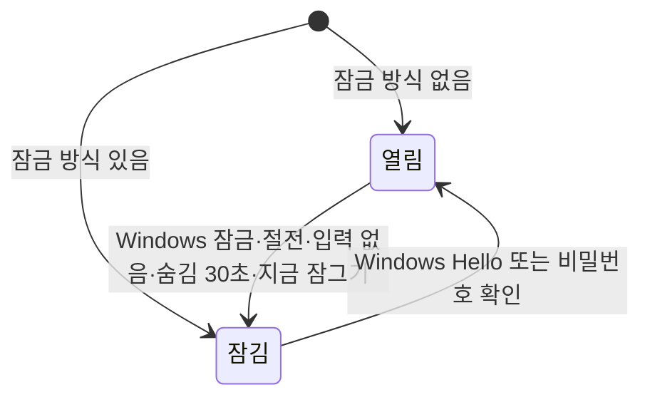

# PC 앱 잠금 설계

- 날짜: 2026-11-26
- 대상: Notevine PC 앱(Windows), 현재 버전 0.5.0
- 참고 구현: 안드로이드 저장소(`notevine-aos`)의 `src/mobile/LockGate.tsx`, `src/mobile/AppLockSettings.tsx`, `src/mobile/appLock.ts`, `MainActivity.kt`의 `Lock` (읽기만 하고 고치지 않는다)

"(내 판단)"으로 표시한 항목은 대화에서 정하지 않아 작성자가 정한 것이다.

## 1. 의도

사용자가 자리를 비운 사이 다른 사람이 이 PC에서 Notevine의 노트를 보지 못하게 한다. 안드로이드의 앱 잠금을 PC에 맞게 옮긴다.

### 목표

- 잠금 방식 선택: **없음 / Windows Hello / 앱 비밀번호**. 처음 상태는 없음.
- 자리를 비운 상황에서 알아서 잠긴다.
- 잠긴 동안 노트 내용이 화면에 보이지 않고, 앱을 조작할 수 없다.

### 하지 않는 것

- 노트 파일 암호화. 탐색기나 다른 편집기에서는 `.md`를 그대로 읽을 수 있다.
- MCP 서버(`notevine --mcp`) 차단. 앱 화면과 별개 프로세스이며 그대로 동작한다.
- 화면 캡처·화면 공유 차단 (본인의 캡처와 화면 공유까지 막힌다).
- 설정 파일을 지우거나 고칠 수 있는, 작정한 사람을 막는 것.

### 실패로 보는 것

- 시작할 때나 창이 다시 나타날 때 노트가 잠깐이라도 비친다.
- 잠금 화면 뒤의 편집기에 키 입력이 들어가 노트가 바뀐다.
- 잠금 때문에 저장하지 않은 편집 내용을 잃는다.

## 2. 제약

- 설정은 앱 전체의 것이다. 노트 폴더 설정이 아니라 앱 설정 폴더에 저장한다(노트 폴더가 열리기 전에 읽어야 한다). 개발용 빌드는 기존처럼 `.dev` 설정 폴더를 쓴다.
- 네트워크 접속을 추가하지 않는다.
- 화면 글은 `tx("…")`와 `src/i18n/en.json`. Tauri 명령은 `commands`/`api.ts`를 함께 맞춘다.
- 트레이 상주, 전역 단축키(Ctrl+Alt+N), 탐색기에서 파일 열기, 중복 실행 시 기존 창 띄우기와 함께 동작해야 한다.

## 3. 접근 방법

| 방법 | 내용 | 장점 | 단점 |
| --- | --- | --- | --- |
| **A. 둘 다 (선택)** | 없음 / Windows Hello / 앱 비밀번호 | 안드로이드와 같고 상황에 맞게 고른다 | 작업량이 가장 많다 |
| B. 앱 비밀번호만 | 4자 이상 | 단순하고 어느 PC에서나 동작 | 열 때마다 입력 |
| C. Windows Hello만 | 지문·얼굴·Windows PIN | 외울 비밀번호가 없다 | Windows PIN을 아는 사람은 열 수 있고, Hello가 없는 PC에서는 못 쓴다 |

사용자가 **A**를 골랐다. 안드로이드와 같고, 남이 Windows PIN을 아는 경우에도 앱 비밀번호로 막을 수 있다.

## 4. 동작

### 4.1 잠기는 때

| 계기 | 조건 |
| --- | --- |
| 앱 시작 | 잠금 방식이 없음이 아니면 항상 (트레이로 시작해 처음 창을 열 때 포함) |
| Windows 잠금 | Win+L, 사용자 전환 등으로 세션이 잠길 때 바로 |
| 절전 | 절전·최대 절전에 들어갈 때 (깨어난 뒤 잠겨 있다) |
| 입력 없음 | PC 전체에서 키보드·마우스 입력이 정한 시간 동안 없을 때. 1 / **5(기본)** / 10 / 30분 / 사용 안 함 |
| 최소화·트레이로 숨김 | 그 상태로 30초가 지나면. 30초 안에 돌아오면 잠그지 않는다 |
| 지금 잠그기 | 사용자가 실행하면 바로 |

다른 프로그램 창으로 옮겨 가는 것만으로는 잠그지 않는다.

### 4.2 잠금 화면

- 창 전체를 불투명하게 덮는다. 앱 아이콘, "Notevine", 안내 문구, 비밀번호 입력칸과 **열기** 단추 또는 **잠금 해제** 단추. 노트 폴더 이름·노트 경로 등 노트에서 온 글자는 보이지 않는다. 라이트·다크 테마를 따른다.
- 아래 화면(열린 탭, 커서, 대화상자)은 그대로 두어, 풀면 하던 곳으로 돌아온다.
- Windows Hello 방식: **사용자가 돌아온 경우**(앱 시작, 숨김·최소화에서 다시 보일 때, Windows 잠금·절전 뒤)에는 창이 앞에 보일 때 확인 창을 한 번 자동으로 띄운다. **지금 잠그기**와 입력 없음으로 잠긴 경우에는 자동으로 띄우지 않는다(얼굴 인식이 앞에 앉은 본인을 보고 바로 풀거나, 아무도 없을 때 확인 창이 뜨는 것을 막는다). 어느 경우든 **잠금 해제** 단추(커서가 가 있어 Enter로 누를 수 있다)로 띄운다. 취소하면 다시 자동으로 띄우지 않는다. (내 판단)
- 비밀번호 방식: 입력칸에 커서가 가고 Enter로 연다. 틀리면 "비밀번호가 맞지 않습니다". 연속 5번 틀리면 30초 동안 받지 않고 남은 초를 알린다. 틀린 횟수와 대기 시각은 저장해 앱을 다시 켜도 유지한다.
- "비밀번호를 잊었으면 사용자 매뉴얼을 보세요" 한 줄만 둔다. 설정을 지우는 방법은 잠금 화면에 쓰지 않는다. (내 판단)

### 4.3 잠긴 동안

- 아래 화면은 마우스·키보드·포커스·끌어다 놓기를 받지 않는다. 앱 단축키, 편집기 단축키, 알림·대화상자의 키 처리 모두 포함한다.
- 알림(toast), 확인 창, 팝업·메뉴 등 앱의 어떤 요소도 잠금 화면 위에 나오지 않는다.
- Windows 확인 창(`ask`: 파일 트리의 삭제, 버전 복원)은 덮개로 가릴 수 없고 노트 이름이 보이므로 앱 안의 확인 창으로 바꾼다. (내 판단)
- Windows의 파일·폴더 선택 창(시작 화면, 저장소 받기)은 예외로 둔다. 열려 있던 창은 닫지 않는다. 보이는 것은 탐색기와 같은 파일 목록이며, 파일 접근은 이 잠금의 범위가 아니다. (내 판단)
- Ctrl+Alt+N, 트레이의 빠른 메모, 탐색기에서 파일 열기: 창은 앞으로 오고 잠금 화면이 보인다. 요청한 동작은 잠금을 푼 뒤에 이어진다.
- 창 닫기, 트레이로 숨기기, 트레이의 **종료** 는 잠긴 상태에서도 동작한다. 단, 저장하지 못한 편집이 있으면 잠긴 상태에서는 앱을 끝내지 않고, 창을 앞으로 가져와 "저장하지 못한 편집이 있어 종료하지 않았습니다. 잠금을 풀어 확인하세요"를 보인다. 트레이로 숨기기는 그대로 동작한다. 이를 위해 저장 실패를 호출한 쪽이 알 수 있게 해야 한다(지금 `flushEditor`는 실패해도 정상 종료로 끝난다). (내 판단: 노트를 잃지 않는다는 프로젝트 원칙)
- 저장, 자동 백업, 파일 감시 같은 뒤에서 도는 일은 계속한다.
- 잠글 때 열려 있는 노트를 먼저 저장한다. 저장에 실패해도 잠그고, 편집 내용은 화면 뒤에 남는다. 한글 조합 중이던 글자도 잃지 않는다.

**풀린 상태의 종료** (2026-11-26 사용자 요청으로 추가): 창 닫기(트레이를 끈 경우)나 트레이의 **종료** 때 저장하지 못한 편집이 있으면 바로 끝내지 않는다. 창을 앞으로 가져와 "저장하지 못한 편집이 있습니다. 저장하지 않고 종료할까요?"를 묻고, 취소하면 앱과 편집 내용이 그대로 남는다. **저장하지 않고 종료**를 고르면 끝낸다. 무조건 막지 않는 이유는 저장이 계속 실패하는 경우(드라이브 분리 등)에도 앱을 끌 수 있어야 하기 때문이다. 본문 편집기와 나란히 보기의 오른쪽 편집기 모두에 적용한다. (묻는 방식은 내 판단)

### 4.4 설정 (설정 → 일반 → 앱 잠금)

- **잠금 방식**: 없음 / Windows Hello / 비밀번호. 안내 문구에 노트 파일을 암호화하지 않는다는 점을 적는다.
- **자동 잠금**(방식이 없음이 아닐 때): 입력 없음 시간 선택.
- **지금 잠그기**, 비밀번호 방식이면 **비밀번호 바꾸기**.
- 이미 잠금이 켜진 상태에서 방식·비밀번호·시간을 바꾸려면 먼저 지금 방식으로 본인 확인을 한다.
- Windows Hello를 켜려면 확인에 한 번 성공해야 한다. Hello를 쓸 수 없는 PC에서는 "Windows 설정에서 Windows Hello(PIN·지문·얼굴)를 먼저 설정하세요"를 알리고 바꾸지 않는다.
- 비밀번호는 4자 이상, 두 번 입력해 같아야 한다.

### 4.5 지금 잠그기

- 명령 팔레트 **지금 잠그기**, 기본 단축키 Ctrl+Alt+L(설정 → 단축키에서 변경), 상단바 자물쇠 단추. 모두 잠금이 켜져 있을 때만 보이고 동작한다. (내 판단: 단축키·상단바 단추)
- 시작 화면(노트 폴더가 없을 때)에서도 잠금은 똑같이 적용된다.

### 4.6 문제 상황

| 상황 | 처리 |
| --- | --- |
| 잠금 설정 파일이 없음 | 잠금 없음 |
| 파일이 있는데 읽거나 해석할 수 없음 | 잠긴 상태로 두고 매뉴얼 안내를 보인다 (내 판단) |
| Hello 방식인데 Windows에서 Hello가 사라짐 | 열지 않고 "Windows Hello를 다시 설정하세요"를 알린다 (내 판단) |
| 비밀번호를 잊음 | 앱을 종료(트레이 아이콘 → 종료)하고 앱 설정 폴더의 잠금 설정 파일을 지운다. 매뉴얼에 적는다 |

## 5. 만드는 방식

(모두 내 판단)

- 잠김 여부의 원본은 **Rust 쪽**에 둔다. 웹뷰가 다시 로드돼도(언어 변경 등) 상태가 유지된다. 화면은 상태를 읽고 변경 이벤트를 받아 그리며, 상태를 알기 전에는 노트를 그리지 않는다.
- 잠금 계기 감지(세션 잠금, 절전, 입력 없음, 숨김 30초)는 Rust에서 한다. 숨겨진 웹뷰의 타이머는 늦어질 수 있다.
- 비밀번호는 평문으로 저장하지 않는다. 소금을 넣은 느린 해시(Argon2id)만 저장하고, 비교와 틀린 횟수 관리, 설정 변경 시 본인 확인은 Rust에서 한다.
- 설정은 앱 설정 폴더의 별도 파일 `app-lock.json`.
- Windows Hello는 WinRT `UserConsentVerifier`(데스크톱 창용 interop)로 Notevine 창에 붙여 띄운다.
- 잠긴 동안 Rust 명령 자체를 거부하지는 않는다. 화면 차단으로 충분하다.

### 확인 방법

- 단위 테스트: 비밀번호 설정·확인, 5회 실패 대기와 재시작 후 유지, 본인 확인 없는 설정 변경 거부, 설정 파일 상태별 처리, 잠금 계기 판단.
- 화면 테스트: 잠긴 동안 단축키·입력이 아래로 가지 않음, 잠글 때 저장, 저장 실패 시 잠긴 상태의 종료 보류, 풀면 대기하던 빠른 메모가 열림, 잠금 계기별 Hello 자동 실행 여부.
- 실제 앱에서: Windows Hello, Win+L, 절전, 트레이·최소화, 시작 시 노트가 비치지 않는지.

### 문서

`docs/사용자매뉴얼.md`, `docs/요구사항정의서.md`(새 요구사항 ID)를 함께 고친다. 버전 번호는 올리지 않는다.

## 6. 만드는 사람에게 맡기는 것

모듈·파일 나누기, 명령과 이벤트 이름, Windows API 호출 방법과 crate 선택, 잠금 화면의 세부 배치, 문구 다듬기.
