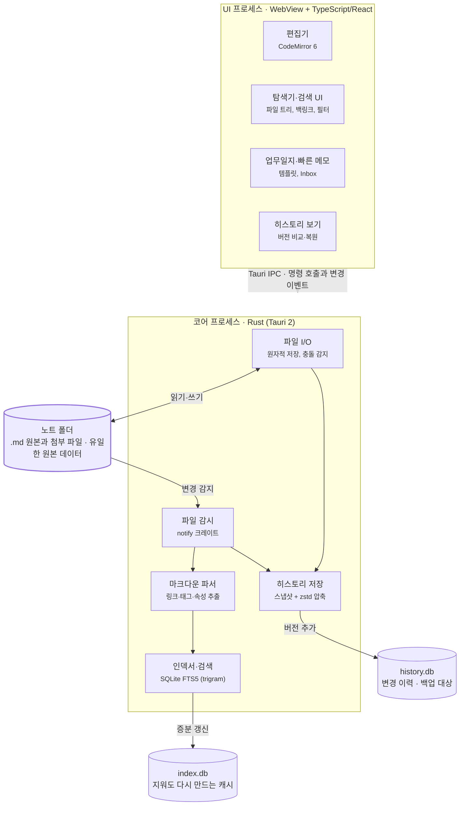

# Notevine 개발 계획서

> Notevine (note + vine): 노트가 덩굴처럼 뻗어 이어지는 범용 로컬 마크다운 지식관리 앱. 업무·아이디어·조사 자료 기록 관리를 기본 프리셋으로 제공

2026-10-28 (개정: 1인 + AI, 1주 MVP, 사용 목적 반영)

## 1. 개요

로컬 폴더의 마크다운(.md) 파일을 그대로 저장소로 쓰는 개인용 **범용 지식관리 앱**을 만든다. 개발자 1명이 AI 코딩 도구를 써서 **1주(7일) 안에 v0.1 MVP**를 오픈소스로 무료 배포한다.

**포지셔닝: 범용 코어 + 기록 관리 프리셋**

앱의 코어는 특정 용도에 묶이지 않는 일반 기능(노트, 링크, 임의 속성, 템플릿, 검색·필터, 히스토리)으로 만든다. 그 위에 아래 세 가지 기록 관리 용도를 **기본 프리셋**(폴더 구조·템플릿·속성 설정 묶음)으로 얹는다. 프리셋은 코드에 박아 넣지 않고 설정으로 제공하므로, 사용자는 빈 노트 폴더로 자유롭게 쓰거나, 프리셋을 켜서 바로 시작하거나, 프리셋을 고쳐 자기 용도를 만들 수 있다. 더 깊은 확장은 v0.2의 플러그인 API로 연다.

**기본 프리셋이 다루는 용도**

| 목적 | 사용자가 하는 일 | 앱이 해 주는 일 |
| --- | --- | --- |
| 업무 정리·기록·히스토리 관리 | 날마다 한 일·결정·회의 내용을 적는다 | 날짜별 업무일지 자동 생성, 템플릿, 모든 저장 시점의 변경 이력 보관·비교·복원 |
| 아이디어 기록·관리 | 떠오른 생각을 바로 적고 나중에 다듬는다 | 빠른 메모(Inbox), 상태(아이디어→검토→진행→완료/보류) 관리, 관련 노트 링크 |
| 조사 자료 정리·기록 관리 | 자료를 모으고 요약하고 출처를 남긴다 | 첨부 파일(이미지·PDF) 보관, 출처 URL·작성일 속성, 태그·전문 검색 |

세 목적은 `[[위키링크]]`와 백링크로 서로 이어진다. 예를 들어 업무일지에서 조사 노트와 아이디어 노트를 링크하면, 각 노트에서 "어느 날 어떤 업무에서 쓰였는지"를 거꾸로 볼 수 있다.

**확정된 조건**

| 항목 | 결정 |
| --- | --- |
| 타깃 사용자 | 개인 사용자 |
| 수익 모델 | 무료 배포 |
| 런타임 | Tauri 2 |
| 인력 | 1명 + AI 코딩 도구 |
| 기간 | 1주 (v0.1 MVP) |
| 모바일·동기화 | 다음 버전 이후 |
| 소스 공개 | 오픈소스, MIT 라이선스, GitHub 공개 저장소 |
| 지원 OS | v0.1은 Windows만 배포(테스트는 Windows 11). macOS·Linux는 v0.2 이후 |

**1주 MVP의 목표**

- 업무일지 쓰기 → 아이디어 빠른 메모 → 조사 노트 정리 → 링크로 연결 → 검색·히스토리로 다시 찾기가 끊김 없이 동작한다.
- 어떤 노트든 이전 저장 시점으로 비교·복원할 수 있다.
- 노트 1만 개짜리 노트 폴더에서 전체 검색 응답이 200ms 이내다(7일 차에 측정).
- 외부 편집기로 파일을 고치면 1초 안에 앱에 반영된다.
- Windows 설치 파일(.msi·.exe)을 GitHub Releases로 배포한다.

**범위를 줄인 이유.** 처음 계획(4.5명, 9개월, v1.0)을 1명·1주로 옮기면 투입량이 약 1/200로 줄어든다. 그래서 1주에는 세 가지 목적의 핵심 루프만 만들고, 그래프 뷰·플러그인처럼 목적과 거리가 있는 기능은 v0.2 이후로 넘긴다.

**차별화 포인트**

- 범용 + 바로 쓰는 프리셋: 빈 노트 폴더로 자유롭게 쓰거나, 업무·아이디어·자료 프리셋으로 설정 없이 바로 시작
- 변경 이력(버전 비교·복원)을 무료 기본 기능으로 제공
- 한국어 우선: 한글 부분 일치 검색(trigram), 한국어 UI
- 경량 런타임(Tauri), 데이터는 일반 .md 파일이라 앱이 없어져도 기록이 남음
- 특정 제품의 화면이나 코드를 복제하지 않고, 마크다운·위키링크 같은 공개 형식만 호환한다.

## 2. 기능 범위

1주 안에 범용 코어(편집·링크·속성·검색·히스토리)와 기록 관리 프리셋을 끝낸다. 범용 도구로서 확장성을 여는 플러그인 API와 그래프 뷰는 v0.2의 최우선 과제로 둔다. 아래 표의 업무 기록·아이디어·조사 자료 행은 프리셋으로 제공되는 기능이다.

| 영역 | v0.1 MVP (1주) | v0.2~v1.0 | v1.0 이후 |
| --- | --- | --- | --- |
| 업무 기록 | 날짜별 업무일지(오늘 노트 자동 생성), 템플릿(업무일지·회의록) | 주간·월간 회고 자동 묶음, 캘린더 보기 | — |
| 히스토리 | 저장 시점마다 스냅샷, 이전 버전 보기·비교(diff)·복원 | 노트별 타임라인, 히스토리 보관 정책 설정 | 동기화 기기 간 히스토리 |
| 아이디어 | 빠른 메모(앱 내 단축키 → Inbox), 상태 속성, 상태별 목록 | 전역 단축키(앱이 닫혀 있어도 메모), 칸반 보기 | — |
| 조사 자료 | 첨부 파일 드래그 앤 드롭(형식 제한 없음)·이미지 붙여넣기·기본 프로그램으로 열기, 출처 URL·작성일 속성, 자료 템플릿 | 웹 클리핑 브라우저 확장, PDF 미리보기·주석 | 의미 기반 검색(로컬 임베딩) |
| 편집기 | 마크다운 편집, 라이브 미리보기, 자동 저장 | 탭·분할 창, 표 편집, 수식(KaTeX), 다이어그램(Mermaid) | — |
| 링크 | `[[위키링크]]` 자동완성·클릭 이동, 백링크 패널, 이름 변경 시 링크 자동 갱신 | 블록·헤딩 링크, 노트 임베드 | — |
| 속성·템플릿 (범용) | 임의 속성(frontmatter) 정의·편집, 사용자 템플릿, 프리셋 켜기/끄기 | 속성으로 만드는 표·목록 보기 | — |
| 검색 | 파일명 빠른 열기, 전문 검색(한글 부분 일치), 태그·날짜·임의 속성 필터 | 저장된 검색 | — |
| 노트 폴더 | 폴더 열기, 파일 트리, 외부 변경 감지 | 다중 노트 폴더 전환, 휴지통 | 노트 폴더 암호화 |
| 시각화·확장 | 라이트·다크 테마, 플러그인을 붙일 수 있는 내부 구조(명령·이벤트 레지스트리) | **플러그인 API(최우선)**, 그래프 뷰, CSS 테마 | 플러그인 마켓, 캔버스 |
| 배포 | Windows 설치 파일, GitHub Releases | macOS·Linux 설치 파일, 코드 서명, 자동 업데이트, 패키지 저장소(winget·Homebrew·Flathub) | 모바일 앱, E2E 암호화 동기화 |

## 3. 기술 스택과 아키텍처

Tauri 2(Rust) + TypeScript/React 조합을 쓴다. 파일 감시·파싱·인덱싱·히스토리 저장을 Rust가 맡아 대용량 노트 폴더에서도 UI가 멈추지 않는다.



사용자가 저장하면 코어가 .md 파일을 쓰고, 같은 시점의 내용을 history.db에 스냅샷으로 남긴다. 외부 편집기로 고친 경우에도 감시기가 변경을 잡아 스냅샷과 인덱스를 함께 갱신한다.

| 구분 | 선택 | 이유 |
| --- | --- | --- |
| 런타임 | Tauri 2 | 설치 용량·메모리가 작고 Rust로 파일 처리가 빠름 |
| UI | React + TypeScript, Zustand | AI 도구가 가장 잘 다루는 조합이라 1인 개발 속도에 유리 |
| 편집기 | CodeMirror 6 | 대용량 문서 성능, 라이브 미리보기 데코레이션, 한글 IME 안정성 |
| 마크다운 파서 | comrak (Rust) | CommonMark·GFM 준수, 위키링크·frontmatter 처리 |
| 인덱스·검색 | SQLite + FTS5 trigram 토크나이저 (rusqlite, bundled) | 단일 파일, 한글 부분 일치 검색 가능 |
| 히스토리 | SQLite + zstd 압축 스냅샷, diff는 similar 크레이트 | Git보다 단순하고 사용자가 Git을 몰라도 됨, 압축으로 용량 절감 |
| 파일 감시 | notify 크레이트 | Windows·macOS·Linux 공통 API (나중에 OS를 늘려도 그대로 사용) |
| 테스트·배포 | cargo test, Vitest, GitHub Actions + tauri-action | v0.1은 Windows에서만 빌드·단위 테스트. 태그를 달면 설치 파일이 Releases에 자동 업로드 |

## 4. 데이터 모델과 노트 폴더 구조

원본은 항상 .md 파일이다. index.db는 언제든 다시 만들 수 있는 캐시이고, history.db는 다시 만들 수 없는 변경 이력이므로 백업 대상이다.

**노트 폴더 구조 (기록 관리 프리셋을 켰을 때의 예시)**

프리셋 없이 아무 폴더나 열어 쓸 수 있다. 앱이 요구하는 것은 `.app/` 폴더뿐이다.

```
MyVault/
├─ .app/                 # 앱 전용 (숨김)
│  ├─ config.json        # 노트 폴더 설정
│  ├─ workspace.json     # 마지막으로 연 노트
│  ├─ index.db           # 검색 인덱스 (재생성 가능)
│  └─ history.db         # 변경 이력 (백업 대상)
├─ 00 Inbox/             # 빠른 메모가 쌓이는 곳
├─ 10 업무일지/2026/2026-10-28.md
├─ 20 아이디어/
├─ 30 조사자료/
├─ 90 템플릿/            # 업무일지·회의록·아이디어·자료 템플릿
└─ 첨부/                 # 이미지·PDF
```

**노트 속성 (frontmatter 예시)**

속성 이름과 값은 사용자가 자유롭게 정한다. 아래 `type`·`status` 값은 기록 관리 프리셋의 기본값일 뿐이고, 코어는 어떤 속성이든 같은 방식으로 저장·검색한다.

```yaml
---
type: idea          # journal | idea | research | meeting
status: 검토        # 아이디어 | 검토 | 진행 | 완료 | 보류
tags: [업무개선, 자동화]
source: https://example.com/report   # 조사 자료의 출처
created: 2026-10-28
---
```

**인덱스·히스토리 테이블 (SQLite)**

| DB | 테이블 | 주요 컬럼 | 용도 |
| --- | --- | --- | --- |
| index.db | notes | id, path, title, created, mtime, hash | 파일 목록, 날짜 필터 |
| index.db | links | src_id, target_path, target_anchor, kind | 링크·백링크 |
| index.db | tags | note_id, tag | 태그 필터 |
| index.db | properties | note_id, key, value, value_type | 모든 속성(type·status·source 등) 필터 |
| index.db | notes_fts | title, body (FTS5, trigram) | 전문 검색 |
| history.db | versions | id, path, saved_at, hash, size, content_zstd, origin(app/external) | 이전 버전 보기·비교·복원 |

**히스토리 규칙**

1. 저장할 때 내용 hash가 직전 버전과 같으면 스냅샷을 남기지 않는다.
2. 자동 저장이 잦으므로 같은 노트를 쉬지 않고 편집하는 동안의 스냅샷은 5분 단위로 묶는다. 1분 이상 쉬었다가 다시 고치면 새 버전을 시작한다. 노트를 만들 때·처음 열 때, 수동 저장(Ctrl+S), 앱 종료 직전은 항상 남긴다.
3. 이름 변경·이동 시 이력은 새 경로로 이어 붙인다. 삭제한 노트의 이력도 남겨 복원할 수 있게 한다.
4. 보관 기간 기본값은 무제한이다. 용량이 커지면 v0.2에서 보관 정책(예: 30일 이후 하루 1개)을 추가한다.

**링크 해석 규칙**

1. `[[이름]]`은 파일명(확장자 제외)으로 찾는다. 같은 이름이 여러 개면 폴더 깊이가 얕은 노트를, 깊이가 같으면 경로가 짧은 노트를 우선한다. `[[폴더/이름]]`처럼 경로를 쓰면 그 노트를 가리킨다.
2. 대상이 없는 링크도 links에 저장해, 나중에 파일이 생기면 자동으로 연결한다.
3. 파일 이름 변경 시 links에서 참조 노트를 찾아 본문을 일괄 치환하고, 실행 전 변경 목록을 보여준다.
4. 한글 파일명은 NFC로 정규화해 비교한다(macOS는 NFD로 저장한다. v0.1은 Windows만 배포하지만 클라우드 드라이브로 Mac에서 만든 파일이 들어올 수 있으므로 v0.1부터 필수).
5. 경로는 내부에서 `/`로 통일하고, 링크 비교는 대소문자를 무시한다. Windows·macOS는 기본적으로 대소문자를 구분하지 않고 Linux는 구분하므로, 대소문자만 다른 파일이 있으면 경고한다.

## 5. 개발 일정 (7일)

하루에 한 덩어리씩 끝내고, 날마다 "완료 기준"을 통과해야 다음 날로 넘어간다. 3일 차가 끝났을 때 하루 이상 밀렸으면 아래 '자를 기능'을 v0.2로 넘긴다.


| 일차 | 작업 | 완료 기준 |
| --- | --- | --- |
| 1일 | Tauri 2 + React + TS 프로젝트 생성, GitHub 공개 저장소·LICENSE, CI(Windows 빌드·단위 테스트), 노트 폴더 열기, 파일 트리, 파일 생성·이름변경·삭제 | 폴더를 열면 트리가 보이고 파일 조작이 디스크에 반영됨, CI에서 Windows 빌드 성공 |
| 2일 | CodeMirror 6 편집기, 라이브 미리보기 기본, 자동 저장(원자적 쓰기), history.db 스냅샷 저장 | 한글 입력 중 끊김·중복 입력 없음, 저장할 때마다 버전이 쌓임(5분 묶음 규칙 포함) |
| 3일 | comrak으로 링크·태그·frontmatter 추출, index.db 스키마, notify 파일 감시, 증분 인덱싱, 외부 변경도 스냅샷 | 외부 수정이 1초 안에 인덱스와 히스토리에 반영됨 |
| 4일 | `[[` 자동완성, 링크 클릭 이동, 없는 노트 링크 클릭 시 생성, 백링크 패널, 이름 변경 시 링크 갱신 | 이름을 바꿔도 모든 참조 링크가 따라 바뀜 |
| 5일 | FTS5 trigram 전문 검색, 파일명 빠른 열기(Ctrl+O), 태그·날짜·임의 속성 필터, 속성 편집 UI | 한글 단어 일부로 검색되고, "status=검토인 노트"처럼 어떤 속성으로든 걸러짐 |
| 6일 | 사용자 템플릿, 데일리 노트, 빠른 메모 → Inbox, 기록 관리 프리셋(폴더·템플릿 4종) 켜기/끄기, 첨부(드래그 앤 드롭·이미지 붙여넣기·기본 프로그램으로 열기), 히스토리 패널(버전 목록·diff·복원), 라이트·다크 테마 | 빈 노트 폴더에서 자유 사용과, 프리셋으로 업무일지 → 아이디어 메모 → 자료 정리 → 이전 버전 복원이 모두 시연 가능 |
| 7일 | 1만 노트 성능 측정, AI 실사용 테스트, 버그 수정, Windows 설치 파일 빌드, README·CONTRIBUTING, GitHub Releases에 v0.1 배포 | 검색 200ms 이내, Windows 11에서 설치 후 위 시연 흐름이 동작 |

**v0.2 이후 (일정 미정)**: 플러그인 API(최우선), 그래프 뷰, 탭·분할 창, 속성 기반 표·목록 보기, 웹 클리핑 브라우저 확장, 전역 빠른 메모 단축키, 주간·월간 회고 묶음, 칸반·캘린더 보기, 코드 서명, 자동 업데이트, 수식·Mermaid 렌더링. 그다음에 모바일과 동기화를 검토한다.

## 6. 인력·리소스 계획

개발자 1명이 AI 코딩 도구(예: Claude Code)로 구현한다. AI는 코드 작성과 테스트·실사용 테스트를 맡고, 개발자는 판단과 최종 확인에 집중한다.

### 6.1 영역별 역할

| 영역 | 주도 | 개발자가 직접 할 일 |
| --- | --- | --- |
| Rust 백엔드 (파일 I/O·감시·인덱스·히스토리) | AI 작성 | 노트 유실 방지 로직(저장·이름 변경·복원·충돌) 코드 리뷰, 강제 종료 테스트 |
| 프론트엔드 (React·CodeMirror) | AI 작성 | 한글 입력(IME) 중 동작을 직접 타이핑해 확인 |
| 링크 갱신·검색 | AI 작성 + 단위 테스트 | 테스트 케이스가 한글·대소문자·NFC/NFD를 다루는지 확인 |
| UI 디자인 | AI가 화면설계서(PPT) 기준으로 구현 | 강조색·로고 결정 |
| 빌드·배포 (GitHub Actions) | AI 작성 | 태그·릴리스 실행 |
| 실사용 테스트 | AI 진행 (6.3) | 결과 보고서 검토, 고칠 항목 결정 |
| 문서 (README·CONTRIBUTING) | AI 작성 | 최종 검토 |

**AI에게 맡기지 않는 것:** 데이터 구조·파일 포맷 변경, 기능을 v0.2로 미루는 결정, 저장소 push와 릴리스 배포.

### 6.2 하루 작업 흐름

1. **오전 (개발자):** 그날 구현할 요구사항 ID를 고르고 AI에게 줄 작업 단위로 나눈다.
2. **구현 (AI):** 기능 하나마다 코드 → 테스트 → 실행 확인까지 묶어 진행한다. 서로 겹치지 않는 작업(예: 백엔드와 프론트엔드)은 동시에 진행한다.
3. **저녁 (개발자):** 요구사항 정의서의 수용 기준대로 Windows 11에서 직접 실행해 통과 여부를 표시하고 커밋한다. 밀리면 다음 날 범위를 줄인다.

### 6.3 테스트 범위 (2026-10-28 결정)

| 구분 | 방법 | 대상 OS |
| --- | --- | --- |
| 실행·기능 테스트 | 개발자와 AI가 설치 파일로 직접 실행 | **Windows 11만** |
| 단위 테스트 | `cargo test`·Vitest를 GitHub Actions에서 자동 실행 | Windows |
| 실사용 테스트 (NFR-USA-01) | AI 에이전트가 처음 쓰는 사용자 역할로 앱 화면을 조작 | Windows 11 |

- v0.1은 Windows만 배포한다. macOS·Linux 배포는 실행 확인 환경을 마련한 뒤 v0.2 이후에 한다.
- **AI 실사용 테스트 방법:** 코드와 설계 문서를 보지 않은 새 AI 세션에 "처음 설치한 사용자" 역할과 과제만 준다. 화면 조작 도구(computer-use 또는 WebView2 원격 디버깅으로 연결한 Playwright)로 앱을 조작하게 하고, 과제마다 조작 횟수·막힌 지점·헷갈린 문구를 스크린샷과 함께 기록한다. 과제는 ① 노트 폴더 열기 → 첫 노트 저장, ② 오늘 업무일지 쓰기, ③ 빠른 메모, ④ 노트 검색, ⑤ 이전 버전 복원 5개, 각 3회 반복한다.
- **한계:** AI는 사람과 읽는 속도·실수 유형이 달라 시간 기준(1분)은 그대로 비교할 수 없다. 그래서 조작 횟수와 막힌 지점으로 판정하고, 사람 테스트는 공개 후 이슈 제보로 보완한다.

### 6.4 필요한 것

- 개발 환경: Windows 11, Rust 툴체인, Node.js, WebView2(Windows 11 기본 포함)
- GitHub 공개 저장소, Actions(Windows 빌드·단위 테스트), Releases(배포)
- 오픈소스 기본 파일: LICENSE(MIT), README, CONTRIBUTING, 이슈 템플릿
- 노트 1만 개짜리 테스트 노트 폴더(스크립트로 생성)
- 코드 서명 인증서: v0.1에서는 쓰지 않는다. 서명 없는 설치 파일은 Windows SmartScreen 경고가 뜬다는 점과 우회 방법을 README에 적는다.

### 6.5 AI 에이전트 구성

메인 세션 1개가 통합을 맡고, 보조 에이전트는 서로 겹치지 않는 작업에만 띄운다. 동시에 돌리는 에이전트는 3개 이하로 둔다.

| 에이전트 | 맡는 일 | 시기 |
| --- | --- | --- |
| 메인(통합) | 작업 분배, 백엔드·프론트엔드 연결, 수용 기준 확인, 커밋 준비 | 매일 |
| 백엔드 | Rust: 파일 I/O·감시, 인덱스, 히스토리 | 2~6일 차, 프론트엔드와 동시 |
| 프론트엔드 | React·CodeMirror: 편집기, 트리, 패널, 팝업 | 2~6일 차, 백엔드와 동시 |
| 리뷰 | 노트 유실 위험 코드(저장·이름 변경·복원·충돌)만 검토 | 3·6일 차 |
| 실사용 테스트 | 코드를 모르는 '처음 쓰는 사용자'로 앱 조작 (6.3) | 7일 차 |

- 1일 차에 Tauri 명령 이름과 주고받는 타입을 먼저 정한다(`src-tauri/src/commands.rs` ↔ `src/api.ts`). 이 약속이 있어야 백엔드와 프론트엔드가 서로 기다리지 않는다.
- 동시에 일하는 에이전트는 git worktree를 따로 쓰고, 메인이 하루 1~2번 합친다.
- 리뷰와 실사용 테스트는 코드를 쓴 세션과 다른 새 세션으로 띄운다.
- 기능마다 에이전트를 나누지 않는다. 기능끼리 인덱스와 편집기를 함께 쓰므로 맞추는 비용이 더 크다.

## 7. 리스크와 대응방안

가장 큰 위험은 1주 안에 범위가 넘치는 것과, 기록 앱의 신뢰를 깨는 데이터 손실이다. 매일 완료 기준으로 진도를 확인하고, 파일 쓰기·히스토리는 테스트를 먼저 만든다.

| 리스크 | 영향 | 대응 |
| --- | --- | --- |
| 1주 안에 범위를 다 못 끝냄 (6일 차 작업량이 가장 큼) | 상 | 3일 차 점검에서 이름 변경 링크 갱신·첨부 드래그 앤 드롭·diff 보기를 먼저 자름. 업무일지·빠른 메모·검색·히스토리 저장은 지킴 |
| 저장·이름 변경·복원 중 데이터 손실 | 상 | 원자적 쓰기(임시 파일 → 교체), 복원 전 현재 내용을 새 버전으로 먼저 저장, 해당 로직은 단위 테스트 우선 |
| AI가 만든 코드의 숨은 버그 | 상 | 파일 I/O·히스토리·링크 치환은 테스트를 먼저 작성하고 사람이 직접 검토 |
| history.db 용량 증가 | 중 | 5분 묶음 규칙, zstd 압축, 같은 내용은 저장 안 함. 용량 표시와 보관 정책은 v0.2 |
| 클라우드 드라이브(OneDrive 등)가 파일을 동시에 고침 | 상 | 저장 전 mtime·hash 비교, 충돌 시 변경본을 별도 파일로 보존하고 히스토리에도 남김 |
| 다음 버전에서 macOS·Linux로 넓힐 때 WebView 차이(WebKit/WebKitGTK)와 파일 시스템 차이(대소문자, 유니코드 정규화) | 중 | v0.1부터 경로·파일명 처리를 OS 중립으로 만든다. macOS·Linux 단위 테스트는 해당 OS를 지원하는 버전에서 CI에 추가 |
| 한글 IME 조합 중 자동완성·단축키 오작동 | 중 | 2일 차 완료 기준에 한글 입력 테스트 포함, compositionstart/end 처리 |
| Rust·Tauri에 익숙하지 않아 디버깅이 오래 걸림 | 중 | Rust 코어는 파일 I/O·감시·인덱스·히스토리로 최소화하고 나머지는 TypeScript로 작성 |
| 서명 없는 설치 파일에 SmartScreen 경고 | 중 | README에 우회 방법 안내('추가 정보 → 실행'), 사용자가 늘면 v0.2에서 인증서 구입 |
| 기존 제품과의 유사성으로 인한 상표·디자인 분쟁 | 중 | 고유 이름·아이콘·UI, 공개 포맷(마크다운)만 호환, 공개 전 상표 조사 |

## 8. 결정이 필요한 사항

- [x] 타깃·수익 모델·런타임·인력·기간·모바일/동기화 시기 (2026-10-28 결정)
- [x] 소스 공개: 오픈소스, MIT 라이선스 (2026-10-28 결정, 라이선스 종류는 변경 가능)
- [x] 지원 OS: v0.1은 Windows만, macOS·Linux는 v0.2 이후 (2026-10-28 변경. 처음엔 v0.1부터 3개 OS)
- [x] 주 목적: 업무 기록·히스토리, 아이디어 관리, 조사 자료 정리 (2026-10-28 결정)
- [x] 포지셔닝: 범용 지식관리 코어 + 기록 관리 프리셋 (2026-10-28 결정)
- [ ] 플러그인 API를 v0.2 최우선으로 둘지, 그래프 뷰를 먼저 할지
- [x] 앱 이름: **Notevine** (2026-10-28 결정. 웹 검색상 같은 이름의 앱은 확인되지 않음)
- [ ] Notevine 상표(KIPRIS 9류·42류)·GitHub 저장소 이름·도메인 확인
- [ ] 착수일 (7일 일정의 1일 차)
- [ ] 아이디어 상태 단계: 아이디어 → 검토 → 진행 → 완료 / 보류 로 충분한지
- [ ] 기본 폴더 구조(Inbox·업무일지·아이디어·조사자료·템플릿)를 그대로 쓸지
- [x] 테스트 환경: 실행 테스트는 Windows 11만 (2026-10-28 결정)
- [x] 실사용 테스트: AI 에이전트가 진행 (2026-10-28 결정)
- [x] AI 도우미를 v0.1에 포함: 설치·로그인된 Claude Code·Codex CLI 사용, 보낼 노트 매번 확인, 질문·작성 돕기·주간 회고·답변 저장 (2026-10-28 결정, 요구사항 FR-AI-01~07)
