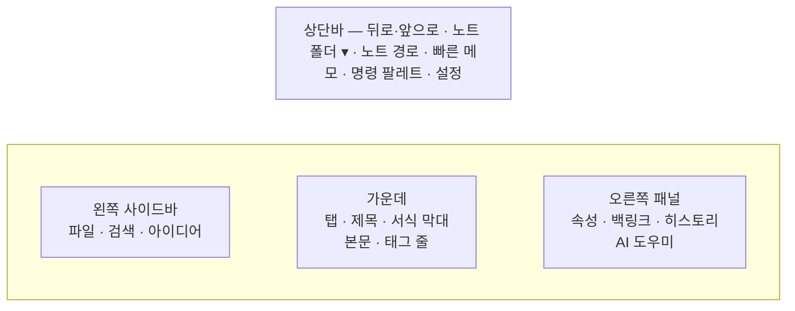

# Notevine 사용자 매뉴얼

Notevine은 내 PC의 폴더에 마크다운(.md) 파일로 노트를 쓰고, 링크·태그·속성으로 엮어 찾는 노트 앱입니다. 노트는 일반 텍스트 파일이라 다른 프로그램으로도 열 수 있고, 앱이 없어져도 그대로 남습니다.

- 대상 버전: 0.1.0 (2026-11-02 기준)
- 앱 안에서 보기: **Shift+F1**, 또는 마크다운 문법 도움말(F1)의 [사용자 매뉴얼], 설정 → 정보 → [매뉴얼 열기]
- 운영체제: Windows 10/11

## 목차

1. [시작하기](#1-시작하기)
2. [화면 구성](#2-화면-구성)
3. [노트 쓰기](#3-노트-쓰기)
4. [노트 연결하기: 링크·태그·속성](#4-노트-연결하기-링크태그속성)
5. [찾기](#5-찾기)
6. [폴더 보기: 표·보드·캘린더·그래프](#6-폴더-보기-표보드캘린더그래프)
7. [기록 관리 (PARA 기본 구조)](#7-기록-관리-para-기본-구조)
8. [첨부 파일과 그림](#8-첨부-파일과-그림)
9. [히스토리와 복원](#9-히스토리와-복원)
10. [AI 도우미](#10-ai-도우미)
11. [설정](#11-설정)
12. [단축키 모음](#12-단축키-모음)
13. [자주 묻는 질문](#13-자주-묻는-질문)

---

## 1. 시작하기

### 1.1 노트 폴더 열기

처음 실행하면 시작 화면이 나옵니다.

1. **[노트 폴더 열기]** 를 누르고 노트가 있는 폴더를 고릅니다. 이미 마크다운 파일이 있는 폴더(옵시디언 보관함 등)여도 됩니다. 새로 시작하려면 **[새 노트 폴더 만들기]** 로 빈 폴더를 고릅니다.
2. 폴더 안의 노트가 왼쪽 파일 트리에 나타납니다. 검색 색인은 뒤에서 만들어지고, 끝나면 목록이 저절로 새로 고쳐집니다.

다음부터는 앱을 켜면 마지막에 쓴 노트 폴더와 열어 두었던 탭이 그대로 열립니다. 다른 노트 폴더로 바꾸려면 상단바의 **노트 폴더 이름 ▾ → 노트 폴더 바꾸기** 를 누르거나 명령 팔레트(Ctrl+P)에서 "노트 폴더 바꾸기"를 실행합니다.

### 1.2 앱이 노트 폴더에 만드는 것

노트 폴더 안에 숨은 `.app` 폴더를 만들어 앱 데이터를 둡니다. 노트 파일은 건드리지 않습니다.

| 파일 | 내용 | 지워도 되나 |
| --- | --- | --- |
| `.app/index.db` | 검색 색인 | 됨 (다시 만들어짐) |
| `.app/history.db` | 노트 이전 버전 | **안 됨** (다시 만들 수 없음. 노트와 함께 백업하세요) |
| `.app/config.json` | 이 노트 폴더의 설정 | 됨 (기본값으로 돌아감) |
| `.app/workspace.json` | 열어 둔 탭 | 됨 |
| `.app/custom.css` | 사용자 CSS (만든 경우) | 됨 |

### 1.3 처음 써 볼 것

- **Ctrl+N**: 새 노트
- **Ctrl+Shift+N**: 빠른 메모 (제목 없이 바로 적기)
- **Ctrl+P**: 명령 팔레트. 기능 이름을 몰라도 한글 몇 글자로 찾아 실행할 수 있습니다.
- **F1**: 마크다운 문법 도움말
- **Shift+F1**: 이 사용자 매뉴얼

---

## 2. 화면 구성



| 영역 | 하는 일 |
| --- | --- |
| 상단바 | 뒤로/앞으로(Alt+←/→), 노트 폴더 바꾸기, 현재 노트 경로(누르면 그 폴더로 이동), 빠른 메모, 명령 팔레트, 설정 |
| 왼쪽 사이드바 | **파일** 트리, **검색**, **아이디어** 보드. Ctrl+\\ 로 접고 폅니다 |
| 가운데 | 탭 줄, 노트 제목(누르거나 F2로 이름 바꾸기), 편집/읽기 전환, 서식 막대, 본문 |
| 오른쪽 패널 | **속성**(노트 맨 위 YAML), **백링크**(이 노트를 가리키는 노트), **히스토리**(이전 버전), **AI 도우미**. Ctrl+Shift+\\ 로 접고 폅니다 |

### 2.1 파일 트리

- 노트·폴더를 **오른쪽 클릭**하면 메뉴가 나옵니다: 새 노트, 새 폴더, 이름 변경, 삭제, 새 탭에서 열기, 오른쪽에 나란히 열기, 히스토리 보기, 경로 복사, 탐색기에서 보기, 폴더 색, 표/보드/캘린더/그래프로 보기.
- **끌어다 놓기**로 노트와 폴더를 다른 폴더로 옮깁니다. 이름을 바꾸거나 옮기면 그 노트를 가리키는 링크도 함께 고쳐집니다(설정에서 끌 수 있음).
- **삭제**한 노트는 Windows 휴지통으로 갑니다. 휴지통을 비운 뒤에도 히스토리에서 되살릴 수 있습니다([9.3](#93-삭제된-노트-되살리기)).
- **폴더 색**: 폴더 이름에 색을 붙이면 그 안의 노트·하위 폴더도 같은 색으로 보입니다.

### 2.2 탭과 나란히 보기

- 노트를 열면 탭으로 쌓입니다. **Ctrl+Tab / Ctrl+Shift+Tab** 으로 옮겨 다니고, **Ctrl+W** 로 닫고, **Ctrl+Shift+T** 로 닫은 탭을 다시 엽니다.
- 노트를 오른쪽 클릭 → **오른쪽에 나란히 열기** 로 두 노트를 동시에 봅니다.

---

## 3. 노트 쓰기

### 3.1 편집 모드와 읽기 모드

- **편집 모드**: 마크다운을 쓰는 화면입니다. 커서가 없는 줄은 `**`, `#` 같은 기호를 숨기고 서식대로 보여 주고(라이브 미리보기), 커서가 있는 줄만 원문을 보여 줍니다.
- **읽기 모드**: 서식이 모두 적용된 화면입니다. 표·수식·다이어그램·강조 상자·체크박스·그림이 그려지고, 체크박스는 눌러서 체크할 수 있습니다.
- **Ctrl+E** 또는 제목 줄 오른쪽의 **[편집 | 읽기]** 로 바꿉니다.

### 3.2 저장

입력을 멈추면 1초 뒤 자동으로 저장됩니다(설정에서 0.5~5초로 바꿈). 제목 줄 오른쪽에 "편집 중 → 저장 중… → √ 저장됨"이 보입니다. **Ctrl+S** 는 바로 저장하고, 그 시점을 히스토리 버전으로 확실히 남깁니다.

다른 프로그램이 같은 노트를 동시에 고쳐 내용이 엇갈리면, 내 변경을 `이름 (충돌 날짜 시각).md` 로 따로 저장하고 알려 줍니다. 어느 쪽도 잃지 않습니다.

### 3.3 서식 막대

본문 위의 서식 막대로 자주 쓰는 마크다운을 넣습니다. 글을 선택하고 누르면 선택한 글에, 선택이 없으면 커서가 있는 단어나 줄에 적용하고, 다시 누르면 풀립니다. 아이콘에 마우스를 올리면 이름과 단축키가 보입니다.

| 묶음 | 단추 (단축키) |
| --- | --- |
| 제목 | 제목 1 · 제목 2 · 제목 3 |
| 글자 | 굵게 (Ctrl+B) · 기울임 (Ctrl+I) · 취소선 (Ctrl+Shift+X) · 형광펜 (Ctrl+Shift+H) · 인라인 코드 (Ctrl+\`) · 글자 색 · 배경색 |
| 문단 | 글머리 목록 · 번호 목록 · 체크리스트 (Ctrl+L) · 인용 · 강조 상자 |
| 넣기 | 노트 링크 `[[ ]]` · 웹 링크 (Ctrl+K) · 표 · 코드 블록 · 구분선 |
| 도움말 | `?` 마크다운 문법 도움말 (F1) |

### 3.4 강조 상자로 중요도 표시하기

내용의 중요도를 색 상자로 보여 줍니다. 서식 막대의 **강조 상자** 단추를 누르고 종류를 고릅니다.

| 종류 | 색 | 쓰는 곳 |
| --- | --- | --- |
| 중요 | 빨강 | 꼭 지켜야 할 것, 결정 사항 |
| 주의 | 주황 | 마감·위험·실수하기 쉬운 것 |
| 참고 | 파랑 | 덧붙이는 설명 |
| 팁 | 초록 | 요령, 잘된 점 |

직접 쓸 수도 있습니다. 첫 줄 `[!종류]` 뒤에 제목을 붙이면 종류 이름 대신 그 제목이 보입니다.

```markdown
> [!주의] 마감 임박
> 11월 30일까지 제출
```

- 상자 첫 줄에 커서를 두고 다른 종류를 고르면 종류만 바뀌고, 같은 종류를 다시 고르면 상자가 풀립니다.
- 옵시디언 방식의 영어 이름(`[!important]`, `[!warning]`, `[!note]`, `[!tip]` 등)도 같은 색 상자로 보입니다.

### 3.5 자주 쓰는 마크다운

| 쓰기 | 결과 |
| --- | --- |
| `# 제목`, `## 소제목` | 제목 |
| `**굵게**`, `*기울임*`, `~~취소~~`, `==형광펜==` | 글자 서식 |
| `- 항목`, `1. 항목` | 목록 (Tab으로 들여쓰기) |
| `- [ ] 할 일`, `- [x] 한 일` | 체크리스트 |
| `> 인용` | 인용문 |
| `` `코드` ``, ` ``` ` 로 감싼 블록 | 코드 (언어 이름을 붙이면 색으로 강조) |
| `| 항목 | 내용 |` | 표 |
| `$E=mc^2$`, `$$ … $$` | 수식 |
| ` ```mermaid ` 블록 | 다이어그램 (읽기 모드) |

> `2026. 06. 22 ~ 2029. 06. 21` 처럼 한국식 날짜로 시작하는 줄은 번호 목록이 아니라 일반 글로 봅니다.

### 3.6 템플릿

- **Ctrl+N**(새 노트)을 누르면 템플릿을 고를 수 있고, **Ctrl+T** 는 지금 노트에 템플릿 내용을 넣습니다.
- 템플릿은 템플릿 폴더(기본 `90.템플릿`)에 있는 일반 노트입니다. 그 안에 `{{date}}`, `{{time}}`, `{{title}}` 을 쓰면 만들 때 오늘 날짜·시각·노트 제목으로 바뀝니다.

### 3.7 빠른 메모

**Ctrl+Shift+N** 을 누르면 작은 창이 뜹니다. 첫 줄이 제목이 되고, **Ctrl+Enter** 로 저장하면 Inbox 폴더(기본 구조를 끈 경우 노트 폴더 맨 위)에 저장됩니다. Esc는 닫기입니다.

다른 프로그램을 쓰고 있거나 Notevine 창을 최소화했을 때는 **Ctrl+Alt+N** 을 누르면 Notevine이 앞으로 오면서 빠른 메모가 열립니다.

창을 닫은 뒤에도 쓰려면 설정 → 일반 → **닫으면 트레이로** 를 켜세요. 창을 닫아도 작업 표시줄 오른쪽(트레이)에 Notevine 아이콘이 남아 Ctrl+Alt+N이 계속 동작합니다. 아이콘을 누르면 창이 다시 열리고, 아이콘을 오른쪽 클릭하면 **열기 / 빠른 메모 / 종료** 가 나옵니다. **Windows 시작 시 실행** 을 함께 켜면 PC에 로그인할 때 Notevine이 트레이에 떠 있습니다.

---

## 4. 노트 연결하기: 링크·태그·속성

### 4.1 노트 링크

- `[[` 를 치면 노트 이름 자동완성이 뜹니다. 한글 일부만 쳐도 찾고, Enter로 고릅니다.
- `[[노트 이름|보일 글]]` 로 다른 글자로 보이게 할 수 있습니다.
- 링크를 **Ctrl+클릭**(설정에서 그냥 클릭으로 바꿈)하면 그 노트로 갑니다. 아직 없는 노트면 새로 만듭니다(점선 밑줄로 보임).
- 같은 이름의 노트가 여러 개면 폴더 깊이가 얕은 노트로 이어지고, 링크에 경로를 쓰면(`[[폴더/노트]]`) 정확히 그 노트로 갑니다.
- 일반 마크다운 링크 `[글](경로.md)` 도 링크로 인식합니다.

### 4.2 제목·문단 링크와 끼워 넣기

| 쓰기 | 뜻 |
| --- | --- |
| `[[노트#제목]]` | 그 노트의 그 제목으로 바로 가기. `[[노트#` 까지 치면 제목 목록이 뜹니다 |
| `[[#제목]]` | 이 노트 안의 제목으로 가기 |
| `[[노트#^id]]` | 그 노트의 특정 문단으로 가기. `[[노트#^` 까지 치면 문단 목록이 뜨고, 고르면 대상 문단 끝에 `^id` 가 저절로 붙습니다 |
| `![[노트]]` | 다른 노트 내용을 그 자리에 보여 주기 (읽기 모드) |
| `![[노트#제목]]`, `![[노트#^id]]` | 그 제목 아래 부분, 그 문단만 보여 주기 |

### 4.3 백링크

오른쪽 패널의 **백링크** 에 지금 노트를 가리키는 노트가 모입니다. 링크를 넣거나 지우면 바로 반영됩니다.

### 4.4 태그

- 본문에 `#회의`, `#프로젝트/웹` 처럼 쓰면 태그가 됩니다. `#` 뒤에 글자를 치면 이미 쓰던 태그가 많이 쓴 순서로 제안됩니다.
- 속성 `tags: [회의, 예산]` 으로 붙여도 됩니다.
- 노트 본문 맨 아래 **태그 줄** 에 그 노트의 태그가 모이고, 누르면 그 태그로 검색합니다.
- 줄 맨 앞 `# 제목`, `C#` 처럼 단어에 붙은 `#`, 코드 안, 글자 색 HTML 속 색상값(`#1c7ed6`)은 태그가 아닙니다.
- `#비공개` 태그가 붙은 노트는 AI로 보내지 않습니다([10](#10-ai-도우미)).

### 4.5 속성

노트 맨 위의 YAML 블록이 속성입니다. 오른쪽 패널 **속성** 에서 추가·수정·삭제하면 파일에 그대로 반영됩니다. 날짜는 날짜 선택기, URL은 누를 수 있는 링크로 보입니다.

```markdown
---
type: project
status: 진행
deadline: 2026-12-31
tags: [KYWA, 유지보수]
---
```

속성은 검색 조건([5.2](#52-검색))과 폴더 보기([6](#6-폴더-보기-표보드캘린더그래프))에 씁니다.

---

## 5. 찾기

### 5.1 빠른 열기와 명령 팔레트

- **Ctrl+O**: 노트 이름으로 찾아 열기. 한글·영문 일부로 찾습니다.
- **Ctrl+P**: 명령 팔레트. 앱의 모든 기능을 이름으로 찾아 실행하고, 단축키도 함께 보여 줍니다.

### 5.2 검색

**Ctrl+Shift+F** 로 왼쪽 **검색** 탭을 엽니다.

- 본문 전체에서 찾고, 한글은 부분 일치로 찾습니다("업무개선"을 "무개"로도 찾음). 결과에서 일치한 부분이 강조되고, 누르면 그 위치로 갑니다.
- **조건으로 좁히기**: `#태그`, 속성 조건(`status=검토`, `type=idea` 등, 여러 개는 모두 만족), 기간(오늘·7일·30일, 수정일/생성일).
- **저장된 검색**: 검색창 옆 ☆ 를 눌러 지금 검색을 이름 붙여 저장합니다. 검색창 아래 칩을 누르면 다시 실행되고, × 로 지웁니다.

---

## 6. 폴더 보기: 표·보드·캘린더·그래프

폴더를 오른쪽 클릭 → **표로 보기 / 보드로 보기 / 캘린더로 보기 / 그래프로 보기** 를 고르면 편집기 자리에 그 폴더가 보기로 열립니다. 위쪽 단추로 보기를 바꾸고, Esc로 닫습니다.

| 보기 | 하는 일 |
| --- | --- |
| **표** | 폴더 안 노트를 속성 열로 늘어놓습니다. 열 제목을 눌러 정렬하고, 줄을 누르면 그 노트를 엽니다. 속성 값은 오른쪽 패널 **속성** 에서 고칩니다 |
| **보드** | 속성 값(기본 `status`)마다 열을 만들고 노트를 카드로 놓습니다. 카드를 다른 열로 끌면 그 노트의 속성이 바뀝니다 |
| **캘린더** | 날짜 속성(생성일·마감일 등 고를 수 있음)으로 노트를 달력에 놓습니다. 날짜 칸의 ＋로 그날 업무일지를 열고, "n월 회고 만들기"로 월간 회고를 만듭니다 |
| **그래프** | 노트 사이의 링크를 점과 선으로 그립니다. 끌어서 옮기고 휠로 확대하며, 점을 누르면 그 노트를 엽니다. "링크 없는 노트 숨기기", "화면에 맞추기"가 있습니다 |

노트 폴더 전체는 명령 팔레트의 **전체 노트 그래프**, **전체 노트 캘린더** 로 봅니다.

---

## 7. 기록 관리 (PARA 기본 구조)

업무 기록을 정리하는 기본 폴더·템플릿 묶음입니다. 쓰지 않아도 다른 기능은 모두 쓸 수 있습니다.

### 7.1 켜기

상단바의 **[기본 구조 만들기]** 또는 설정 → 프리셋에서 켭니다. 다음 폴더와 템플릿 5종이 생깁니다(이미 있는 폴더·파일은 건드리지 않음).

| 폴더 | 쓰임 |
| --- | --- |
| `00.Inbox` | 빠른 메모가 쌓이는 곳 |
| `10.프로젝트` | 끝이 있는 일 (프로젝트마다 하위 폴더) |
| `20.영역` | 계속 관리하는 일 (업무일지 포함) |
| `30.자료` | 참고 자료, 아이디어, 조사자료 |
| `40.보관` | 끝난 프로젝트·자료 |
| `90.템플릿` | 템플릿 |

끄면 이 기능들만 숨고, 만든 폴더와 노트는 그대로 남습니다.

### 7.2 쓰는 법

- **오늘 업무일지** (Ctrl+Shift+D): `20.영역/업무일지/YYYY/YYYY-MM-DD.md` 를 열거나 템플릿으로 만듭니다. 경로 규칙은 설정에서 바꿉니다.
- **새 프로젝트**: `10.프로젝트` 폴더를 오른쪽 클릭 → 새 프로젝트.
- **보관으로 옮기기 / 보관에서 꺼내기**: 프로젝트·자료를 오른쪽 클릭해서 `40.보관` 으로 옮기거나 원래 자리로 되돌립니다.
- **아이디어 보드**: 왼쪽 **아이디어** 탭. 아이디어 노트를 상태(아이디어·검토·진행·완료·보류)별로 보고 바꿉니다.
- **주간·월간 회고 묶음**: 명령 팔레트에서 "주간 회고 묶음 만들기 (이번 주/지난주)", "월간 회고 묶음 만들기 (이번 달/지난달)". 그 기간의 업무일지·회의록·프로젝트·아이디어·자료를 링크 목록으로 모은 노트를 만듭니다. AI를 쓰지 않습니다.

---

## 8. 첨부 파일과 그림

- 파일을 편집기로 **끌어다 놓으면** 첨부 폴더(기본 `첨부/`)로 복사하고 링크를 넣습니다. 같은 이름이 있으면 번호를 붙여 덮어쓰지 않습니다.
- 클립보드의 그림을 **Ctrl+V** 로 붙이면 `첨부/이미지 YYYYMMDD-HHmmss.png` 로 저장하고 그 자리에 넣습니다.
- 그림 링크(`![[그림.png]]`)는 그림으로 보이고, 엑셀·한글 같은 다른 첨부는 링크를 누르면 Windows 기본 프로그램으로 열립니다.
- 웹 주소의 그림은 자동으로 내려받지 않고 링크로만 보여 줍니다.

### 8.1 PDF 보기와 주석

- PDF는 파일 트리에서 누르거나 노트의 링크(`[[첨부/계획서.pdf]]`)를 따라가면 **앱 안에서** 열립니다. `[[첨부/계획서.pdf#page=3]]` 처럼 쓰면 3쪽이 바로 열립니다.
- 위쪽에서 쪽을 옮기고(‹ ›, 쪽 번호 입력), −/＋로 확대합니다. **[기본 프로그램으로 열기]** 는 Acrobat 같은 프로그램으로 엽니다. Esc나 ×로 닫습니다.
- **주석 달기**: PDF의 글을 마우스로 끌어 고르면 옆에 **[주석 달기]** 가 나옵니다. 누르고 메모를 쓴 뒤 **[주석 저장]**(Ctrl+Enter)을 누르세요.
  - 주석은 PDF 옆의 **"계획서 주석.md"** 노트에 쌓입니다. PDF 파일 자체는 바꾸지 않습니다.
  - 주석마다 `p.3` 같은 쪽 링크가 붙은 상자로 들어가, 노트에서 누르면 PDF의 그 쪽이 열립니다.
  - PDF 화면 오른쪽에 주석 목록이 보이고, 주석을 단 글에는 형광펜이 칠해집니다. **[주석 노트]** 로 그 노트를 엽니다.

### 8.2 웹 페이지 클립

1. 명령 팔레트(Ctrl+P)에서 **웹 페이지 클립** 을 실행합니다.
2. 저장할 페이지 주소(`https://…`)를 붙여 넣고 **[가져오기]** 를 누릅니다.
3. 메뉴·광고를 뺀 본문만 마크다운 노트로 바뀌어 Inbox(기본 구조를 끈 경우 노트 폴더 맨 위)에 저장되고 열립니다. 원문 주소는 노트 속성 `source` 에 남습니다.

로그인이 필요한 페이지는 본문 대신 로그인 화면이 저장될 수 있습니다. 페이지의 그림은 내려받지 않고 링크로 남깁니다.

---

## 9. 히스토리와 복원

### 9.1 버전이 남는 방식

- 저장할 때마다 이전 버전이 `.app/history.db` 에 남습니다. 내용이 같으면 남기지 않습니다.
- 쉬지 않고 계속 고치면 5분 단위로 한 버전으로 묶고, 1분 이상 쉬었다 다시 고치면 새 버전이 됩니다. Ctrl+S, 다른 노트로 옮기기, 앱 종료 때는 항상 버전이 남습니다.
- 다른 프로그램이 고친 내용도 '외부 변경'으로 남습니다.

### 9.2 보기와 복원

1. 오른쪽 패널 **히스토리** 에서 버전을 누르면 그때 내용이 보입니다.
2. 두 버전을 비교하면 추가된 줄과 지운 줄이 색으로 구분됩니다.
3. **이 버전으로 복원** 을 누르면 지금 내용을 먼저 새 버전으로 남긴 뒤 되돌립니다. 그래서 복원도 다시 되돌릴 수 있습니다.

### 9.3 삭제된 노트 되살리기

명령 팔레트 → **삭제된 노트 히스토리** (또는 설정 → 히스토리)에서 지운 노트의 버전을 보고 되살립니다.

### 9.4 용량과 정리

설정 → **히스토리** 에서 노트·버전 수와 파일 크기를 봅니다. 히스토리가 너무 커지면 정리 규칙을 정합니다. 기본은 모두 보관입니다.

| 항목 | 뜻 |
| --- | --- |
| 오래된 버전 줄이기 | 정한 기간(7일~1년)보다 오래된 버전은 노트마다 **하루에 하나**(그날 마지막)만 남깁니다 |
| 오래된 버전 지우기 | 정한 기간(90일~2년)보다 오래된 버전을 지웁니다. 노트마다 **가장 최근 버전 하나는 늘 남깁니다** |
| 지금 정리 | 지울 개수를 먼저 알려 주고, 확인하면 지운 뒤 파일 크기도 줄입니다 |

규칙은 노트 폴더를 열 때마다 자동으로 적용됩니다. 지운 버전은 되살릴 수 없으니 신중히 정하세요.

---

## 10. AI 도우미

PC에 설치·로그인된 **Claude Code**(Claude Pro/Max 구독) 또는 **Codex CLI**(ChatGPT 구독)를 그대로 씁니다. Notevine은 로그인 정보를 읽지 않습니다.

### 10.1 켜기

1. 설정 → **AI** 에서 "AI 도우미"를 켭니다.
2. 연결할 AI를 고릅니다. 설치만 되어 있고 로그인이 안 되어 있으면 **[로그인]** 을 눌러 각 AI의 공식 로그인 창에서 로그인합니다.
3. 모델 칸은 비워 두면 기본 모델을 씁니다.

### 10.2 질문하기

- 오른쪽 패널 아래 AI 칸에 질문을 쓰고 Enter(줄바꿈은 Shift+Enter)를 누르거나 위쪽 화살표 단추를 누릅니다. **Ctrl+J** 로 바로 질문 칸으로 갑니다.
- 질문과 관련된 노트를 찾아 **보낼 노트 목록과 분량을 먼저 보여 줍니다.** 빼고 싶은 노트를 끄고 [보내기]를 눌러야 전송됩니다. `#비공개` 태그가 붙은 노트는 처음부터 빠집니다.
- "웹에서도 찾아보기"를 켜면 노트로 부족할 때 AI가 웹을 검색해 출처 링크와 함께 답합니다.
- 답에는 근거 노트가 `[[링크]]` 로 붙고, **[새 노트로 저장]** 으로 질문·답·출처를 노트로 남깁니다. 답변 중에는 ■ 단추로 멈춥니다.

### 10.3 글 고치기

글을 선택하고 명령 팔레트에서 **AI: 요약 / 다듬기 / 이어 쓰기 / 영어로 번역 (선택한 글)** 을 실행합니다. 결과를 미리 보고 **바꾸기 / 아래에 넣기 / 취소** 중에서 고릅니다.

### 10.4 주간 회고 초안

명령 팔레트 → **AI: 이번 주 업무일지로 주간 회고 만들기**. 이번 주 업무일지만 보내고, 결과가 새 노트로 열립니다.

### 10.5 API 키나 내 PC 모델로 쓰기

Claude Code·Codex 구독 대신 다음으로도 쓸 수 있습니다. 설정 → **AI** 아래 **API 키 · 내 PC 모델** 에서 넣습니다.

| 연결 | 넣을 것 | 요금 |
| --- | --- | --- |
| Claude API | Anthropic 콘솔에서 만든 API 키(`sk-ant-…`) | Anthropic 계정으로 쓴 만큼 청구 |
| OpenAI API | OpenAI에서 만든 API 키(`sk-…`) | OpenAI 계정으로 쓴 만큼 청구 |
| Ollama | 이 PC에서 실행 중인 Ollama 주소(비워 두면 `http://localhost:11434`) | 없음 (내 PC에서 실행) |

- 키는 Windows 자격 증명 관리자에 저장되고 Notevine 화면에는 다시 보이지 않습니다. **[지우기]** 로 지웁니다.
- 넣으면 AI 패널의 AI 고르기에 나타나고, 모델은 각 서비스가 제공하는 목록에서 고릅니다. Claude API의 기본 모델은 `claude-opus-5-5` 입니다.
- 보낼 노트를 먼저 확인받는 것과 `#비공개` 노트를 빼는 것은 똑같습니다. 웹 검색은 Claude Code·Codex 연결에서만 됩니다.

---

## 11. 설정

**Ctrl+,** 또는 상단바의 ⚙ 로 엽니다. 설정은 노트 폴더마다 `.app/config.json` 에 저장됩니다.

| 탭 | 항목 |
| --- | --- |
| 일반 | 테마(시스템·라이트·다크), 언어(현재 한국어), 닫으면 트레이로, Windows 시작 시 실행, 사용자 CSS |
| 편집기 | 링크 이동 방법(Ctrl+클릭/클릭), 자동 저장 간격 |
| 단축키 | 명령마다 단축키 바꾸기 |
| 파일·링크 | 첨부 폴더, 이름 바꿀 때 링크 자동 갱신 |
| 프리셋 | 기본 구조 켜고 끄기, 폴더 이름, 업무일지 경로, 아이디어 상태 |
| AI | AI 켜기, 연결할 AI·모델, 로그인, API 키·Ollama 주소 |
| 히스토리 | 사용량, 정리 규칙, 지금 정리, history.db 위치, 삭제된 노트 |
| 정보 | 버전, 라이선스, 검색 인덱스 다시 만들기 |

### 11.1 단축키 바꾸기

1. 설정 → **단축키** 에서 바꿀 명령을 찾습니다(위쪽 찾기 칸).
2. 오른쪽 단추를 누르고 새 키 조합을 누릅니다. **Backspace** 는 단축키 없애기, **Esc** 는 취소입니다.
3. 다른 명령이 쓰던 키를 고르면 그 명령의 단축키는 없어집니다.
4. 바꾼 명령에는 "기본: …"과 ↺(기본값으로) 가 보이고, **[모두 기본값]** 으로 한 번에 되돌립니다.

편집기 안의 서식 단축키(Ctrl+B 등)와 다른 프로그램에서 쓰는 빠른 메모(Ctrl+Alt+N)는 바꿀 수 없습니다.

### 11.2 사용자 CSS로 모양 바꾸기

1. 설정 → 일반 → **사용자 CSS** 의 **[파일 열기]** 를 누릅니다. `.app/custom.css` 가 안내 주석과 함께 만들어지고 기본 편집기(메모장 등)로 열립니다. 사용자 CSS도 함께 켜집니다.
2. CSS를 고치고 저장한 뒤 Notevine 창으로 돌아오면 바로 반영됩니다.
3. 체크를 끄면 원래 모양으로 돌아갑니다.

```css
:root { --accent: #7048e8; }                   /* 강조색 */
.cm-content, .note-view { font-size: 17px; }   /* 본문 글자 크기 */
.note-view h1 { color: #1c7ed6; }              /* 읽기 모드 제목 색 */
```

---

## 12. 단축키 모음

설정 → 단축키에서 바꾼 경우 그 키를 따릅니다. 명령 팔레트(Ctrl+P)에서도 각 명령의 단축키를 볼 수 있습니다.

### 12.1 앱

| 단축키 | 동작 |
| --- | --- |
| Ctrl+N | 새 노트 (템플릿 선택) |
| Ctrl+T | 템플릿 넣기 (지금 노트) |
| Ctrl+O | 빠른 열기 |
| Ctrl+P | 명령 팔레트 |
| Ctrl+Shift+N | 빠른 메모 |
| Ctrl+Alt+N | 빠른 메모 (다른 프로그램을 쓰는 중이거나 최소화했을 때) |
| Ctrl+Shift+D | 오늘 업무일지 |
| Ctrl+Shift+F | 검색 |
| Ctrl+\\ / Ctrl+Shift+\\ | 왼쪽 사이드바 / 오른쪽 패널 접기·펴기 |
| Ctrl+E | 편집/읽기 전환 |
| F1 | 마크다운 문법 도움말 |
| Shift+F1 | 사용자 매뉴얼 |
| F2 | 지금 노트 이름 바꾸기 |
| Ctrl+, | 설정 |
| Alt+← / Alt+→ | 이전 / 다음 노트 |
| Ctrl+W | 탭 닫기 |
| Ctrl+Tab / Ctrl+Shift+Tab | 다음 / 이전 탭 |
| Ctrl+Shift+T | 닫은 탭 다시 열기 |
| Ctrl+J | AI 질문 칸으로 |

### 12.2 편집기

| 단축키 | 동작 |
| --- | --- |
| Ctrl+S | 바로 저장 (히스토리 버전 남김) |
| Ctrl+B / Ctrl+I | 굵게 / 기울임 |
| Ctrl+Shift+X | 취소선 |
| Ctrl+Shift+H | 형광펜 |
| Ctrl+\` | 인라인 코드 |
| Ctrl+L | 체크리스트 |
| Ctrl+K | 웹 링크 |
| Ctrl+Z / Ctrl+Y | 되돌리기 / 다시 하기 |
| Tab / Shift+Tab | 목록 들여쓰기 / 내어쓰기 |

---

## 13. 자주 묻는 질문

**Q. 노트는 어디에 저장되나요?**
처음에 고른 노트 폴더 안에 `.md` 파일로 저장됩니다. 탐색기에서 그대로 보이고 복사·백업할 수 있습니다.

**Q. 무엇을 백업해야 하나요?**
노트 폴더 전체를 백업하세요. 특히 `.app/history.db` 는 다시 만들 수 없는 이전 버전이 들어 있습니다.

**Q. 다른 편집기(옵시디언, VS Code 등)로 같은 노트를 고쳐도 되나요?**
됩니다. 바깥에서 바뀐 내용은 1초 안에 반영되고, 히스토리에 '외부 변경'으로 남습니다.

**Q. 검색 결과가 이상합니다.**
설정 → 정보 → **인덱스 다시 만들기** 를 누르세요. 노트는 바뀌지 않습니다.

**Q. `2026. 06. 22` 처럼 쓴 날짜가 번호 목록이 되지 않나요?**
연·월·일에 각각 점이 붙은 한국식 날짜로 시작하는 줄은 일반 글로 봅니다. 그 줄에서 Enter를 눌러도 번호가 붙지 않습니다.

**Q. AI에 노트가 전부 보내지나요?**
아니요. 질문할 때마다 보낼 노트 목록과 분량을 먼저 보여 주고, 확인한 것만 보냅니다. `#비공개` 태그가 붙은 노트는 보내지 않습니다.

**Q. Ctrl+Alt+N이 동작하지 않습니다.**
다른 프로그램이 같은 키를 먼저 쓰고 있으면 동작하지 않습니다. Notevine이 꺼져 있어도 동작하지 않으니, 창을 닫은 뒤에도 쓰려면 설정 → 일반 → 닫으면 트레이로 를 켜세요. 앱 안에서는 Ctrl+Shift+N 을 쓰세요.
