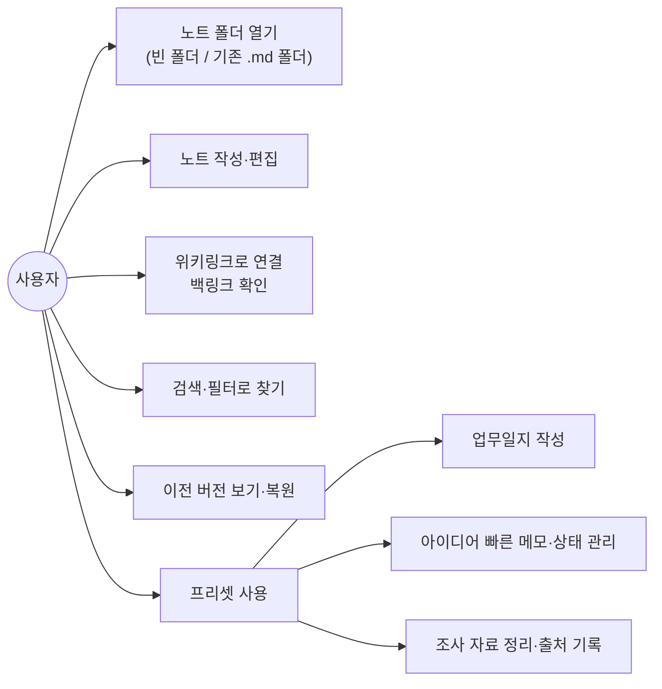

# Notevine 요구사항 정의서

- 문서 버전: v0.5.0 기준 (처음 작성 2026-10-28, 갱신 2026-11-24)
- 기준 문서: `docs/개발계획서.md`
- 대상 릴리스: v0.1 MVP (1주)로 시작했다. 우선순위 C 항목도 상당수 먼저 구현했고, 수용 기준 칸에 '구현(날짜)'로 표시한다.

## 1. 개요

### 1.1 목적

이 문서는 Notevine v0.1 MVP가 갖춰야 할 기능·비기능 요구사항을 ID 단위로 정의한다. 개발(AI 도구 포함)과 검증은 이 문서의 요구사항 ID와 수용 기준을 기준으로 한다.

### 1.2 제품 정의

Notevine은 로컬 폴더의 마크다운(.md) 파일을 그대로 저장소로 쓰는 **범용 개인 지식관리 앱**이다. 코어는 특정 용도에 묶이지 않는 일반 기능(노트, 링크, 속성, 템플릿, 검색, 히스토리)으로 만들고, 업무 기록·아이디어 관리·조사 자료 정리는 **기록 관리 프리셋**(설정 묶음)으로 제공한다.

### 1.3 범위

| 구분 | 포함 | 제외 (이후 버전) |
| --- | --- | --- |
| 플랫폼 | Windows 데스크톱 | macOS·Linux 데스크톱, 모바일(iOS·Android), 웹 |
| 데이터 | 로컬 노트 폴더(.md 파일), 로컬 인덱스·히스토리, 드라이브 앱이 동기화하는 폴더(FR-VLT-09) | 앱이 직접 하는 클라우드 동기화·드라이브 로그인, 공동 편집 |
| 기능 | 편집, 링크·백링크, 속성·템플릿, 검색·필터, 히스토리, 기록 관리 프리셋, 첨부, AI 도우미. 먼저 구현: 플러그인 API, 그래프 뷰, 탭·분할 창, 앱 안 웹 클리핑, 캔버스, 여러 노트 폴더 막대, 외부 AI 도구 연결(MCP), 할 일 모아 보기, Git 백업 암호화 | 플러그인 마켓, 웹 클리핑 브라우저 확장 |
| 배포 | GitHub Releases(공개 저장소, 2026-11-07 전환), 서명 없는 설치 파일, 앱 업데이트(FR-UI-07) | 코드 서명, 패키지 저장소 |

### 1.4 용어

| 용어 | 정의 |
| --- | --- |
| 노트 폴더 | Notevine이 여는 최상위 폴더. 그 안의 .md 파일이 노트다 (처음 이름은 '볼트', 2026-10-30 변경) |
| 노트 | 노트 폴더 안의 .md 파일 하나 |
| 위키링크 | `[[노트 이름]]` 형식의 노트 간 링크 |
| 백링크 | 현재 노트를 가리키는 다른 노트의 링크 |
| 속성 | 노트 맨 앞 frontmatter(YAML)에 적는 key–value 값 |
| 템플릿 | 새 노트를 만들 때 복사되는 노트 틀 |
| 프리셋 | 폴더 구조·템플릿·속성 기본값을 묶은 설정. 켜고 끌 수 있다 |
| 스냅샷 | 특정 시점의 노트 내용을 history.db에 저장한 버전 |
| Inbox | 빠른 메모가 저장되는 기본 폴더 |

### 1.5 우선순위 표기

| 표기 | 의미 |
| --- | --- |
| **M** (Must) | v0.1에 반드시 포함. 빠지면 출시하지 않는다 |
| **S** (Should) | v0.1에 포함 목표. 3일 차 점검에서 일정이 하루 이상 밀리면 v0.2로 넘긴다 |
| **C** (Could) | v0.2 이후로 계획한 항목. 먼저 구현한 항목은 수용 기준 칸에 '구현(날짜)'로 표시한다 |

## 2. 사용자와 사용 시나리오

**대상 사용자:** 개인 사용자. 업무 기록, 아이디어, 조사 자료를 한곳에서 관리하고 싶은 사람, 그리고 Obsidian처럼 자유로운 마크다운 지식관리를 원하는 사람.



| ID | 시나리오 | 관련 요구사항 |
| --- | --- | --- |
| SC-01 | 기존에 쓰던 .md 폴더(예: Obsidian 볼트)를 열어 그대로 편집·검색한다 | FR-VLT-01~05, FR-EDT, FR-SRC |
| SC-02 | 아침에 오늘 업무일지를 열어 한 일과 회의 내용을 적고, 관련 자료 노트를 링크한다 | FR-PRS-01~03, FR-LNK-01~03 |
| SC-03 | 일하다 떠오른 아이디어를 단축키로 Inbox에 적고, 나중에 상태를 '검토'로 바꿔 정리한다 | FR-PRS-04~06, FR-PRP-01~03 |
| SC-04 | 조사한 웹 자료를 요약하고 출처 URL과 PDF를 함께 남긴다 | FR-PRS-07~08, FR-ATT-01~02 |
| SC-05 | 실수로 지운 문단을 히스토리에서 찾아 이전 버전으로 복원한다 | FR-HIS-01~05 |
| SC-06 | "상태가 검토인 아이디어" 또는 "지난주 업무일지"를 필터로 찾는다 | FR-SRC-03~04 |

## 3. 기능 요구사항

### 3.1 노트 폴더·파일 관리 (VLT)

| ID | 요구사항 | 우선순위 | 수용 기준 |
| --- | --- | --- | --- |
| FR-VLT-01 | 사용자는 로컬 폴더를 노트 폴더로 열 수 있어야 한다 | M | 폴더 선택 후 3초 안에 파일 트리가 표시된다(1만 노트 기준) |
| FR-VLT-02 | 마지막으로 연 노트 폴더를 앱 시작 시 자동으로 다시 연다 | M | 앱 재시작 후 같은 노트 폴더와 마지막 노트가 열린다. 최근 폴더 목록은 폴더를 확인하지 않고 바로 보이고, 고를 때(앱 시작 때는 맨 위 폴더) 그 폴더만 확인한다(2026-11-07) |
| FR-VLT-03 | 파일 트리에서 노트·폴더를 생성·이름 변경·삭제·이동할 수 있어야 한다 | M | 모든 조작이 디스크에 즉시 반영되고 외부 탐색기에서 확인된다 |
| FR-VLT-04 | 앱 밖에서 일어난 파일 추가·수정·삭제를 감지해 반영해야 한다 | M | 외부 편집기에서 저장한 내용이 1초 안에 앱에 반영된다 |
| FR-VLT-05 | 앱 전용 데이터는 노트 폴더 안 `.app/` 폴더에만 저장한다 | M | 노트 폴더에서 `.app/`을 지워도 노트는 손상되지 않고, 다시 열면 인덱스가 재생성된다 |
| FR-VLT-06 | 삭제한 노트는 바로 지우지 않고 휴지통으로 옮긴다 | C | 구현: 삭제는 OS 휴지통으로 옮기고, 지운 노트는 히스토리(삭제된 노트)에서 되살린다 |
| FR-VLT-07 | 여러 노트 폴더를 등록하고 전환할 수 있다 | C | 구현(2026-11-09): 창 왼쪽 끝 노트 폴더 막대(폴더마다 첫 글자 단추, 클릭·Ctrl+1~9로 바꾸기, ＋·"노트 폴더 더 열기…"로 추가, 오른쪽 클릭으로 순서 바꾸기·막대에서 닫기). 백엔드는 한 번에 한 폴더만 열고, 바꿀 때 새 폴더를 먼저 연 뒤 바꿔 끼워 열기에 실패해도 보던 폴더가 남는다. 바꿨다 돌아오면 노트 탭·마지막 노트·스크롤·펼친 폴더·나란히 보기·AI 대화가 그대로(앱이 켜져 있는 동안, 같은 경로의 노트도 폴더별로 따로). 막대에서 닫아도 폴더·노트·최근 목록은 그대로이고 확인 창은 없다. 보던 폴더를 닫으면 아래(없으면 위) 폴더로, 마지막이면 시작 화면. 앱 시작 때 막대에서 마지막으로 보던 폴더를 연다. 목록은 PC별 `vault-rail.json`. 설계: `docs/superpowers/specs/2026-11-09-folder-rail-design.md` (2026-11-12) 시작 화면의 최근 폴더 목록에서 지운 폴더는 막대에서도 빠진다. (2026-11-13) 큰 노트 폴더의 전환 속도 개선: 이미 열어 본 폴더는 저장해 둔 트리를 먼저 보이고 뒤에서 다시 읽으며(늦게 온 이전 폴더의 트리는 버림), 트리 읽기·검색은 창 스레드 밖에서 하고, 바꿀 때 필요한 것을 한꺼번에 읽어 화면을 한 번에 바꾼다(NFR-PRF-06). (2026-11-24) 바꿨다 돌아와도 유지되는 것에 폴더 보기 탭(FR-UI-08)이 더해졌다 |
| FR-VLT-08 | 노트 폴더 백업·여러 PC 동기화 | C | 2026-11-04 보안 수정: 이미 있던 `.git`은 사용자가 이 PC에서 허용하기 전에는 Git을 실행하지 않고, 저장소 설정의 fsmonitor·훅은 항상 끈다. 자동 백업 간격은 기기별 저장. 구현(2026-11-03): 설치된 Git으로 노트 폴더를 저장소로 만들고 [지금 백업](명령 팔레트·설정 > 백업)·자동 백업(15분~3시간, 바뀐 것이 있을 때만). 원격 저장소를 넣으면 다른 PC의 백업을 받아 합친 뒤 보낸다. 같은 줄을 양쪽에서 고쳐 합칠 수 없으면 합치기를 되돌리고 그 노트 이름을 알려 준다(이 PC의 노트는 그대로). 검색 인덱스·히스토리 DB는 `.gitignore`로 뺀다. 줄 끝(LF)을 바꾸지 않도록 저장소의 core.autocrlf를 끈다 (2026-11-13 변경) 자동 백업 간격을 마지막 백업 커밋 시각부터 잰다: 5분마다 확인해 바뀐 것(또는 보낼 백업)이 있고 마지막 백업에서 설정한 간격이 지났을 때만 백업하므로, 노트 폴더를 바꾸거나 앱을 다시 켜도 처음부터 다시 세지 않는다. 실패한 백업은 간격이 지난 뒤 다시 시도한다. 상단바 백업 단추는 FR-VLT-12 |
| FR-VLT-09 | Google Drive·OneDrive 앱이 동기화하는 폴더를 노트 폴더로 사용 | C | 구현(2026-11-06): 앱이 설치되고 로그인된 PC가 전제이며 드라이브에 직접 접속하지 않는다. 시작 화면에 드라이브 버튼. 드라이브 폴더의 `history.db`·`index.db`·`workspace.json`은 이 PC(`%LOCALAPPDATA%\net.notevine.app\vaults\<경로 해시>`)에 두고, 기존 히스토리는 처음 열 때 옮기며 `.app/history-moved.db`로 남겨 다른 PC가 이어받는다. 히스토리는 PC별. 온라인 전용 파일은 색인 때 내려받지 않고 이름만 올린다(Google Drive 스트리밍은 구별 불가). 파일이 잠겨 있으면 저장·이동을 약 3초까지 다시 시도(모든 노트 폴더 공통). 드라이브 앱이 만든 충돌본을 찾아 알림 |
| FR-VLT-10 | 탐색기의 연결 프로그램에서 `.md` 파일을 Notevine으로 연다 | C | 구현(2026-11-07): 설치 프로그램이 `.md`의 OpenWithProgids에만 등록해 기본 앱은 바꾸지 않는다. 파일을 넘겨받으면 가장 가까운 상위 노트 폴더(`.app`이 있는 폴더, 숨김 폴더 안의 파일 제외)에서 열고, 없으면 파일의 폴더를 노트 폴더로 열지 물어본다. 묻기 전에는 `.app`을 만들지 않는다. 실행 중이면 그 창에서 연다. 노트 폴더 막대(FR-VLT-07)에 없는 폴더는 막대에 저장하지 않는 잠깐 연 폴더로 열고, 막대의 다른 폴더로 가면 사라진다(오른쪽 클릭 "막대에 추가"로 남김) (2026-11-09) |
| FR-VLT-11 | Git 백업의 원격 저장소에 노트 내용을 암호화해 올린다 | C | 구현(2026-11-11): 노트 폴더마다 설정 > 백업에서 켠다(신뢰한 `.git`이 있고 이 PC에 열쇠가 있을 때만 단추가 나온다). 켠 뒤 새 빈 원격 주소를 넣는다. 켤 때 옛 `.git`은 `.git-before-encryption-날짜-시각`으로 옮기고(Git 제외) 새 저장소로 시작하며, 새 빈 원격 주소와 옛 원격 삭제는 사용자가 한다. `.gitattributes`·`.gitignore`·`.notevine-crypt`를 뺀 모든 파일의 내용을 AES-256-SIV로 암호화하고(`.app`의 DB·`workspace.json`은 원래 올리지 않음) 파일·폴더 이름, 크기, 시각, 커밋 메시지는 원격에서 보인다. 열쇠는 PC 사용자당 하나(모든 노트 폴더 공용)로 Windows 자격 증명 관리자에만 두고, 열쇠 만들기(복구 코드는 한 번 보여 주고 "보관했습니다" 체크 후 닫음)·복구 코드 입력·복구 코드 보기를 설정에 둔다. 안전 멈춤(백업은 아무것도 바꾸지 않고 거부): 열쇠가 없거나 다름, 원격이 이 암호화 저장소가 아님(평문 이력·다른 열쇠·다른 브랜치만 있음), 하위 `.gitattributes` 등이 암호화를 끔(파일 이름 안내), 이 PC의 열쇠와 맞는 암호화 폴더에서 다시 켜려 함(켜기 단추는 암호화 뒤 숨김). 시작 화면·명령 팔레트의 "Git 저장소에서 받기"(주소·받을 위치·폴더 이름, 암호화 저장소는 열쇠 필요, 기본 브랜치를 못 찾으면 거부, 실패 시 받다 만 폴더 삭제). 두 PC가 한 노트의 다른 줄을 고치면 자동 병합, 같은 줄·바이너리는 멈춤. 형식 명세: `docs/암호화-형식.md`, 검토: `docs/Git-암호화-검토.md` 변경(2026-11-12, v0.4.0): 켤 때 옛 `.git`에 커밋이 없으면 이미 넣은 origin 주소를 새 저장소로 옮겨 원격이 사라지지 않게 한다. 암호화 폴더가 원격 없이 백업되면 "원격 저장소 주소가 없어 이 PC에만 저장됩니다"로 알린다. 새 빈 암호화 폴더의 첫 백업은 같은 열쇠로 암호화된 원격 기록이 있으면 그 기록에서 시작해 원격 노트를 먼저 받아 온다. 옮겨 둔 `.git-before-encryption-*` 폴더는 바뀐 파일 개수에서 뺀다. 설정 > 백업에서 암호화 줄을 원격 저장소 줄 앞에 둔다. 2026-11-11 검토 반영: 평문 폴더가 암호화 원격에 평문을 보내지 않도록, 보내기 전에 암호문인지 확인하고 대체 객체·중첩 저장소·태그·좁은 fetch 경로로 평문이 새지 않게 막았다 |
| FR-VLT-12 | 상단바(빠른 메모 옆)에 백업 단추를 두어 설정을 열지 않고 백업한다 (2026-11-12 추가) | C | 구현(2026-11-12): 허용된 Git 저장소(이 PC에서 허용한 `.git`)의 노트 폴더에서만 보인다. 바뀐 노트 또는 보낼 백업이 있으면 "바뀜" 점, 확인이 필요하거나("problem") 암호화 폴더에 원격이 없으면 경고 점을 달고, 마우스를 올리면 바뀐 노트 수·보낼 백업 수·마지막 백업 시각을 보인다. 상태 조회에 실패하면 단추를 숨기지 않고 오류를 보인다. 백업이 끝나거나 설정에서 허용·원격·열쇠가 바뀌면 상태를 바로 다시 읽는다 |
| FR-VLT-13 | 파일 트리 키보드·열기 규칙: 줄을 누르면 선택되고 키보드는 파일 트리에 남는다. Delete는 확인 후 선택한 노트·폴더를 휴지통으로 옮기고, Enter는 노트를 열어 본문으로 커서를 보낸다(폴더는 펼침·접힘, 그 밖의 파일은 연결된 프로그램). 노트가 아닌 파일은 더블클릭해야 열린다 (2026-11-10~11 추가) | C | 구현: 이름 변경·새 폴더 입력칸에서 친 키는 그 입력칸의 것이며 Delete·Enter로 처리하지 않는다. 노트(.md)는 한 번 눌러 열고, 엑셀·한글·워드·PDF 같은 다른 파일은 더블클릭(PDF·캔버스는 앱 안, 나머지는 Windows 연결 프로그램)으로 열어 한 번 클릭으로 외부 프로그램이 켜지지 않게 한다(2026-11-10). Delete의 확인 창은 오른쪽 클릭 메뉴의 삭제와 같다(2026-11-11) |
| FR-VLT-14 | 폴더 이름에 색을 붙이면 그 안의 노트·하위 폴더도 같은 색으로 보인다. 색은 13가지다 (2026-11-10 변경: 기존 8가지에 노랑·연두·청록·하늘·남색 추가) | C | 구현(2026-11-10): 빨강·주황·노랑·갈색·연두·초록·청록·하늘·파랑·남색·보라·분홍·회색. 기존 8가지 색의 값은 그대로라 전에 칠한 폴더 색은 바뀌지 않는다. 오른쪽 클릭 메뉴의 "폴더 색"에서 고른다 |

### 3.2 편집기 (EDT)

| ID | 요구사항 | 우선순위 | 수용 기준 |
| --- | --- | --- | --- |
| FR-EDT-01 | CommonMark·GFM 문법의 마크다운을 편집할 수 있어야 한다 | M | 헤딩·목록·체크박스·표·코드 블록·인용이 올바르게 저장·표시된다 |
| FR-EDT-02 | 편집 중 라이브 미리보기(헤딩·강조·링크·코드 블록 스타일)를 제공한다 | M | 마크다운 기호가 편집 위치가 아닐 때 서식으로 표시된다 |
| FR-EDT-03 | 변경 내용을 자동 저장한다 | M | 입력을 멈추고 1초 안에 디스크에 저장된다 |
| FR-EDT-04 | 저장은 원자적 쓰기(임시 파일 → 교체)로 한다 | M | 저장 중 강제 종료해도 파일이 깨지거나 비지 않는다 |
| FR-EDT-05 | 한글 IME 조합 중 입력 끊김·중복 입력이 없어야 한다 | M | 한글 1,000자 연속 입력 테스트에서 누락·중복 0건 |
| FR-EDT-06 | 코드 블록 문법 강조를 제공한다 | M | 주요 언어(JS, TS, Python, Rust, SQL)가 강조된다 |
| FR-EDT-07 | 탭·분할 창으로 여러 노트를 동시에 연다 | C | 구현: 탭, 오른쪽 분할 창 |
| FR-EDT-08 | 수식(KaTeX)·Mermaid 다이어그램을 렌더링한다 | C | 구현: `$…$`·`$$…$$` 수식, ```mermaid 다이어그램(읽기 모드) |
| FR-EDT-09 | 편집기 위 서식 막대에서 자주 쓰는 마크다운(제목 1~3, 굵게, 기울임, 취소선, 형광펜, 인라인 코드, 글자 색·배경색(각 8색 + 해제), 글머리·번호·체크 목록, 인용, 강조 상자 7종(중요·주의·참고·팁·결정·질문·아이디어), 노트 링크, 웹 링크, 표, 시트, 코드 블록, 구분선)을 아이콘 한 번으로 넣고 뺀다 | S | 선택한 글(없으면 커서 위치 단어·줄)에 적용되고 다시 누르면 해제된다. Ctrl+Z 한 번으로 되돌아간다. 주요 서식은 단축키(Ctrl+B·I·K·L, Ctrl+Shift+X·H, Ctrl+`)로도 된다. 색은 `<span style="color: …">` HTML로 저장해 다른 마크다운 앱에서도 보이고, 편집기에서도 태그 대신 색으로 표시된다 |
| FR-EDT-10 | 읽기 모드(Ctrl+E)에서 서식이 모두 적용된 노트를 본다 | S | 표·형광펜·태그·체크박스·이미지까지 렌더링되고 속성(frontmatter)은 숨긴다. 링크를 누르면 이동하고 체크박스를 누르면 원문이 바뀐다. 웹 이미지·외부 자원은 불러오지 않는다(NFR-SEC-02) 변경(2026-11-10~11): 문장부호로 끝나고 조사가 붙은 굵게·기울임(예: `**전이 학습(transfer learning)**의`)과 안쪽에 공백이 낀 취소선(`~~ 글~~`)도 서식이 보이게 고쳤다 |
| FR-EDT-11 | 읽기 모드와 편집 모드를 키보드·마우스로 오간다 (2026-11-16 추가) | S | 구현(0.4.3, 2026-11-16): 읽기 모드에서 본문을 더블클릭하거나 Insert 키를 누르면 편집 모드로 바뀐다. 링크·체크박스·그림을 더블클릭할 때는 바뀌지 않는다. 구현(0.4.4, 2026-11-16): 편집 모드에서 Esc를 누르면 읽기 모드로 돌아간다. 자동 완성 목록 등 팝업이 열려 있을 때의 Esc는 그 창을 먼저 닫고, 한글 조합(IME) 중의 Esc는 IME가 가진다. Ctrl+E는 기존대로 |
| FR-EDT-12 | ```sheet 블록을 편집기에서는 고칠 수 있는 격자로, 읽기 모드에서는 합계 행이 붙은 표로 보여 주고 수식(`=B2*C2`)을 계산한다 (2026-11-25 추가) | C | 서식 막대 '시트' 단추로 넣는다. 첫 열은 이름 열, 둘째 열부터 숫자 열마다 합계(오류 칸이 있으면 `#오류`). 수식은 + - * / × ÷ 괄호·칸 참조(제목 행이 1행)만 지원하고 `#오류`·`#나누기0`·`#참조`·`#순환`·`#글자`를 표시한다. 합계 행은 저장하지 않아 다른 마크다운 앱에서는 보이지 않는다. 보기만 해서는 노트가 바뀌지 않는다 |

### 3.3 링크 (LNK)

| ID | 요구사항 | 우선순위 | 수용 기준 |
| --- | --- | --- | --- |
| FR-LNK-01 | `[[` 입력 시 노트 이름 자동완성을 제공한다 | M | 한글 일부 입력으로도 후보가 나오고, 선택하면 링크가 완성된다 |
| FR-LNK-02 | 위키링크를 클릭하면 대상 노트로 이동한다. 대상이 없으면 새 노트를 만든다 | M | 없는 링크 클릭 시 같은 이름의 노트가 생성되어 열린다 변경(2026-11-24, v0.5.0 이후): 노트 링크(위키링크·마크다운 링크)를 따라가면 항상 새 탭으로 연다(이미 열려 있으면 그 탭으로 이동). 읽기 모드는 그냥 클릭, 편집 모드는 설정의 링크 누르는 방식(기본 Ctrl+클릭, 설정에서 클릭으로 바꿀 수 있음)을 따른다. 전에는 읽기 모드의 그냥 클릭이 현재 탭에서 열리고 Ctrl+클릭·가운데 클릭만 새 탭이었다 |
| FR-LNK-03 | 현재 노트의 백링크 목록을 패널로 보여 준다 | M | 링크를 추가·삭제하면 1초 안에 상대 노트의 백링크 패널이 갱신된다 |
| FR-LNK-04 | 표준 마크다운 링크 `[텍스트](경로.md)`도 링크로 인식한다 | M | 두 형식 모두 백링크에 나타난다 |
| FR-LNK-05 | 노트 이름 변경·이동 시 이 노트를 가리키는 모든 링크를 자동으로 고친다 | S | 실행 전 바뀔 노트 목록을 보여 주고, 확인 후 모든 참조가 새 이름으로 바뀐다 |
| FR-LNK-06 | 링크 해석 규칙: 파일명 일치, 동명이면 폴더 깊이가 얕은 노트(같으면 경로가 짧은 노트), 대소문자 무시, 한글은 NFC 정규화 | M | macOS(NFD)에서 만들어 클라우드 드라이브로 옮겨 온 한글 파일명도 같은 링크로 연결된다 |
| FR-LNK-07 | 헤딩·블록 링크, 노트 임베드 | C | 구현(2026-11-02): `[[노트#제목]]`·`[[노트#^id]]` 이동·임베드, `[[노트#`에서 제목, `[[노트#^`에서 문단을 골라 쓰면 그 줄 끝에 ` ^id`가 붙는다 |

### 3.4 속성·템플릿 (PRP)

| ID | 요구사항 | 우선순위 | 수용 기준 |
| --- | --- | --- | --- |
| FR-PRP-01 | 노트 frontmatter(YAML)의 임의 속성을 읽고 인덱싱한다 | M | 속성 이름·값을 미리 정의하지 않아도 모든 속성이 검색·필터 대상이 된다 |
| FR-PRP-02 | 속성 편집 UI로 속성을 추가·수정·삭제할 수 있다 | M | UI에서 바꾼 값이 frontmatter에 반영되고, 직접 YAML을 고쳐도 UI에 반영된다 |
| FR-PRP-03 | 속성 값 유형(텍스트·날짜·목록·URL)을 구분해 표시한다 | S | 날짜는 날짜 선택기, URL은 클릭 가능한 링크로 보인다 |
| FR-PRP-04 | 사용자 템플릿 폴더의 노트를 템플릿으로 써서 새 노트를 만든다 | M | `{{date}}`, `{{time}}`, `{{title}}` 변수가 치환된다 |
| FR-PRP-05 | 속성 기반 표·목록 보기 | C | 구현: 폴더 표 보기(속성 열, 정렬, 줄을 누르면 노트 열기) 변경(2026-11-24): 폴더 보기(표·보드·캘린더·그래프)는 노트 탭 옆 별도 탭으로 열린다(FR-UI-08) |
| FR-PRP-06 | 새 빈 노트는 기본 속성 `type`·`date`·`status`를 가지고 시작한다. 속성 패널에서 `type`·`status`는 목록에서 고른다 (2026-11-11 추가) | C | 구현(2026-11-11): 템플릿 없이 만든 새 노트는 frontmatter에 `type:`(빈 값)·`date:`(오늘, YYYY-MM-DD)·`status:`(빈 값)가 들어간다(템플릿으로 만들 때는 템플릿 내용). 속성 패널의 `type` 목록은 `idea`·`research`·`project`·`journal`·`meeting`·`guide`(아이디어·자료·프로젝트·업무일지·회의록·안내), `status` 목록은 노트 폴더의 상태 값이며, 둘 다 노트 폴더에서 쓰던 다른 값과 직접 입력도 된다 |

### 3.5 검색 (SRC)

| ID | 요구사항 | 우선순위 | 수용 기준 |
| --- | --- | --- | --- |
| FR-SRC-01 | 파일명 빠른 열기(Ctrl/Cmd+O)를 제공한다 | M | 한글 일부·영문 일부로 노트를 찾아 Enter로 연다 |
| FR-SRC-02 | 본문 전문 검색을 제공하며, 한글은 부분 일치로 찾는다 | M | "업무개선"을 "무개"로 검색해도 결과에 나온다 |
| FR-SRC-03 | 태그·날짜(생성·수정일)로 필터링한다 | M | `#태그` 또는 기간 지정으로 결과가 좁혀진다 |
| FR-SRC-04 | 임의 속성 값으로 필터링한다 (예: `status=검토`, `type=idea`) | M | 여러 조건을 AND로 조합할 수 있다 |
| FR-SRC-05 | 검색 결과에서 일치 부분을 강조하고 클릭 시 해당 위치로 이동한다 | S | — |
| FR-SRC-06 | 저장된 검색 | C | 구현(2026-11-02): 검색창 ☆로 이름 붙여 저장(.app/config.json), 칩을 누르면 다시 실행 |
| FR-SRC-07 | 숫자만 있는 `#400`도 태그로 인식한다 (2026-11-17 추가) | C | 구현(0.4.6, 2026-11-17): 전에는 숫자뿐인 `#123`을 태그로 보지 않았다. HTML의 색 값(`<span style="color:#123456">`, `<font color="#400">`, `<mark style='background: #400'>`)은 태그가 아니다. 색인 스키마를 7로 올려 옛 색인을 버리고 파일에서 다시 만든다(DR-02) |

### 3.6 히스토리 (HIS)

| ID | 요구사항 | 우선순위 | 수용 기준 |
| --- | --- | --- | --- |
| FR-HIS-01 | 노트를 저장할 때 스냅샷을 history.db에 남긴다 | M | 내용이 바뀐 저장마다 버전이 쌓인다 |
| FR-HIS-02 | 스냅샷 규칙: 내용 동일 시 생략, 같은 노트를 쉬지 않고 편집하면 5분 단위로 묶음, 1분 이상 쉬었다 다시 고치면 새 버전, 노트를 처음 만들 때·처음 열 때·수동 저장(Ctrl/Cmd+S)·앱 종료 직전은 항상 저장 | M | 30분간 계속 편집 시 스냅샷이 약 6개 생기고, 2분 뒤 다시 고치면 고치기 전 내용이 버전으로 남는다 |
| FR-HIS-03 | 외부 편집기로 바뀐 내용도 스냅샷을 남기고 출처(앱/외부)를 기록한다 | M | 히스토리 목록에 '외부 변경'으로 표시된다 |
| FR-HIS-04 | 노트별 버전 목록을 시간순으로 보고, 선택한 버전 내용을 읽기 전용으로 본다 | M | — |
| FR-HIS-05 | 선택한 버전으로 복원한다. 복원 전 현재 내용을 새 버전으로 먼저 저장한다 | M | 복원 후 다시 복원 전 상태로 되돌릴 수 있다 |
| FR-HIS-06 | 두 버전의 차이(diff)를 줄 단위로 강조해 보여 준다 | S | 추가·삭제 줄이 색으로 구분된다 |
| FR-HIS-07 | 이름 변경·이동 시 이력을 새 경로로 이어 붙이고, 삭제된 노트의 이력도 남긴다 | M | 삭제한 노트를 히스토리에서 찾아 복원할 수 있다 |
| FR-HIS-08 | 히스토리 보관 정책·용량 표시 | C | 구현(2026-11-02): 설정 > 히스토리에 노트·버전 수와 파일 크기 표시. "오래된 버전 줄이기"(N일 지나면 노트마다 하루 1개)·"오래된 버전 지우기"(N일 지나면 삭제, 노트마다 최신 1개는 남김)를 노트 폴더 열 때 적용, [지금 정리]는 지울 개수를 확인받고 파일 크기도 줄인다. 기본은 모두 보관 |

### 3.7 기록 관리 프리셋 (PRS)

| ID | 요구사항 | 우선순위 | 수용 기준 |
| --- | --- | --- | --- |
| FR-PRS-01 | 프리셋을 켜고 끌 수 있다. 끄면 코어 기능만으로 쓴다 | M | 프리셋을 꺼도 기존 노트·폴더는 그대로 남는다 |
| FR-PRS-02 | 프리셋을 켜면 PARA(Tiago Forte: Projects·Areas·Resources·Archives) 방식의 기본 폴더(`00.Inbox`, `10.프로젝트`, `20.영역`, `30.자료`와 그 안의 `아이디어`·`조사자료`, `40.보관`, `90.템플릿`, `첨부`)와 폴더 색, 템플릿 5종(프로젝트·업무일지·회의록·아이디어·자료)을 만든다. 이미 있는 파일은 덮어쓰지 않는다 | M | 기존 노트 폴더에서 켜도 사용자 파일이 바뀌지 않는다 |
| FR-PRS-03 | '오늘 업무일지' 명령으로 `20.영역/업무일지/YYYY/YYYY-MM-DD.md`를 열거나 템플릿으로 만든다 | M | 같은 날 다시 실행하면 새로 만들지 않고 기존 노트를 연다 |
| FR-PRS-04 | 빠른 메모 단축키(앱 내)로 제목 없이 바로 적고 Inbox에 저장한다 | M | 단축키 → 입력 → Enter까지 3초 안에 메모가 저장된다 |
| FR-PRS-05 | 아이디어 노트는 `status` 속성(아이디어·검토·진행·완료·보류)을 기본으로 가진다 | M | 상태 값은 프리셋 설정에서 바꿀 수 있다 |
| FR-PRS-06 | 상태별 아이디어 목록을 보여 준다 | M | 상태를 바꾸면 목록이 즉시 갱신된다 |
| FR-PRS-07 | 자료 노트는 `source`(출처 URL)·`created` 속성을 기본으로 가진다 | M | source URL을 클릭하면 기본 브라우저로 열린다 |
| FR-PRS-08 | 전역 단축키(앱이 닫혀 있어도) 빠른 메모, 주간·월간 회고 묶음, 칸반·캘린더 보기 | C | 보드(칸반 방식)·캘린더 보기 구현(2026-11-02): 보드에서 카드를 옮기면 속성이 바뀌고, 캘린더 날짜 칸에서 그날 업무일지를 연다. 주간·월간 회고 묶음 구현(2026-11-02): 기간의 업무일지·회의록·프로젝트·아이디어·자료를 링크 목록으로 모은 노트(AI 없음). 전역 단축키 구현(2026-11-02): 다른 프로그램을 쓰는 중이나 창을 최소화했을 때 Ctrl+Alt+N으로 창이 앞으로 오고 빠른 메모가 열린다. 트레이 상주 구현(2026-11-02): 설정 > 일반 "닫으면 트레이로"를 켜면 창을 닫아도 작업 표시줄 아이콘(열기·빠른 메모·종료)으로 계속 실행되어 Ctrl+Alt+N이 동작하고, "Windows 시작 시 실행"으로 로그인할 때 트레이에 띄운다. 이미 실행 중이면 다시 실행해도 새로 뜨지 않고 기존 창이 앞으로 온다 |
| FR-PRS-09 | 할 일 모아 보기: 모든 노트의 체크박스(`- [ ]`)를 왼쪽 **할 일** 탭에 모은다 (2026-11-11 추가) | C | `📅 YYYY-MM-DD` 기한으로 기한 지남·오늘·다가오는 일·기한 없음으로 나뉜다. 체크하면 원래 노트의 그 줄이 바뀌고(열린 노트는 편집기로, 그 줄 내용이 달라졌으면 바꾸지 않음), 글자를 누르면 그 줄로 간다. 코드 블록·템플릿 폴더의 체크박스는 빠진다. 색인 `tasks` 표(스키마 6) |

### 3.8 첨부 파일 (ATT)

| ID | 요구사항 | 우선순위 | 수용 기준 |
| --- | --- | --- | --- |
| FR-ATT-01 | 파일을 편집기에 드래그 앤 드롭하면 `첨부/` 폴더로 복사하고 링크를 삽입한다. 형식은 제한하지 않는다(이미지·PDF·엑셀·한글·zip 등). 이미지는 `![[파일]]`, 그 밖의 파일은 `[[파일.확장자]]`로 넣는다 | S | 같은 이름이 있으면 번호를 붙여 덮어쓰지 않는다 |
| FR-ATT-02 | 노트 안의 이미지 링크를 미리보기로 표시한다 | M | png·jpg·gif·webp·svg가 표시된다 |
| FR-ATT-03 | PDF 미리보기·주석, 웹 클리핑 브라우저 확장 | C | 구현(2026-11-02): PDF를 파일 트리·링크로 열면 편집기 자리에서 본다(쪽 이동·확대, 한글 글자 선택). 글을 골라 [주석 달기]를 누르면 PDF 옆 "이름 주석.md"에 `> [!참고] [[문서.pdf#page=3\|p.3]]` 상자와 메모로 쌓이고, PDF 위에 형광펜으로 보인다(PDF 파일은 바꾸지 않음). 웹 클리핑은 브라우저 확장 대신 앱 안 "웹 페이지 클립"으로 구현: 주소를 넣으면 본문만 골라 마크다운 노트로 Inbox에 저장(원문 주소는 속성 source). 본문이 프레임 안에 있는 페이지도 읽고, 본문 그림을 첨부 폴더에 내려받는다(2026-11-06: 인터넷과 그 페이지의 서버만, PNG·JPEG·GIF·WebP·AVIF, 그림당 20MB, 한 번에 50개까지) 변경(2026-11-10): 웹 클립은 열린 노트가 있으면 그 노트의 커서 자리(읽기 모드면 노트 끝)에 `## 페이지 제목`, 원문 링크와 클립한 날짜, 본문 순서로 넣고(노트 속성은 바꾸지 않으며 Ctrl+Z로 되돌림), 열린 노트가 없으면(PDF·캔버스·폴더 보기 중 포함) 지금처럼 새 노트를 Inbox에 만든다. 클립 창에 어디로 들어갈지 미리 보인다. 표는 마크다운 표로 가져오고(합친 칸은 빈칸, 셀 안 줄은 `<br>`), 한 줄·한 칸짜리 꾸밈용 표는 내용만 남긴다. 네이버 블로그는 다른 표를 품은 바깥 꾸밈용 표만 풀고 본문 영역만 가져온다(공지 목록·프로필 제외) |
| FR-ATT-04 | 클립보드의 이미지를 편집기에 붙여넣으면(Ctrl/Cmd+V) `첨부/`에 `이미지 YYYYMMDD-HHmmss.png`로 저장하고 커서 위치에 `![[...]]`를 삽입한다 | M | 화면 캡처 후 붙여넣기 한 번으로 노트에 이미지가 보인다. 텍스트 붙여넣기는 기존대로 동작한다 |
| FR-ATT-05 | 이미지가 아닌 첨부 링크(PDF 포함)를 클릭하면 OS 기본 프로그램으로 연다. 클릭 방식은 노트 링크 설정(클릭/Ctrl+클릭)을 따른다 | M | PDF·xlsx 링크가 기본 프로그램으로 열린다. 파일이 없으면 "첨부 파일을 찾을 수 없음" 토스트를 띄운다 |

### 3.9 화면·사용성 (UI)

| ID | 요구사항 | 우선순위 | 수용 기준 |
| --- | --- | --- | --- |
| FR-UI-01 | 기본 레이아웃: 왼쪽 파일 트리·검색, 가운데 편집기, 오른쪽 백링크·속성·히스토리 패널 | M | 좌우 패널을 접을 수 있다 |
| FR-UI-02 | 라이트·다크 테마, 시스템 설정 따르기 | M | — |
| FR-UI-03 | UI 언어는 한국어 기본, 영어 지원 | S | 설정에서 언어를 바꾸면 재시작 없이 반영된다. 구현(2026-11-03): 설정 > 일반 > 언어에서 한국어/English를 고르면 창을 다시 불러와 모든 화면 글(메뉴·단추·설정·알림·명령 팔레트·도움말 창, 날짜 표기, 자주 나는 오류 메시지)이 바뀐다. 노트 내용·폴더 이름·사용자 매뉴얼·AI 지시문은 그대로. 화면 글은 `tx("한국어")`로 쓰고 `src/i18n/en.json`에 영어를 둔다. 빠진 번역은 단위 테스트가 잡는다 |
| FR-UI-04 | 명령 팔레트(Ctrl/Cmd+P)로 모든 명령을 실행한다 | S | — |
| FR-UI-05 | 그래프 뷰, CSS 테마, 단축키 사용자 설정 | C | 그래프 뷰 구현(2026-11-02): 폴더·전체 노트의 링크 그래프, 노트 400개에서 첫 그림 0.3초 이내. 단축키 사용자 설정 구현(2026-11-02): 설정 > 단축키에서 명령마다 바꾸기·없애기·기본값, 겹치면 이전 명령에서 뺌(`.app/config.json`의 `keybindings`). CSS 테마 구현(2026-11-02): 노트 폴더의 `.app/custom.css`를 켜면 앱 스타일 위에 적용, 창으로 돌아올 때 다시 읽음. 켜기는 확인 후 이 PC에 저장(2026-11-04) |
| FR-UI-06 | 캔버스: 글 상자·노트·그림 카드를 자유롭게 놓고 선으로 잇는 화이트보드 | C | 구현(2026-11-03): `.canvas` 파일(JSON Canvas 형식, 다른 앱과 호환)을 편집기 자리에서 연다. 빈 곳 두 번 눌러 글 상자(마크다운), [＋ 노트]·파일 트리에서 끌어 놓기로 노트·그림 카드, [＋ 묶음]으로 고른 카드 감싸기. 카드 옮기기·크기 바꾸기, 가장자리 점을 끌어 다른 카드와 화살표로 잇기, 색 6가지, Delete 지우기, Ctrl+Z/Y, 휠 이동·Ctrl+휠 확대. 노트 카드는 내용 미리보기, 두 번 누르면 오른쪽에 연다. 고친 뒤 0.4초 뒤 자동 저장(파일을 원자적으로 쓰고 JSON이 아니면 거부). 노트 이름을 바꾸거나 옮기면(링크 자동 갱신이 켜져 있을 때) 캔버스의 노트 카드도 새 경로로 바뀐다(2026-11-03) |
| FR-UI-07 | 앱 업데이트 | C | 구현(2026-11-04): 설정 > 정보의 [지금 확인]과 '시작할 때 확인'(기본 꺼짐). 서명을 확인한 파일만 설치하고 다시 시작한다. 설치된 앱의 실제 업데이트는 아직 확인하지 못했다 |
| FR-UI-08 | 폴더 보기(표·보드·캘린더·그래프)를 노트 탭 옆 별도 탭으로 연다 (2026-11-24 추가) | C | 구현(v0.5.0, 2026-11-24): 파일 트리 폴더 메뉴의 "보기"나 명령 팔레트로 폴더 보기를 열면 "표 · 폴더이름"처럼 이름 붙은 탭이 노트 탭 오른쪽에 생긴다(같은 폴더·같은 보기는 하나만). 보기 창 위의 표·보드·캘린더·그래프 전환은 그 탭의 모드를 바꾼다. 탭의 ×·가운데 클릭·Esc로 닫는다. 노트 탭을 누르면 노트로 돌아온다. 폴더가 지워지거나 옮겨지면 그 폴더의 보기 탭은 닫힌다. 노트 폴더를 바꿨다 돌아와도 보기 탭이 남는다(앱이 켜져 있는 동안). 앱을 껐다 켜면 복원되지 않는다(`workspace.json`에 보기 탭을 저장하지 않음, 코드로 확인). 같은 날 시도한 "Ctrl을 누른 채 탐색기의 .md 파일을 편집기에 놓으면 그 노트의 `[[링크]]`를 넣는다"는 동작은 넣었다가 같은 날 뺐다(요구사항으로 확정하지 않음) |

### 3.10 확장 구조 (EXT)

| ID | 요구사항 | 우선순위 | 수용 기준 |
| --- | --- | --- | --- |
| FR-EXT-01 | 모든 명령과 이벤트(노트 열기·저장·이름 변경 등)를 내부 레지스트리에 등록하는 구조로 만든다 | M | 새 명령을 레지스트리에 추가하는 것만으로 명령 팔레트·단축키에 노출된다 |
| FR-EXT-02 | 플러그인 API(권한 선언, 명령·패널·이벤트 등록) | C | 구현(2026-11-03): 노트 폴더 `.app/plugins/<id>/`의 `manifest.json`(id·이름·버전·설명·권한)과 `main.js`. 설정 > 플러그인에서 켤 때 권한(read 노트 읽기·write 노트 쓰기·network 인터넷 접속)을 보여 주고 허락받는다. 허락은 노트 폴더가 아니라 이 PC에 그 코드의 해시와 함께 저장하며(2026-11-04), manifest나 main.js가 바뀌면 꺼진 것으로 보고 다시 허락받는다. 플러그인마다 보이지 않는 샌드박스 프레임(앱·부모 화면 접근 불가, CSP로 직접 네트워크 차단, 다른 페이지로 이동 차단)에서 실행하고, `notevine.commands.add`(명령 팔레트·단축키)·`notevine.panel`(오른쪽 패널, 정리된 HTML과 data-action 단추)·`notevine.on("note-open"/"note-save")`·`notevine.notes`·`notevine.editor`·`notevine.net.fetch`를 부를 때마다 앱이 권한을 확인한다. network 권한이 있는 플러그인에는 #비공개 노트의 내용·선택 글·이름을 보여 주지 않는다(2026-11-04 보강). notes.read는 노트만 읽는다. 예시 플러그인(글자 수 세기) 제공 |

### 3.11 AI 도우미 (AI) — 2026-10-28 추가

PC에 설치·로그인된 공식 AI CLI(Claude Code, OpenAI Codex CLI)를 실행해 사용자의 구독(Claude Pro/Max, ChatGPT)으로 질의한다. 앱은 CLI의 로그인 정보를 읽지 않는다.

| ID | 요구사항 | 우선순위 | 수용 기준 |
| --- | --- | --- | --- |
| FR-AI-01 | 설치·로그인된 Claude Code·Codex CLI를 자동으로 찾아 연결한다. 로그인되어 있지 않으면 앱에서 [로그인] 버튼으로 각 CLI의 공식 로그인(`claude auth login` / `codex login`)을 새 창에서 열고, 끝나면 다시 확인해 연결한다. 로그인 정보(토큰·쿠키)는 읽거나 복사하지 않는다 | M | 설정과 AI 패널에 감지 결과(설치 여부·버전·로그인 상태)가 보인다. 로그아웃 상태면 [로그인] 버튼이, 미설치면 공식 설치 명령이 보인다. 로그인 창을 닫으면 자동으로 다시 확인한다 |
| FR-AI-02 | AI 패널에서 노트에 대해 질문하면 관련 노트를 찾아 근거로 답하고, 답에 출처 노트를 `[[링크]]`로 단다 | M | "지난주 회의에서 결정한 것"처럼 물으면 관련 노트를 인용해 답한다 |
| FR-AI-03 | 질문에는 사용자가 직접 고른 노트만 보낸다. 2026-11-10 변경: 질문 낱말로 노트를 찾아 확인받던 방식을 없애고, 파일 트리에서 AI 입력창에 끌어다 놓은 노트·폴더(하위 폴더까지)만 보낸다. 끌어다 놓은 것은 입력창 위 칩으로 보이고 ×로 뺀다. `#비공개` 태그(하위 태그·frontmatter tags 포함)가 있는 노트는 어떤 경로로도 보내지 않는다 | M | 질문은 끌어다 놓은 노트, 요청한 템플릿, (열린 노트에 쓰라는 요청일 때) 열린 노트 말고는 노트를 보내지 않는다. 아무것도 끌어다 놓지 않으면 노트 없이 질문만 보낸다. 노트 폴더 이름 목록은 보내지 않는다. 글 고치기·주간 회고는 지금처럼 보낼 노트를 확인받는다. 노트가 아닌 파일은 FR-AI-10. 비공개 노트는 끌어다 놓아도 빠지고(칩에 "비공개 n개 제외"), 질문·작성 돕기·주간 회고 어디서도 전송되지 않는다. 노트 폴더마다 "답변 지침"(설정 → AI, `.app/config.json`의 `ai_instructions`, 최대 4,000자)을 모든 AI 요청에 붙이되 앱의 규칙이 우선한다 |
| FR-AI-04 | 편집기에서 선택한 글을 요약·다듬기·이어 쓰기·번역한다. 결과는 미리 보고 바꾸기/아래에 넣기/취소를 고른다 | M | 적용 전에는 노트가 바뀌지 않고, 적용은 실행 취소(Ctrl+Z)로 되돌릴 수 있다 |
| FR-AI-05 | 이번 주 업무일지를 모아 주간 회고 초안을 새 노트로 만든다 | S | 업무일지 폴더의 이번 주 노트만 보내고, 결과가 새 노트로 열린다 |
| FR-AI-06 | AI 답변을 출처 링크와 함께 새 노트로 저장한다 | M | 저장된 노트에 질문·답변·출처가 남는다 |
| FR-AI-07 | API 키(Anthropic·OpenAI)·로컬 모델(Ollama) 연결 | C | 구현(2026-11-02): 설정 > AI에서 Claude·OpenAI API 키(Windows 자격 증명 관리자에 저장, 화면에는 다시 보이지 않음)와 Ollama 주소(이 PC만)를 넣으면 AI 도우미에서 고를 수 있다. 모델 목록은 각 서비스에서 받아 오고, Claude 기본은 claude-opus-5-5. 보내기 전 확인·#비공개 제외는 CLI와 같다. 웹 검색은 CLI 연결에서만 |
| FR-AI-08 | AI 질문 하나로 관련 내 노트와 웹을 함께 참고해 답한다. 노트로 부족하거나 최신·외부 정보가 필요하면 AI가 웹을 검색·열람하고 출처 링크를 단다. 웹 검색은 전송 확인 창의 '웹에서도 찾아보기'로 끄고 켤 수 있고(기본 켬, 선택 기억), AI에는 웹 검색·페이지 읽기 도구만 허용한다. 답은 [새 노트로 저장]으로 남긴다(웹을 쓴 답은 프리셋 사용 시 조사자료 폴더) | S | 입력 칸은 하나다. 진행 중 검색어·읽은 페이지가 보이고, 답에 웹 출처는 [제목](URL), 노트 근거는 `[[노트]]`로 달리며 눌러서 연다. 웹 검색을 끄면 노트만으로 답한다. `#비공개` 노트는 보내지 않는다 |
| FR-AI-09 | AI가 노트를 새로 만들거나 고치는 안을 내고, 사용자가 확인한 것만 적용한다 | C | 구현(2026-11-03, 2026-11-05 입력 칸 통합): AI 패널의 입력 칸 하나로 질문과 작업을 받는다. 작성을 요청하면 열린 노트 끝에 덧붙이는 안을 제안하고, 열린 노트가 없으면 답으로 쓰며 [새 노트로 저장]·[복사]로 남긴다. 말한 템플릿(템플릿 폴더에서 이름으로 찾음, 없으면 알리고 멈춤)의 형식을 따르고, 템플릿 자체는 고칠 수 없다. 관련 노트를 보내기 전에 확인받고(FR-AI-03과 같음), AI는 새 노트(CREATE)·덧붙이기(APPEND)·고치기(EDIT, 원래 글 찾아 바꾸기) 형식으로 제안만 한다. 웹 검색도 쓸 수 있다(2026-11-05). AI CLI에는 여전히 파일 도구를 주지 않는다. 앱이 노트별로 바뀌는 줄을 보여 주고 체크한 것만 적용하며, 편집기·저장 경로를 거쳐 히스토리에 남는다. 고칠 수 있는 노트는 이번에 보낸 노트와 열린 노트뿐이고, 지우기·이름 바꾸기는 할 수 없다. 노트 폴더 밖 경로·`.app`·이미 있는 이름의 새 노트·원래 글을 찾지 못하거나 여러 곳인 고치기는 "적용할 수 없음"으로 보여 주고 고를 수 없다 |
| FR-AI-10 | 노트가 아닌 파일(PDF·문서·텍스트)도 AI 입력창에 끌어다 놓아 보낸다 (2026-11-10 추가) | C | 구현(2026-11-10, v0.1.8): 파일 트리에서 PDF, 워드(.docx)·엑셀(.xlsx)·파워포인트(.pptx)·한글(.hwpx), 텍스트·CSV·JSON·코드 파일을 입력창에 끌어다 놓으면 📎 칩이 붙고 파일에서 뽑은 글자를 `<참고 노트>`의 file 태그로 보낸다. PDF는 화면의 PDF 엔진(pdfjs, 필요할 때만 불러옴)이, 나머지는 앱(`filetext.rs`, `ai_file_text`)이 뽑는다. 파일당 앞 40,000자까지 보내고, 30MB를 넘는 파일은 읽지 않는다. 폴더를 놓으면 그 안의 이런 파일도 함께 가고 칩에 "노트 n개 · 파일 m개"로 보인다. 글자가 없는 파일(스캔 PDF)은 빼고 "읽지 못한 파일 n개 제외"로 표시한다. 그림 파일·옛 한글(.hwp)은 받지 않는다. Windows 탐색기에서 끌어온 파일은 받지 않는다. 읽기만 하고 파일을 바꾸지 않는다 |
| FR-AI-11 | 모든 AI 요청에 앱이 정한 공통 지침을 붙인다 (2026-11-10 추가) | C | 구현(2026-11-10): 표·강조 상자·형광펜 같은 이 앱의 서식을 최대한 활용해 쓰고, 이미지가 필요하면 Mermaid로 그리거나 실제 웹 이미지 링크(``)로 넣으라는 내용이다. 웹 이미지는 허락 없이 접속하지 않도록 `[그림] 설명` 링크로 보이고 누르면 브라우저에서 열린다. 노트 폴더별 답변 지침(FR-AI-03)이 공통 지침과 다르면 답변 지침을 따른다. 같은 날 고침: 답변 지침 입력 중 Esc·바깥 클릭으로 설정을 닫으면 저장되지 않던 문제 |

### 3.12 외부 AI 도구 연결 (MCP) — 2026-11-10 추가

이 PC의 AI 도구(Claude Code, Claude Desktop, Codex CLI)가 MCP(Model Context Protocol)로 노트 폴더의 노트를 찾고 읽고, 허용하면 쓰게 한다. 앱이 AI를 부르는 3.11과 반대 방향이다. 설계는 `docs/MCP서버-개발계획서.md`.

| ID | 요구사항 | 우선순위 | 수용 기준 |
| --- | --- | --- | --- |
| FR-MCP-01 | `notevine.exe --mcp [--vault <폴더>]`로 실행하면 창 없이 stdio MCP 서버로 동작한다. 네트워크 포트는 열지 않는다 | C | AI 도구가 실행하면 `initialize`·`tools/list`·`tools/call`에 답한다. stdout에는 프로토콜 메시지만 나간다. 앱이 켜져 있어도 기존 창으로 넘어가지 않는다. `--vault`가 없으면 앱에서 마지막으로 연 노트 폴더를 따라간다: 도구를 부를 때마다 확인해 바뀌었으면 그 폴더로 옮기고, 그 답에 바뀐 사실을 적는다. AI 도구 쪽 설정은 다시 하지 않는다 |
| FR-MCP-02 | 읽기 도구: 목록(`list_notes`), 읽기(`read_note`), 검색(`search_notes`), 백링크(`get_backlinks`), 히스토리(`get_note_history`) | C | 경로는 노트 폴더 기준 상대 경로. 한 노트는 40,000자까지, 검색은 기본 20건·최대 100건. 읽기는 해시를 함께 돌려준다 |
| FR-MCP-03 | 노트 폴더마다 연결을 켜야 쓸 수 있다(기본 꺼짐). 권한은 노트 폴더 밖 앱 설정(`vault-trust.json`의 `mcp`)에 두고, 도구를 부를 때마다 다시 읽는다 | C | 꺼진 노트 폴더는 모든 도구가 안내 문구와 함께 거부된다. 앱에서 끄면 서버를 다시 시작하지 않아도 다음 호출부터 거부된다 |
| FR-MCP-04 | 쓰기 도구: 만들기(`create_note`), 덧붙이기(`append_to_note`, 제목 아래 가능), 고치기(`update_note`, `read_note`의 해시 필요). 쓰기는 따로 허용해야 한다. 지우기·이름 바꾸기·옮기기 도구는 없다 | C | 쓰기는 저장 경로(`save_note`)를 거쳐 히스토리에 출처 "AI 도구"(`mcp`)로 남고 되돌릴 수 있다. 해시가 다르면 쓰지 않는다. 같은 이름의 새 노트는 번호를 붙인다 |
| FR-MCP-05 | `#비공개` 노트, 점(.)으로 시작하는 폴더(`.app`·`.git` 등), 사용자가 뺀 폴더는 AI 도구에 보이지 않는다 | C | 목록·검색·읽기·백링크·쓰기 어디서도 나오지 않는다. 인덱스가 늦어도 검색 결과는 파일 내용으로 다시 확인한다. `..`·절대 경로는 거부한다 |
| FR-MCP-06 | 설정 → AI 도구 연결 탭(2026-11-17, v0.4.5 변경: 처음에는 설정 → AI 탭 안): 켜기, 쓰기 허용, 뺄 폴더, AI 도구별 연결 설정 복사, 최근 활동 | C | 연결 설정은 이 PC의 실행 파일·노트 폴더 경로로 채워진다(Claude Code·Claude Desktop·Codex). 최근 활동은 앱 설정 폴더의 `mcp-activity.jsonl`에 200건까지 남고, 도구 이름·대상만 있고 노트 내용은 없다 변경(2026-11-17): 설정에 "AI 도구 연결" 탭을 따로 두고 AI 탭에는 사용할 AI·답변 지침만 남겼다. 이 탭 제목 줄에 "연결 켜짐/꺼짐" 상태를 보인다 |

## 4. 비기능 요구사항

| ID | 분류 | 요구사항 | 우선순위 | 측정 방법 |
| --- | --- | --- | --- | --- |
| NFR-PRF-01 | 성능 | 노트 1만 개짜리 노트 폴더에서 앱 시작 3초 이내(인덱스가 있을 때) | M | 테스트 노트 폴더로 7일 차 측정 |
| NFR-PRF-02 | 성능 | 노트 1만 개짜리 노트 폴더에서 전문 검색 응답 200ms 이내 | M | 검색어 20개 평균 |
| NFR-PRF-03 | 성능 | 1만 노트 최초 인덱싱 60초 이내 | S | — |
| NFR-PRF-04 | 성능 | 1MB 노트 편집 시 입력 지연 50ms 이내 | M | — 알려진 한계(2026-11-14): 줄바꿈 없이 1MB가 한 문단인 노트는 입력 지연이 78~100ms로 기준을 넘는다(마크다운 파서가 문단 하나를 통째로 다시 읽음). 제목·문단이 있는 일반 1MB 노트는 중앙값 약 15ms. 고치지 않았다 |
| NFR-PRF-05 | 자원 | 설치 파일 30MB 이하, 유휴 메모리 500MB 이하(앱과 WebView2 프로세스의 전용 메모리 합계) | S | Windows 11에서 측정. 2026-10-30 기준 변경: 200MB → WebView2 포함 500MB (WebView2만 약 208MB를 써서 200MB는 구조상 불가) 측정(2026-11-13): 유휴 메모리 387MB(WebView2 372MB). `perf.cjs`의 기준은 200MB, 이 문서·README는 500MB로 서로 달라 정리가 필요하다 |
| NFR-PRF-06 | 성능 | 큰 노트 폴더(노드 2만 7천 개)에서 폴더 전환과 1~2글자 검색이 느려지지 않는다 (2026-11-13 추가) | S | 작업기록 5-8: 파일 감시 시작 2.7초 → 1ms(11-13, v0.4.1), 1~2글자 검색 175~295ms → 63~83ms(11-14, v0.4.2, 같은 색인을 Rust 테스트로 잰 값이며 v0.4.2 앱에서 재측정은 하지 않음). 0.4.1 릴리스 exe로 1만 노트를 재측정: 최초 인덱싱 10.5초, 시작 2.37초, 검색 평균 197ms(최대 452ms) |
| NFR-REL-01 | 신뢰성 | 어떤 조작에서도 사용자 노트 내용이 유실되지 않는다 | M | 저장·이름 변경·복원 단위 테스트, 강제 종료 테스트 |
| NFR-REL-02 | 신뢰성 | 클라우드 드라이브 등과 동시 수정 충돌 시 양쪽 내용을 모두 보존한다 | M | 저장 전 mtime·hash 비교, 충돌본은 `이름 (충돌 날짜).md`로 저장 |
| NFR-REL-03 | 신뢰성 | index.db가 손상되거나 없으면 자동 재생성한다 | M | index.db 삭제 후 재실행 테스트 |
| NFR-CMP-01 | 호환성 | 노트는 표준 .md 파일로만 저장하며 독자 포맷을 쓰지 않는다 | M | 다른 편집기(VS Code, Obsidian)로 열어 내용이 같다 |
| NFR-CMP-02 | 호환성 | Windows 10 이상에서 동작 (추정, 확인 필요). macOS·Linux는 v0.2 이후 | M | Windows 11 실행 확인 + CI Windows 빌드 |
| NFR-CMP-03 | 호환성 | 경로 구분자·대소문자·유니코드 정규화(NFC/NFD) 차이를 흡수한다 | M | 경로 처리 단위 테스트를 Windows CI에서 실행. NFD 파일명·대소문자만 다른 파일명은 테스트 데이터로 재현 |
| NFR-SEC-01 | 보안 | 앱은 사용자가 연 노트 폴더 밖의 파일에 쓰지 않는다 | M | Tauri capability로 파일 접근 범위 제한 |
| NFR-SEC-02 | 보안 | 사용자 데이터를 외부 서버로 전송하지 않는다(텔레메트리 없음). 업데이트 확인은 사용자가 누르거나 켰을 때만 GitHub에 접속하며 노트는 보내지 않는다(2026-11-04). 예외는 사용자가 직접 켜고 쓰는 다음 다섯 가지뿐이다 (2026-11-03 갱신, 2026-11-10 ⑤ 추가). ① AI 질의(FR-AI-03·07·10): 사용자가 AI 입력창에 끌어다 놓은 노트·파일과 질문만(2026-11-10부터. 글 고치기·주간 회고는 확인한 노트), 고른 AI CLI(Claude Code·Codex) 또는 API(Anthropic·OpenAI)로 보낸다. Ollama는 이 PC 주소만 쓴다. 설정 > AI에서 API 모델 목록을 받을 때도 해당 서비스에 접속한다(노트는 보내지 않음) ② 웹 페이지 클립(FR-ATT-03): 사용자가 넣은 http/https 주소로 접속해 페이지와 본문 그림을 받기만 하고 노트는 보내지 않는다 ③ 인터넷 접속(network) 권한을 허락한 플러그인(FR-EXT-02): 플러그인이 요청한 주소로 앱이 대신 접속한다. 이런 플러그인에는 #비공개 노트를 보여 주지 않는다 ④ Git 백업에 원격 저장소를 넣은 경우(FR-VLT-08): 백업할 때 노트 폴더(인덱스·히스토리 DB 제외)를 그 저장소로 보내고 받는다. 암호화를 켠 노트 폴더(FR-VLT-11)는 내용을 암호문으로 보내며, 시작 화면의 "Git 저장소에서 받기"도 사용자가 넣은 주소로 접속한다(2026-11-11) ⑤ 외부 AI 도구 연결(FR-MCP-01~06): 노트 폴더마다 켰을 때만, 사용자가 등록한 이 PC의 AI 도구가 읽은 노트를 그 AI 서비스로 보낸다. 앱 자신은 접속하지 않고 포트도 열지 않는다. #비공개 노트와 뺀 폴더는 보이지 않는다 | M | AI·웹 클립·network 권한 플러그인·원격 백업을 쓰지 않으면 네트워크 요청 없음. AI 질의는 끌어다 놓은 것(글 고치기·주간 회고는 확인 창을 거친 것)만 전송. 플러그인 프레임의 직접 접속·페이지 이동·앱 명령 호출이 막히는지 E2E로 확인(tests/e2e/plugins-canvas.cjs) |
| NFR-SEC-03 | 보안 | 받은 노트 폴더의 파일은 이 PC에서 무엇을 실행할지 스스로 정하지 못한다(Git 설정, 플러그인 허락, CSS, 자동 백업). 실행될 수 있는 첨부는 전체 이름을 보여 주고 묻는다. 앱 창은 앱 밖으로 이동하지 않고, CSP로 외부 자원을 막는다 (2026-11-04 추가) | M | 단위 테스트(`backup.rs`, `plugins.rs`, `trust.rs`, `safeHtml`, `openSafety`), 화면 테스트 `tests/e2e/vault-trust.cjs` |
| NFR-USA-01 | 사용성 | 처음 설치한 사용자가 안내 없이 노트 폴더를 열고 첫 노트를 저장할 수 있다 | S | AI 실사용 테스트 3회(개발계획서 6.3): 막힌 지점 0, 조작 10회 이내 |
| NFR-MNT-01 | 유지보수 | 파일 I/O·링크 치환·히스토리 로직은 단위 테스트 커버리지 80% 이상 | M | cargo test 커버리지 |
| NFR-MNT-02 | 유지보수 | MIT 라이선스(권리자 jkin), README·CONTRIBUTING, 오픈소스 고지 제공 | M | 저장소 확인. 라이선스 원문이 없는 패키지가 있으면 빌드가 실패한다(`scripts/gen-notices.mjs --check`) |

## 5. 데이터 요구사항

| ID | 요구사항 | 우선순위 |
| --- | --- | --- |
| DR-01 | 원본 데이터는 노트 폴더의 .md 파일과 첨부 파일뿐이다 | M |
| DR-02 | 검색 색인(SQLite, 파일 이름 `index-v<스키마 버전>.db`, 2026-11-11부터. 버전이 다른 앱·MCP 서버가 같은 파일을 서로 다시 만들다 실패하지 않게 한다)은 notes·links·tags·properties·tasks·notes_fts(FTS5 trigram) 테이블을 가지며, 언제든 재생성 가능한 캐시다. 스키마 버전은 7(2026-11-17, FR-SRC-07로 올림. 파일 이름 `index-v7.db`) | M |
| DR-03 | history.db(SQLite)는 versions 테이블(path, saved_at, hash, size, content_zstd, origin)을 가지며, 재생성이 불가능하므로 백업 대상임을 사용자에게 안내한다 | M |
| DR-04 | 노트 폴더 설정은 `.app/config.json`, 화면 상태는 `.app/workspace.json`에 저장한다 | M |
| DR-05 | 프리셋 정의(폴더·템플릿·속성 기본값)는 설정 파일로 관리하며 코드에 하드코딩하지 않는다 | M |

## 6. 제약사항

| ID | 제약 |
| --- | --- |
| CON-01 | 런타임은 Tauri 2(Rust) + TypeScript/React, 편집기는 CodeMirror 6 |
| CON-02 | 개발 인력 1명 + AI 코딩 도구, 개발 기간 7일 |
| CON-03 | 오픈소스(MIT), GitHub 공개 저장소(2026-11-07 공개 전환), 무료 배포 |
| CON-04 | 지금까지의 버전은 코드 서명 없이 배포한다. SmartScreen 경고 우회 방법을 README에 안내한다 |
| CON-05 | 특정 제품의 UI·코드·상표를 복제하지 않고, 마크다운·위키링크 같은 공개 형식만 호환한다 |

## 7. 요구사항 집계

| 영역 | M | S | C | 합계 |
| --- | --- | --- | --- | --- |
| VLT 노트 폴더·파일 | 5 | 0 | 9 | 14 |
| EDT 편집기 | 6 | 3 | 2 | 11 |
| LNK 링크 | 5 | 1 | 1 | 7 |
| PRP 속성·템플릿 | 3 | 1 | 2 | 6 |
| SRC 검색 | 4 | 1 | 2 | 7 |
| HIS 히스토리 | 6 | 1 | 1 | 8 |
| PRS 프리셋 | 7 | 0 | 2 | 9 |
| ATT 첨부 | 3 | 1 | 1 | 5 |
| UI 화면 | 2 | 2 | 4 | 8 |
| EXT 확장 | 1 | 0 | 1 | 2 |
| AI 도우미 | 5 | 2 | 4 | 11 |
| MCP 외부 AI 도구 연결 | 0 | 0 | 6 | 6 |
| **기능 소계** | **47** | **12** | **35** | **94** |
| NFR 비기능 | 14 | 4 | 0 | 18 |
| DR 데이터 | 5 | 0 | 0 | 5 |
| **전체** | **66** | **16** | **35** | **117** |

## 8. 일정 추적 (개발계획서 5장과 대응)

| 일차 | 구현할 요구사항 |
| --- | --- |
| 1일 | FR-VLT-01~03, FR-VLT-05, FR-UI-01, NFR-MNT-02, CI(NFR-CMP-02) |
| 2일 | FR-EDT-01~06, FR-HIS-01~02, NFR-REL-01 |
| 3일 | FR-VLT-04, FR-PRP-01, FR-HIS-03, FR-HIS-07, DR-02~03, NFR-REL-02~03 |
| 4일 | FR-LNK-01~06 |
| 5일 | FR-SRC-01~05, FR-PRP-02~03 |
| 6일 | FR-PRP-04, FR-PRS-01~07, FR-ATT-01~02, FR-ATT-04~05, FR-HIS-04~06, FR-UI-02~04, FR-EXT-01 |
| 7일 | NFR-PRF-01~05, NFR-CMP-01~03, NFR-SEC-01~02, NFR-USA-01, 배포 |
| 추가 | FR-AI-01~06 (v0.1에 포함하기로 2026-10-28 결정), FR-AI-08·FR-EDT-09~10 (2026-10-29 추가) |

**3일 차 점검 시 v0.2로 넘길 후보 (S 등급):** FR-LNK-05(이름 변경 시 링크 갱신), FR-ATT-01(첨부 드래그 앤 드롭), FR-HIS-06(diff 보기), FR-PRP-03, FR-SRC-05, FR-UI-03~04, NFR-PRF-03, NFR-PRF-05, NFR-USA-01.

## 9. 확인이 필요한 사항

- [ ] 지원 OS 최소 버전(NFR-CMP-02)은 추정값이다. Tauri 2와 WebView2 요구 버전으로 확정 필요 (Windows 10 실행 확인은 하지 않음)
- [ ] 아이디어 상태 단계(FR-PRS-05)를 이대로 쓸지
- [ ] 유휴 메모리 기준(NFR-PRF-05)을 200MB(`perf.cjs`)와 500MB(이 문서) 중 어느 쪽으로 맞출지 (작업기록 5-8 "결정 필요")
- [ ] 폴더 보기 탭(FR-UI-08)을 앱을 다시 켤 때 복원하는지 확인 필요
- [x] 프리셋 기본 폴더 이름(FR-PRS-02): PARA 방식으로 정함 (2026-10-30)
- [x] 빠른 메모 단축키 조합(FR-PRS-04): Ctrl+Shift+N, 앱 밖에서는 Ctrl+Alt+N. Ctrl+Shift+N은 설정 > 단축키에서 바꿀 수 있다
- [x] 히스토리 묶음 규칙(FR-HIS-02): 5분 묶음 + 1분 쉬면 새 버전 (2026-10-28, AI 실사용 테스트 결과로 보완)
