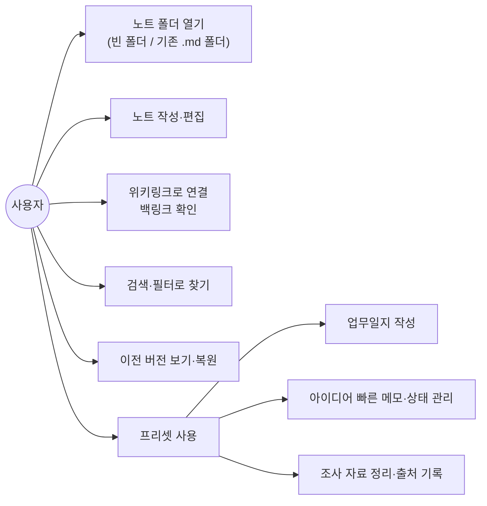

# Notevine 요구사항 정의서

- 문서 버전: v0.1 (2026-10-28)
- 기준 문서: `docs/개발계획서.md`
- 대상 릴리스: v0.1 MVP (1주), v0.2 이후 항목은 참고용으로 함께 적는다.

## 1. 개요

### 1.1 목적

이 문서는 Notevine v0.1 MVP가 갖춰야 할 기능·비기능 요구사항을 ID 단위로 정의한다. 개발(AI 도구 포함)과 검증은 이 문서의 요구사항 ID와 수용 기준을 기준으로 한다.

### 1.2 제품 정의

Notevine은 로컬 폴더의 마크다운(.md) 파일을 그대로 저장소로 쓰는 **범용 개인 지식관리 앱**이다. 코어는 특정 용도에 묶이지 않는 일반 기능(노트, 링크, 속성, 템플릿, 검색, 히스토리)으로 만들고, 업무 기록·아이디어 관리·조사 자료 정리는 **기록 관리 프리셋**(설정 묶음)으로 제공한다.

### 1.3 범위

| 구분 | 포함 | 제외 (v0.2 이후) |
| --- | --- | --- |
| 플랫폼 | Windows 데스크톱 | macOS·Linux 데스크톱, 모바일(iOS·Android), 웹 |
| 데이터 | 로컬 노트 폴더(.md 파일), 로컬 인덱스·히스토리 | 클라우드 동기화, 공동 편집 |
| 기능 | 편집, 링크·백링크, 속성·템플릿, 검색·필터, 히스토리, 기록 관리 프리셋, 첨부 | 플러그인 API, 그래프 뷰, 탭·분할 창, 웹 클리핑, 캔버스 |
| 배포 | GitHub Releases, 서명 없는 설치 파일 | 코드 서명, 자동 업데이트, 패키지 저장소 |

### 1.4 용어

| 용어 | 정의 |
| --- | --- |
| 노트 폴더 | Notevine이 여는 최상위 폴더. 그 안의 .md 파일이 노트다 (처음 이름은 '노트 폴더', 2026-10-30 변경) |
| 노트 | 노트 폴더 안의 .md 파일 하나 |
| 위키링크 | `[[노트 이름]]` 형식의 노트 간 링크 |
| 백링크 | 현재 노트를 가리키는 다른 노트의 링크 |
| 속성 | 노트 맨 앞 frontmatter(YAML)에 적는 key–value 값 |
| 템플릿 | 새 노트를 만들 때 복사되는 노트 틀 |
| 프리셋 | 폴더 구조·템플릿·속성 기본값을 묶은 설정. 켜고 끌 수 있다 |
| 스냅샷 | 특정 시점의 노트 내용을 history.db에 저장한 버전 |
| Inbox | 빠른 메모가 저장되는 기본 폴더 |

### 1.5 우선순위 표기

| 표기 | 의미 |
| --- | --- |
| **M** (Must) | v0.1에 반드시 포함. 빠지면 출시하지 않는다 |
| **S** (Should) | v0.1에 포함 목표. 3일 차 점검에서 일정이 하루 이상 밀리면 v0.2로 넘긴다 |
| **C** (Could) | v0.2 이후. 설계 시 확장 여지만 남긴다 |

## 2. 사용자와 사용 시나리오

**대상 사용자:** 개인 사용자. 업무 기록, 아이디어, 조사 자료를 한곳에서 관리하고 싶은 사람, 그리고 Obsidian처럼 자유로운 마크다운 지식관리를 원하는 사람.

| ID | 시나리오 | 관련 요구사항 |
| --- | --- | --- |
| SC-01 | 기존에 쓰던 .md 폴더(예: Obsidian 볼트)를 열어 그대로 편집·검색한다 | FR-VLT-01~05, FR-EDT, FR-SRC |
| SC-02 | 아침에 오늘 업무일지를 열어 한 일과 회의 내용을 적고, 관련 자료 노트를 링크한다 | FR-PRS-01~03, FR-LNK-01~03 |
| SC-03 | 일하다 떠오른 아이디어를 단축키로 Inbox에 적고, 나중에 상태를 '검토'로 바꿔 정리한다 | FR-PRS-04~06, FR-PRP-01~03 |
| SC-04 | 조사한 웹 자료를 요약하고 출처 URL과 PDF를 함께 남긴다 | FR-PRS-07~08, FR-ATT-01~02 |
| SC-05 | 실수로 지운 문단을 히스토리에서 찾아 이전 버전으로 복원한다 | FR-HIS-01~05 |
| SC-06 | "상태가 검토인 아이디어" 또는 "지난주 업무일지"를 필터로 찾는다 | FR-SRC-03~04 |

## 3. 기능 요구사항

### 3.1 노트 폴더·파일 관리 (VLT)

| ID | 요구사항 | 우선순위 | 수용 기준 |
| --- | --- | --- | --- |
| FR-VLT-01 | 사용자는 로컬 폴더를 노트 폴더로 열 수 있어야 한다 | M | 폴더 선택 후 3초 안에 파일 트리가 표시된다(1만 노트 기준) |
| FR-VLT-02 | 마지막으로 연 노트 폴더를 앱 시작 시 자동으로 다시 연다 | M | 앱 재시작 후 같은 노트 폴더와 마지막 노트가 열린다 |
| FR-VLT-03 | 파일 트리에서 노트·폴더를 생성·이름 변경·삭제·이동할 수 있어야 한다 | M | 모든 조작이 디스크에 즉시 반영되고 외부 탐색기에서 확인된다 |
| FR-VLT-04 | 앱 밖에서 일어난 파일 추가·수정·삭제를 감지해 반영해야 한다 | M | 외부 편집기에서 저장한 내용이 1초 안에 앱에 반영된다 |
| FR-VLT-05 | 앱 전용 데이터는 노트 폴더 안 `.app/` 폴더에만 저장한다 | M | 노트 폴더에서 `.app/`을 지워도 노트는 손상되지 않고, 다시 열면 인덱스가 재생성된다 |
| FR-VLT-06 | 삭제한 노트는 바로 지우지 않고 휴지통으로 옮긴다 | C | — |
| FR-VLT-07 | 여러 노트 폴더를 등록하고 전환할 수 있다 | C | — |

### 3.2 편집기 (EDT)

| ID | 요구사항 | 우선순위 | 수용 기준 |
| --- | --- | --- | --- |
| FR-EDT-01 | CommonMark·GFM 문법의 마크다운을 편집할 수 있어야 한다 | M | 헤딩·목록·체크박스·표·코드 블록·인용이 올바르게 저장·표시된다 |
| FR-EDT-02 | 편집 중 라이브 미리보기(헤딩·강조·링크·코드 블록 스타일)를 제공한다 | M | 마크다운 기호가 편집 위치가 아닐 때 서식으로 표시된다 |
| FR-EDT-03 | 변경 내용을 자동 저장한다 | M | 입력을 멈추고 1초 안에 디스크에 저장된다 |
| FR-EDT-04 | 저장은 원자적 쓰기(임시 파일 → 교체)로 한다 | M | 저장 중 강제 종료해도 파일이 깨지거나 비지 않는다 |
| FR-EDT-05 | 한글 IME 조합 중 입력 끊김·중복 입력이 없어야 한다 | M | 한글 1,000자 연속 입력 테스트에서 누락·중복 0건 |
| FR-EDT-06 | 코드 블록 문법 강조를 제공한다 | M | 주요 언어(JS, TS, Python, Rust, SQL)가 강조된다 |
| FR-EDT-07 | 탭·분할 창으로 여러 노트를 동시에 연다 | C | — |
| FR-EDT-08 | 수식(KaTeX)·Mermaid 다이어그램을 렌더링한다 | C | — |
| FR-EDT-09 | 편집기 위 서식 막대에서 자주 쓰는 마크다운(제목 1~3, 굵게, 기울임, 취소선, 형광펜, 인라인 코드, 글자 색·배경색(각 8색 + 해제), 글머리·번호·체크 목록, 인용, 노트 링크, 웹 링크, 표, 코드 블록, 구분선)을 아이콘 한 번으로 넣고 뺀다 | S | 선택한 글(없으면 커서 위치 단어·줄)에 적용되고 다시 누르면 해제된다. Ctrl+Z 한 번으로 되돌아간다. 주요 서식은 단축키(Ctrl+B·I·K·L, Ctrl+Shift+X·H, Ctrl+`)로도 된다. 색은 `` HTML로 저장해 다른 마크다운 앱에서도 보이고, 편집기에서도 태그 대신 색으로 표시된다 |
| FR-EDT-10 | 읽기 모드(Ctrl+E)에서 서식이 모두 적용된 노트를 본다 | S | 표·형광펜·태그·체크박스·이미지까지 렌더링되고 속성(frontmatter)은 숨긴다. 링크를 누르면 이동하고 체크박스를 누르면 원문이 바뀐다. 웹 이미지·외부 자원은 불러오지 않는다(NFR-SEC-02) |

### 3.3 링크 (LNK)

| ID | 요구사항 | 우선순위 | 수용 기준 |
| --- | --- | --- | --- |
| FR-LNK-01 | `[[` 입력 시 노트 이름 자동완성을 제공한다 | M | 한글 일부 입력으로도 후보가 나오고, 선택하면 링크가 완성된다 |
| FR-LNK-02 | 위키링크를 클릭하면 대상 노트로 이동한다. 대상이 없으면 새 노트를 만든다 | M | 없는 링크 클릭 시 같은 이름의 노트가 생성되어 열린다 |
| FR-LNK-03 | 현재 노트의 백링크 목록을 패널로 보여 준다 | M | 링크를 추가·삭제하면 1초 안에 상대 노트의 백링크 패널이 갱신된다 |
| FR-LNK-04 | 표준 마크다운 링크 `[텍스트](경로.md)`도 링크로 인식한다 | M | 두 형식 모두 백링크에 나타난다 |
| FR-LNK-05 | 노트 이름 변경·이동 시 이 노트를 가리키는 모든 링크를 자동으로 고친다 | S | 실행 전 바뀔 노트 목록을 보여 주고, 확인 후 모든 참조가 새 이름으로 바뀐다 |
| FR-LNK-06 | 링크 해석 규칙: 파일명 일치, 동명이면 폴더 깊이가 얕은 노트(같으면 경로가 짧은 노트), 대소문자 무시, 한글은 NFC 정규화 | M | macOS(NFD)에서 만들어 클라우드 드라이브로 옮겨 온 한글 파일명도 같은 링크로 연결된다 |
| FR-LNK-07 | 헤딩·블록 링크, 노트 임베드 | C | — |

### 3.4 속성·템플릿 (PRP)

| ID | 요구사항 | 우선순위 | 수용 기준 |
| --- | --- | --- | --- |
| FR-PRP-01 | 노트 frontmatter(YAML)의 임의 속성을 읽고 인덱싱한다 | M | 속성 이름·값을 미리 정의하지 않아도 모든 속성이 검색·필터 대상이 된다 |
| FR-PRP-02 | 속성 편집 UI로 속성을 추가·수정·삭제할 수 있다 | M | UI에서 바꾼 값이 frontmatter에 반영되고, 직접 YAML을 고쳐도 UI에 반영된다 |
| FR-PRP-03 | 속성 값 유형(텍스트·날짜·목록·URL)을 구분해 표시한다 | S | 날짜는 날짜 선택기, URL은 클릭 가능한 링크로 보인다 |
| FR-PRP-04 | 사용자 템플릿 폴더의 노트를 템플릿으로 써서 새 노트를 만든다 | M | `{{date}}`, `{{time}}`, `{{title}}` 변수가 치환된다 |
| FR-PRP-05 | 속성 기반 표·목록 보기 | C | — |

### 3.5 검색 (SRC)

| ID | 요구사항 | 우선순위 | 수용 기준 |
| --- | --- | --- | --- |
| FR-SRC-01 | 파일명 빠른 열기(Ctrl/Cmd+O)를 제공한다 | M | 한글 일부·영문 일부로 노트를 찾아 Enter로 연다 |
| FR-SRC-02 | 본문 전문 검색을 제공하며, 한글은 부분 일치로 찾는다 | M | "업무개선"을 "무개"로 검색해도 결과에 나온다 |
| FR-SRC-03 | 태그·날짜(생성·수정일)로 필터링한다 | M | `#태그` 또는 기간 지정으로 결과가 좁혀진다 |
| FR-SRC-04 | 임의 속성 값으로 필터링한다 (예: `status=검토`, `type=idea`) | M | 여러 조건을 AND로 조합할 수 있다 |
| FR-SRC-05 | 검색 결과에서 일치 부분을 강조하고 클릭 시 해당 위치로 이동한다 | S | — |
| FR-SRC-06 | 저장된 검색 | C | — |

### 3.6 히스토리 (HIS)

| ID | 요구사항 | 우선순위 | 수용 기준 |
| --- | --- | --- | --- |
| FR-HIS-01 | 노트를 저장할 때 스냅샷을 history.db에 남긴다 | M | 내용이 바뀐 저장마다 버전이 쌓인다 |
| FR-HIS-02 | 스냅샷 규칙: 내용 동일 시 생략, 같은 노트를 쉬지 않고 편집하면 5분 단위로 묶음, 1분 이상 쉬었다 다시 고치면 새 버전, 노트를 처음 만들 때·처음 열 때·수동 저장(Ctrl/Cmd+S)·앱 종료 직전은 항상 저장 | M | 30분간 계속 편집 시 스냅샷이 약 6개 생기고, 2분 뒤 다시 고치면 고치기 전 내용이 버전으로 남는다 |
| FR-HIS-03 | 외부 편집기로 바뀐 내용도 스냅샷을 남기고 출처(앱/외부)를 기록한다 | M | 히스토리 목록에 '외부 변경'으로 표시된다 |
| FR-HIS-04 | 노트별 버전 목록을 시간순으로 보고, 선택한 버전 내용을 읽기 전용으로 본다 | M | — |
| FR-HIS-05 | 선택한 버전으로 복원한다. 복원 전 현재 내용을 새 버전으로 먼저 저장한다 | M | 복원 후 다시 복원 전 상태로 되돌릴 수 있다 |
| FR-HIS-06 | 두 버전의 차이(diff)를 줄 단위로 강조해 보여 준다 | S | 추가·삭제 줄이 색으로 구분된다 |
| FR-HIS-07 | 이름 변경·이동 시 이력을 새 경로로 이어 붙이고, 삭제된 노트의 이력도 남긴다 | M | 삭제한 노트를 히스토리에서 찾아 복원할 수 있다 |
| FR-HIS-08 | 히스토리 보관 정책·용량 표시 | C | — |

### 3.7 기록 관리 프리셋 (PRS)

| ID | 요구사항 | 우선순위 | 수용 기준 |
| --- | --- | --- | --- |
| FR-PRS-01 | 프리셋을 켜고 끌 수 있다. 끄면 코어 기능만으로 쓴다 | M | 프리셋을 꺼도 기존 노트·폴더는 그대로 남는다 |
| FR-PRS-02 | 프리셋을 켜면 PARA(Tiago Forte: Projects·Areas·Resources·Archives) 방식의 기본 폴더(`00.Inbox`, `10.프로젝트`, `20.영역`과 그 안의 `업무일지`, `30.자료`와 그 안의 `아이디어`·`조사자료`, `40.보관`, `90.템플릿`, `첨부`)와 템플릿 4종(업무일지·회의록·아이디어·자료)을 만든다. 이미 있는 파일은 덮어쓰지 않는다 | M | 기존 노트 폴더에서 켜도 사용자 파일이 바뀌지 않는다 |
| FR-PRS-03 | '오늘 업무일지' 명령으로 `20.영역/업무일지/YYYY/YYYY-MM-DD.md`를 열거나 템플릿으로 만든다 | M | 같은 날 다시 실행하면 새로 만들지 않고 기존 노트를 연다 |
| FR-PRS-04 | 빠른 메모 단축키(앱 내)로 제목 없이 바로 적고 Inbox에 저장한다 | M | 단축키 → 입력 → Enter까지 3초 안에 메모가 저장된다 |
| FR-PRS-05 | 아이디어 노트는 `status` 속성(아이디어·검토·진행·완료·보류)을 기본으로 가진다 | M | 상태 값은 프리셋 설정에서 바꿀 수 있다 |
| FR-PRS-06 | 상태별 아이디어 목록을 보여 준다 | M | 상태를 바꾸면 목록이 즉시 갱신된다 |
| FR-PRS-07 | 자료 노트는 `source`(출처 URL)·`created` 속성을 기본으로 가진다 | M | source URL을 클릭하면 기본 브라우저로 열린다 |
| FR-PRS-08 | 전역 단축키(앱이 닫혀 있어도) 빠른 메모, 주간·월간 회고 묶음, 칸반·캘린더 보기 | C | — |

### 3.8 첨부 파일 (ATT)

| ID | 요구사항 | 우선순위 | 수용 기준 |
| --- | --- | --- | --- |
| FR-ATT-01 | 파일을 편집기에 드래그 앤 드롭하면 `첨부/` 폴더로 복사하고 링크를 삽입한다. 형식은 제한하지 않는다(이미지·PDF·엑셀·한글·zip 등). 이미지는 `![[파일]]`, 그 밖의 파일은 `[[파일.확장자]]`로 넣는다 | S | 같은 이름이 있으면 번호를 붙여 덮어쓰지 않는다 |
| FR-ATT-02 | 노트 안의 이미지 링크를 미리보기로 표시한다 | M | png·jpg·gif·webp·svg가 표시된다 |
| FR-ATT-03 | PDF 미리보기·주석, 웹 클리핑 브라우저 확장 | C | — |
| FR-ATT-04 | 클립보드의 이미지를 편집기에 붙여넣으면(Ctrl/Cmd+V) `첨부/`에 `이미지 YYYYMMDD-HHmmss.png`로 저장하고 커서 위치에 `![[...]]`를 삽입한다 | M | 화면 캡처 후 붙여넣기 한 번으로 노트에 이미지가 보인다. 텍스트 붙여넣기는 기존대로 동작한다 |
| FR-ATT-05 | 이미지가 아닌 첨부 링크(PDF 포함)를 클릭하면 OS 기본 프로그램으로 연다. 클릭 방식은 노트 링크 설정(클릭/Ctrl+클릭)을 따른다 | M | PDF·xlsx 링크가 기본 프로그램으로 열린다. 파일이 없으면 "첨부 파일을 찾을 수 없음" 토스트를 띄운다 |

### 3.9 화면·사용성 (UI)

| ID | 요구사항 | 우선순위 | 수용 기준 |
| --- | --- | --- | --- |
| FR-UI-01 | 기본 레이아웃: 왼쪽 파일 트리·검색, 가운데 편집기, 오른쪽 백링크·속성·히스토리 패널 | M | 좌우 패널을 접을 수 있다 |
| FR-UI-02 | 라이트·다크 테마, 시스템 설정 따르기 | M | — |
| FR-UI-03 | UI 언어는 한국어 기본, 영어 지원 | S | 설정에서 언어를 바꾸면 재시작 없이 반영된다 |
| FR-UI-04 | 명령 팔레트(Ctrl/Cmd+P)로 모든 명령을 실행한다 | S | — |
| FR-UI-05 | 그래프 뷰, CSS 테마, 단축키 사용자 설정 | C | — |

### 3.10 확장 구조 (EXT)

| ID | 요구사항 | 우선순위 | 수용 기준 |
| --- | --- | --- | --- |
| FR-EXT-01 | 모든 명령과 이벤트(노트 열기·저장·이름 변경 등)를 내부 레지스트리에 등록하는 구조로 만든다 | M | 새 명령을 레지스트리에 추가하는 것만으로 명령 팔레트·단축키에 노출된다 |
| FR-EXT-02 | 플러그인 API(권한 선언, 명령·패널·이벤트 등록) | C | v0.2 최우선 |

### 3.11 AI 도우미 (AI) — 2026-10-28 추가

PC에 설치·로그인된 공식 AI CLI(Claude Code, OpenAI Codex CLI)를 실행해 사용자의 구독(Claude Pro/Max, ChatGPT)으로 질의한다. 앱은 CLI의 로그인 정보를 읽지 않는다.

| ID | 요구사항 | 우선순위 | 수용 기준 |
| --- | --- | --- | --- |
| FR-AI-01 | 설치·로그인된 Claude Code·Codex CLI를 자동으로 찾아 연결한다. 로그인되어 있지 않으면 앱에서 [로그인] 버튼으로 각 CLI의 공식 로그인(`claude auth login` / `codex login`)을 새 창에서 열고, 끝나면 다시 확인해 연결한다. 로그인 정보(토큰·쿠키)는 읽거나 복사하지 않는다 | M | 설정과 AI 패널에 감지 결과(설치 여부·버전·로그인 상태)가 보인다. 로그아웃 상태면 [로그인] 버튼이, 미설치면 공식 설치 명령이 보인다. 로그인 창을 닫으면 자동으로 다시 확인한다 |
| FR-AI-02 | AI 패널에서 노트에 대해 질문하면 관련 노트를 찾아 근거로 답하고, 답에 출처 노트를 `[[링크]]`로 단다 | M | "지난주 회의에서 결정한 것"처럼 물으면 관련 노트를 인용해 답한다 |
| FR-AI-03 | 노트 내용을 보내기 전에 보낼 노트 목록과 분량을 보여 주고, 사용자가 빼거나 확인한 뒤에만 전송한다. `#비공개` 태그(하위 태그·frontmatter tags 포함)가 있는 노트는 후보에서 빼고 어떤 경로로도 보내지 않는다 | M | 확인 없이 전송되는 경로가 없다. 취소하면 아무것도 전송되지 않는다. 비공개 노트는 질문·작성 돕기·주간 회고 어디서도 전송되지 않는다 |
| FR-AI-04 | 편집기에서 선택한 글을 요약·다듬기·이어 쓰기·번역한다. 결과는 미리 보고 바꾸기/아래에 넣기/취소를 고른다 | M | 적용 전에는 노트가 바뀌지 않고, 적용은 실행 취소(Ctrl+Z)로 되돌릴 수 있다 |
| FR-AI-05 | 이번 주 업무일지를 모아 주간 회고 초안을 새 노트로 만든다 | S | 업무일지 폴더의 이번 주 노트만 보내고, 결과가 새 노트로 열린다 |
| FR-AI-06 | AI 답변을 출처 링크와 함께 새 노트로 저장한다 | M | 저장된 노트에 질문·답변·출처가 남는다 |
| FR-AI-07 | API 키(Anthropic·OpenAI)·로컬 모델(Ollama) 연결 | C | v0.2 이후 |
| FR-AI-08 | AI 질문 하나로 관련 내 노트와 웹을 함께 참고해 답한다. 노트로 부족하거나 최신·외부 정보가 필요하면 AI가 웹을 검색·열람하고 출처 링크를 단다. 웹 검색은 전송 확인 창의 '웹에서도 찾아보기'로 끄고 켤 수 있고(기본 켬, 선택 기억), AI에는 웹 검색·페이지 읽기 도구만 허용한다. 답은 [새 노트로 저장]으로 남긴다(웹을 쓴 답은 프리셋 사용 시 조사자료 폴더) | S | 입력 칸은 하나다. 진행 중 검색어·읽은 페이지가 보이고, 답에 웹 출처는 [제목](URL), 노트 근거는 `[[노트]]`로 달리며 눌러서 연다. 웹 검색을 끄면 노트만으로 답한다. `#비공개` 노트는 보내지 않는다 |

## 4. 비기능 요구사항

| ID | 분류 | 요구사항 | 우선순위 | 측정 방법 |
| --- | --- | --- | --- | --- |
| NFR-PRF-01 | 성능 | 노트 1만 개짜리 노트 폴더에서 앱 시작 3초 이내(인덱스가 있을 때) | M | 테스트 노트 폴더로 7일 차 측정 |
| NFR-PRF-02 | 성능 | 노트 1만 개짜리 노트 폴더에서 전문 검색 응답 200ms 이내 | M | 검색어 20개 평균 |
| NFR-PRF-03 | 성능 | 1만 노트 최초 인덱싱 60초 이내 | S | — |
| NFR-PRF-04 | 성능 | 1MB 노트 편집 시 입력 지연 50ms 이내 | M | — |
| NFR-PRF-05 | 자원 | 설치 파일 30MB 이하, 유휴 메모리 500MB 이하(앱과 WebView2 프로세스의 전용 메모리 합계) | S | Windows 11에서 측정. 2026-10-30 기준 변경: 200MB → WebView2 포함 500MB (WebView2만 약 208MB를 써서 200MB는 구조상 불가) |
| NFR-REL-01 | 신뢰성 | 어떤 조작에서도 사용자 노트 내용이 유실되지 않는다 | M | 저장·이름 변경·복원 단위 테스트, 강제 종료 테스트 |
| NFR-REL-02 | 신뢰성 | 클라우드 드라이브 등과 동시 수정 충돌 시 양쪽 내용을 모두 보존한다 | M | 저장 전 mtime·hash 비교, 충돌본은 `이름 (충돌 날짜).md`로 저장 |
| NFR-REL-03 | 신뢰성 | index.db가 손상되거나 없으면 자동 재생성한다 | M | index.db 삭제 후 재실행 테스트 |
| NFR-CMP-01 | 호환성 | 노트는 표준 .md 파일로만 저장하며 독자 포맷을 쓰지 않는다 | M | 다른 편집기(VS Code, Obsidian)로 열어 내용이 같다 |
| NFR-CMP-02 | 호환성 | Windows 10 이상에서 동작 (추정, 확인 필요). macOS·Linux는 v0.2 이후 | M | Windows 11 실행 확인 + CI Windows 빌드 |
| NFR-CMP-03 | 호환성 | 경로 구분자·대소문자·유니코드 정규화(NFC/NFD) 차이를 흡수한다 | M | 경로 처리 단위 테스트를 Windows CI에서 실행. NFD 파일명·대소문자만 다른 파일명은 테스트 데이터로 재현 |
| NFR-SEC-01 | 보안 | 앱은 사용자가 연 노트 폴더 밖의 파일에 쓰지 않는다 | M | Tauri capability로 파일 접근 범위 제한 |
| NFR-SEC-02 | 보안 | 사용자 데이터를 외부 서버로 전송하지 않는다(텔레메트리 없음). 예외: 사용자가 켜고 매번 확인한 AI 질의(FR-AI-03)만 해당 AI CLI를 통해 전송된다 | M | AI를 쓰지 않으면 네트워크 요청 없음, AI 질의는 확인 창을 거친 것만 전송 |
| NFR-USA-01 | 사용성 | 처음 설치한 사용자가 안내 없이 노트 폴더를 열고 첫 노트를 저장할 수 있다 | S | AI 실사용 테스트 3회(개발계획서 6.3): 막힌 지점 0, 조작 10회 이내 |
| NFR-MNT-01 | 유지보수 | 파일 I/O·링크 치환·히스토리 로직은 단위 테스트 커버리지 80% 이상 | M | cargo test 커버리지 |
| NFR-MNT-02 | 유지보수 | MIT 라이선스, README·CONTRIBUTING 제공 | M | 저장소 확인 |

## 5. 데이터 요구사항

| ID | 요구사항 | 우선순위 |
| --- | --- | --- |
| DR-01 | 원본 데이터는 노트 폴더의 .md 파일과 첨부 파일뿐이다 | M |
| DR-02 | index.db(SQLite)는 notes·links·tags·properties·notes_fts(FTS5 trigram) 테이블을 가지며, 언제든 재생성 가능한 캐시다 | M |
| DR-03 | history.db(SQLite)는 versions 테이블(path, saved_at, hash, size, content_zstd, origin)을 가지며, 재생성이 불가능하므로 백업 대상임을 사용자에게 안내한다 | M |
| DR-04 | 노트 폴더 설정은 `.app/config.json`, 화면 상태는 `.app/workspace.json`에 저장한다 | M |
| DR-05 | 프리셋 정의(폴더·템플릿·속성 기본값)는 설정 파일로 관리하며 코드에 하드코딩하지 않는다 | M |

## 6. 제약사항

| ID | 제약 |
| --- | --- |
| CON-01 | 런타임은 Tauri 2(Rust) + TypeScript/React, 편집기는 CodeMirror 6 |
| CON-02 | 개발 인력 1명 + AI 코딩 도구, 개발 기간 7일 |
| CON-03 | 오픈소스(MIT), GitHub 공개 저장소, 무료 배포 |
| CON-04 | v0.1은 코드 서명 없이 배포한다. SmartScreen 경고 우회 방법을 README에 안내한다 |
| CON-05 | 특정 제품의 UI·코드·상표를 복제하지 않고, 마크다운·위키링크 같은 공개 형식만 호환한다 |

## 7. 요구사항 집계

| 영역 | M | S | C | 합계 |
| --- | --- | --- | --- | --- |
| VLT 노트 폴더·파일 | 5 | 0 | 2 | 7 |
| EDT 편집기 | 6 | 2 | 2 | 10 |
| LNK 링크 | 5 | 1 | 1 | 7 |
| PRP 속성·템플릿 | 3 | 1 | 1 | 5 |
| SRC 검색 | 4 | 1 | 1 | 6 |
| HIS 히스토리 | 6 | 1 | 1 | 8 |
| PRS 프리셋 | 7 | 0 | 1 | 8 |
| ATT 첨부 | 3 | 1 | 1 | 5 |
| UI 화면 | 2 | 2 | 1 | 5 |
| EXT 확장 | 1 | 0 | 1 | 2 |
| AI 도우미 | 5 | 2 | 1 | 8 |
| **기능 소계** | **47** | **11** | **13** | **71** |
| NFR 비기능 | 13 | 3 | 0 | 16 |
| DR 데이터 | 5 | 0 | 0 | 5 |
| **전체** | **65** | **14** | **13** | **92** |

## 8. 일정 추적 (개발계획서 5장과 대응)

| 일차 | 구현할 요구사항 |
| --- | --- |
| 1일 | FR-VLT-01~03, FR-VLT-05, FR-UI-01, NFR-MNT-02, CI(NFR-CMP-02) |
| 2일 | FR-EDT-01~06, FR-HIS-01~02, NFR-REL-01 |
| 3일 | FR-VLT-04, FR-PRP-01, FR-HIS-03, FR-HIS-07, DR-02~03, NFR-REL-02~03 |
| 4일 | FR-LNK-01~06 |
| 5일 | FR-SRC-01~05, FR-PRP-02~03 |
| 6일 | FR-PRP-04, FR-PRS-01~07, FR-ATT-01~02, FR-ATT-04~05, FR-HIS-04~06, FR-UI-02~04, FR-EXT-01 |
| 7일 | NFR-PRF-01~05, NFR-CMP-01~03, NFR-SEC-01~02, NFR-USA-01, 배포 |
| 추가 | FR-AI-01~06 (v0.1에 포함하기로 2026-10-28 결정), FR-AI-08·FR-EDT-09~10 (2026-10-29 추가) |

**3일 차 점검 시 v0.2로 넘길 후보 (S 등급):** FR-LNK-05(이름 변경 시 링크 갱신), FR-ATT-01(첨부 드래그 앤 드롭), FR-HIS-06(diff 보기), FR-PRP-03, FR-SRC-05, FR-UI-03~04, NFR-PRF-03, NFR-PRF-05, NFR-USA-01.

## 9. 확인이 필요한 사항

- [ ] 지원 OS 최소 버전(NFR-CMP-02)은 추정값이다. Tauri 2와 WebView2 요구 버전으로 확정 필요 (Windows 10 실행 확인은 하지 않음)
- [ ] 아이디어 상태 단계(FR-PRS-05)를 이대로 쓸지
- [ ] 프리셋 기본 폴더 이름(FR-PRS-02)을 이대로 쓸지
- [ ] 빠른 메모 단축키 조합(FR-PRS-04)
- [x] 히스토리 묶음 규칙(FR-HIS-02): 5분 묶음 + 1분 쉬면 새 버전 (2026-10-28, AI 실사용 테스트 결과로 보완)
