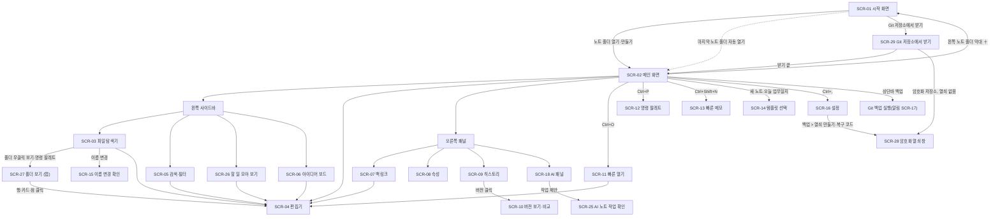

# Notevine 화면 설계서

- 문서 버전: v0.5.0 기준 (처음 작성 2026-10-28, 갱신 2026-11-24)
- 기준 문서: `docs/개발계획서.md`, `docs/요구사항정의서.md`
- 대상 릴리스: v0.1 MVP로 시작해 이후 추가한 화면(SCR-18~29)까지 포함한다.
- 와이어프레임은 배치와 구성만 나타낸다. 한글은 글자 폭 때문에 편집기에 따라 선이 어긋나 보일 수 있다.
- 2026-11-24에 v0.1.6~v0.5.0의 화면 변경을 코드(`src/components/*.tsx`, `src/App.css`, `src/appCommands.ts`, `src/store.ts`)와 맞춰 고쳤다. 앱을 실행해 눈으로 비교한 것은 아니므로, 크기·색·간격 같은 시각 값은 `src/App.css`가, 사용법은 `docs/사용자매뉴얼.md`가 기준이다.
- 2026-11-24 갱신에서 코드에 없는 옛 내용(활동 막대, 하단 상태바, 탐색기 정렬 단추, 시작 화면의 프리셋 체크박스·언어·테마 단추 등)은 고쳤다. 코드로 확인하지 못한 것은 "(추정)"이나 "확인하지 못함"으로 적었다.
- `docs/화면설계서.pptx`는 2026-10-28의 SCR-01~17만 담고 있다.

## 1. 화면 목록

| 화면 ID | 화면명 | 형태 | 관련 요구사항 | 우선순위 |
| --- | --- | --- | --- | --- |
| SCR-01 | 시작 화면 (노트 폴더 선택) | 전체 화면 | FR-VLT-01, FR-VLT-02, FR-VLT-07, FR-VLT-11 | M |
| SCR-02 | 메인 화면 (기본 레이아웃, 노트 폴더 막대, 상단바) | 전체 화면 | FR-UI-01, FR-UI-02, FR-VLT-07, FR-VLT-08 | M |
| SCR-03 | 파일 탐색기 | 왼쪽 사이드바 탭 | FR-VLT-03, FR-VLT-04 | M |
| SCR-04 | 편집기 | 가운데 영역 | FR-EDT-01~07, FR-EDT-10, FR-EDT-12, FR-LNK-01~02, FR-LNK-04, FR-ATT-01~02, FR-ATT-04~05 | M |
| SCR-05 | 검색·필터 | 왼쪽 사이드바 탭 | FR-SRC-02~05 | M |
| SCR-06 | 아이디어 보드 (프리셋) | 왼쪽 사이드바 탭 | FR-PRS-05, FR-PRS-06 | M |
| SCR-07 | 백링크 패널 | 오른쪽 패널 구역 | FR-LNK-03 | M |
| SCR-08 | 속성 패널 | 오른쪽 패널 구역 | FR-PRP-01~03, FR-PRS-07 | M |
| SCR-09 | 히스토리 패널 | 오른쪽 패널 구역 | FR-HIS-03, FR-HIS-04 | M |
| SCR-10 | 버전 보기·비교 | 모달 | FR-HIS-04~06 | M (비교는 S) |
| SCR-11 | 빠른 열기 | 팝업 | FR-SRC-01 | M |
| SCR-12 | 명령 팔레트 | 팝업 | FR-UI-04, FR-EXT-01 | S |
| SCR-13 | 빠른 메모 | 팝업 | FR-PRS-04 | M |
| SCR-14 | 템플릿 선택 | 팝업 | FR-PRP-04, FR-PRS-03 | M |
| SCR-15 | 이름 변경 확인 | 대화상자 | FR-LNK-05 | S |
| SCR-16 | 설정 | 모달 | FR-UI-02~03, FR-PRS-01~02, FR-PRS-05, FR-VLT-08~09, FR-VLT-11, FR-AI-07, FR-MCP-03 | M |
| SCR-17 | 알림 (토스트) | 오버레이 | NFR-REL-02, NFR-REL-03, FR-ATT-05 | M |
| SCR-18 | AI 패널 | 오른쪽 패널 아래 | FR-AI-01~03, FR-AI-06, FR-AI-08 | M |
| SCR-19 | AI 전송 확인 (글 고치기·주간 회고) | 대화상자 | FR-AI-03 | M |
| SCR-20 | AI 작성 결과 미리보기 | 대화상자 | FR-AI-04~05 | M |
| SCR-21 | PDF 보기·주석 | 가운데 영역 | FR-ATT-03 | C |
| SCR-22 | 웹 페이지 클립 | 대화상자 | FR-ATT-03 | C |
| SCR-23 | 캔버스 | 가운데 영역 | FR-UI-06 | C |
| SCR-24 | 플러그인 패널 | 오른쪽 패널 | FR-EXT-02 | C |
| SCR-25 | AI 노트 작업 확인 | 대화상자 | FR-AI-09 | C |
| SCR-26 | 할 일 모아 보기 | 왼쪽 사이드바 탭 | FR-PRS-09 | C |
| SCR-27 | 폴더 보기 (표·보드·캘린더·그래프) | 가운데 영역, 탭 막대의 별도 탭 | FR-PRP-05, FR-PRS-08, FR-UI-05 | C |
| SCR-28 | 암호화 열쇠 창 (복구 코드) | 대화상자 | FR-VLT-11 | C |
| SCR-29 | Git 저장소에서 받기 | 대화상자 | FR-VLT-11 | C |

## 2. 화면 흐름



## 3. 공통 규칙

### 3.1 레이아웃·크기

| 항목 | 기준 |
| --- | --- |
| 최소 창 크기 | 960 × 600 px |
| 노트 폴더 막대 | 창 맨 왼쪽, 폭 52px 고정 (SCR-02) |
| 왼쪽 사이드바 | 기본 260px, 180px부터 드래그 조절(최대 600px, 창 폭의 절반까지), 접기 가능 |
| 오른쪽 패널 | 기본 300px, 240px부터 드래그 조절(최대 600px, 창 폭의 절반까지), 접기 가능 |
| 편집기 본문 폭 | 창 너비에 맞춤 (100%, 사용자 CSS의 `--editor-max`로 바꿀 수 있음) |
| 가운데 영역 최소 폭 | 두 패널을 끌어 넓혀도 가운데 노트 자리는 400px 남긴다 |
| 창 폭 1100px 이하 | 오른쪽 패널을 숨긴다 (`max-width: 1100px`) |
| 간격 단위 | 4px 배수 (4·8·12·16·24) |
| 모서리 | 4·6·8·12px 네 가지 (2026-11-12 정리) |

### 3.2 글꼴·색

| 항목 | 기준 |
| --- | --- |
| UI 글꼴 | Pretendard → 시스템 기본 산세리프 |
| 본문 글꼴 | UI 글꼴과 같음, 16px, 줄 간격 1.7 |
| 코드 글꼴 | D2Coding → JetBrains Mono → 시스템 고정폭 |
| 색 | CSS 변수(토큰)로만 지정: `--bg`, `--bg-sidebar`, `--bg-rail`, `--bg-hover`, `--bg-active`, `--text`, `--muted`, `--accent`, `--border`, `--danger` 등. 라이트·다크 두 벌 (실제 이름은 `src/App.css`의 `:root`) |
| 강조색 | 앱 아이콘의 보라 1개: 라이트 `#5a3a94`, 다크 `#b8a1e8` (2026-11-04 확정). 2026-11-12에 청록으로 바꿨다가 같은 날 보라로 되돌렸다 |
| 글자 크기·굵기 | 12~28px 단계 값만 쓰고(주로 12·13·14·16px), 굵기는 400·500·600 (2026-11-12 정리) |
| 아이콘 | 상단바의 글자 기호(‹ › ⌘ ⚙ ▾)를 선 아이콘 한 벌(`Icon.tsx`)로 바꿨다. 이 문서의 와이어프레임은 글자로 그려 ◀ ▶ ⚙ 등으로 보인다 |
| 대비 | 본문 글자 대비 4.5:1 이상 (WCAG AA) |

### 3.3 상호작용

- 모든 명령은 명령 레지스트리(FR-EXT-01)에 등록하고, 메뉴·단축키·명령 팔레트가 같은 명령을 호출한다.
- 파괴적 작업(삭제, 복원, 일괄 링크 변경)은 확인 대화상자를 거친다. 삭제는 OS 휴지통으로 보낸다.
- 키보드만으로 모든 화면을 쓸 수 있어야 한다. 포커스 테두리는 항상 보이게 한다.
- 단축키 표기는 Windows 기준 `Ctrl`이다. macOS를 지원하는 버전부터 `Cmd`로 바꿔 표시한다.

### 3.4 단축키

| 단축키 | 동작 | 화면 |
| --- | --- | --- |
| Ctrl+O | 빠른 열기 | SCR-11 |
| Ctrl+P | 명령 팔레트 | SCR-12 |
| Ctrl+Shift+N | 빠른 메모 (다른 프로그램을 쓰는 중이거나 창을 최소화했을 때는 Ctrl+Alt+N) | SCR-13 |
| Ctrl+N | 새 노트 (템플릿 선택) | SCR-14 |
| Ctrl+Shift+D | 오늘 업무일지 | SCR-04 |
| Ctrl+Shift+F | 검색 탭 열기 | SCR-05 |
| Ctrl+S | 수동 저장 (스냅샷 강제) | SCR-04 |
| Ctrl+\\ | 왼쪽 사이드바 접기/펴기 | SCR-02 |
| Ctrl+Shift+\\ | 오른쪽 패널 접기/펴기 | SCR-02 |
| Ctrl+, | 설정 | SCR-16 |
| Shift+F1 | 사용자 매뉴얼 (docs/사용자매뉴얼.md를 앱에 묶어 읽기 모드로 보여 줌. 왼쪽 목차, 본문 목차 링크로 이동. 마크다운 문법 도움말의 [사용자 매뉴얼], 설정 > 정보 > [매뉴얼 열기]로도 연다) | — |
| Ctrl+T | 템플릿 삽입 (현재 노트) | SCR-14 |
| F1 | 마크다운 문법 도움말 | SCR-04 |
| F2 | 선택한 노트 이름 변경 | SCR-03 |
| Alt+← / Alt+→ | 지금 탭에서 이전/다음 노트로 이동 | SCR-04 |
| Ctrl+W | 탭 닫기 | SCR-04 |
| Ctrl+Tab / Ctrl+Shift+Tab | 다음/이전 탭 | SCR-04 |
| Ctrl+Shift+T | 닫은 탭 다시 열기 | SCR-04 |
| Ctrl+E | 편집/읽기 전환 | SCR-04 |
| Esc (편집 모드) | 읽기 모드로 전환. 자동완성·검색 창이 열려 있으면 그 창을 먼저 닫고, 한글 조합 중에는 IME가 받는다 | SCR-04 |
| Insert (읽기 모드) | 편집 모드로 전환. 나란히 보기에서는 마지막에 누른 칸에 적용 | SCR-04 |
| 읽기 모드에서 본문 더블클릭 | 편집 모드로 전환 (링크·체크박스·그림·표 밖의 글자일 때) | SCR-04 |
| Esc (폴더 보기) | 지금 보는 폴더 보기 탭을 닫고 노트로 돌아간다 | SCR-27 |
| Delete (파일 트리) | 선택한 항목을 확인 후 휴지통으로 | SCR-03 |
| Enter (파일 트리) | 노트는 열고 본문으로 커서 이동, 폴더는 펼치기·접기 | SCR-03 |
| Ctrl+J | AI 질문 칸으로 이동 | SCR-18 |
| Ctrl+1 ~ Ctrl+9 | 노트 폴더 막대의 1~9번째 폴더로 바꾸기 (대화상자가 열려 있으면 동작 안 함) | SCR-02 |

설정 > 단축키에서 명령마다 바꿀 수 있다(SCR-16).

## 4. 화면 상세

### SCR-01 시작 화면

노트 폴더가 없거나 마지막 노트 폴더를 찾을 수 없을 때 보인다. 메인 화면 위에 "노트 폴더 더 열기"로 띄우기도 한다(아래 '더 열기 모드').

```
┌──────────────────────────────────────────────────────────┐
│                                [취소] ← 더 열기 모드일 때만 │
│                  🌿 Notevine                             │
│   내 컴퓨터의 마크다운 폴더에 기록하고, 연결하고, 다시 찾습니다.   │
│                                                          │
│   [노트 폴더 열기] [새 노트 폴더 만들기] [Git 저장소에서 받기] │
│   [Google Drive에서 열기] [OneDrive에서 열기]  ← 있을 때만 │
│                                                          │
│   최근 노트 폴더                                           │
│   ─────────────────────────────────────────────          │
│   업무노트        D:\Notes\업무노트                        │
│   개인위키        C:\Users\me\wiki        찾을 수 없음     │
│   우클릭하면 목록에서 제거합니다.                          │
└──────────────────────────────────────────────────────────┘
```

| 요소 | 동작 | 요구사항 |
| --- | --- | --- |
| 노트 폴더 열기 | OS 폴더 선택 창 → 선택 폴더로 SCR-02 진입. 기존 .md 폴더(Obsidian 볼트 포함)도 그대로 연다 | FR-VLT-01 |
| 새 노트 폴더 만들기 | 폴더 선택 창에서 쓸 폴더(빈 폴더 권장)를 고른다. 기본 폴더·템플릿은 들어간 뒤 [기본 구조 만들기]로 만든다. 이 화면에는 프리셋 체크박스가 없다 | FR-PRS-01~02 |
| Git 저장소에서 받기 | SCR-29를 연다 (2026-11-11) | FR-VLT-11 |
| 드라이브에서 열기 | Google Drive·OneDrive를 찾으면 'Google Drive에서 열기'·'OneDrive에서 열기' 버튼이 보인다 | FR-VLT-09 |
| 최근 노트 폴더 | 폴더를 확인하지 않고 목록을 바로 보여 준다. 고르면 그 폴더만 확인해 연다. 확인 중에는 '확인 중…', 없으면 '찾을 수 없음'이고 다시 눌러 재확인할 수 있다. 다른 폴더를 고르면 먼저 고른 것은 버린다. 우클릭으로 목록에서 제거하고, 막대에 있던 폴더면 막대에서도 뺀다 (2026-11-07, 막대 연동 2026-11-12) | FR-VLT-02 |
| 언어·테마 | 이 화면에는 없다. 설정 > 일반(SCR-16)에서 바꾼다 | FR-UI-02~03 |
| 탐색기에서 열기 | 탐색기의 연결 프로그램으로 `.md`를 넘겨받으면 마지막 노트 폴더를 자동으로 열지 않고 그 파일을 연다. 노트 폴더 밖의 파일이면 확인 대화상자 "이 폴더를 노트 폴더로 열까요?"를 띄운다(메인 화면에서도 같음). 막대에 없는 폴더는 잠깐 연 폴더로 연다(SCR-02 노트 폴더 막대) | FR-VLT-10 |
| 앱 시작 | 노트 폴더 막대에서 마지막으로 보던 폴더(없으면 막대 첫 폴더)를 연다. 막대를 모두 비웠으면 자동으로 열지 않는다. 막대 파일이 아직 없으면(업데이트 직후) 최근 목록 맨 위 폴더를 열고 그 폴더를 막대에 넣는다 (2026-11-09) | FR-VLT-02, FR-VLT-07 |
| 더 열기 모드 | 막대의 ＋·"노트 폴더 더 열기…"·명령 팔레트 "노트 폴더 더 열기"로 열면 메인 화면 위에 시작 화면을 띄운다. 오른쪽 위 [취소]·Esc로 닫으면 보던 폴더 그대로. 폴더를 고르면 막대에 추가하고 그 폴더로 바꾼다. 자동 열기는 하지 않는다. 명령 팔레트 "Git 저장소에서 받기"는 이 모드로 열면서 SCR-29를 바로 띄운다 | FR-VLT-07, FR-VLT-11 |

**상태:** 첫 인덱싱 중에도 SCR-02로 들어가 편집은 즉시 할 수 있다. 인덱싱 진행률을 보이는 상태바는 현재 화면에 없다(코드에서 찾지 못함).

### SCR-02 메인 화면

```
┌────┬──────────────────────────────────────────────────────────────────────────────┐
│ 업 │ ▯ ◀ ▶ 업무노트 ▾  20.영역 › 업무일지 › 2026-10-28   [백업 ●][빠른 메모] ⌘ ⚙ ▯ │ 상단바
│▌개 ├───────────────────┬───────────────────────────────────┬──────────────────────┤
│ 위 │파일│검색│할 일│아이디어│[2026-10-28 ×][회의록 ×][표 · 업무일지 ×]│ 속성 (SCR-08)        │ 탭 막대
│    │                   │ 2026-10-28 업무일지  [편집|읽기] √ 저장됨 │ 백링크 (SCR-07)      │
│    │ ▾ 00.Inbox        │ 서식 막대                          │ 히스토리 (SCR-09)    │
│    │ ▸ 10.프로젝트      │                                   ├──────────────────────┤
│    │ ▾ 20.영역          │   ## 한 일                         │ AI 도우미 (SCR-18)   │
│    │   ▾ 업무일지       │   - [x] 요구사항 정의서 작성        │  대화                │
│    │     2026-10-28    │   - [ ] [[화면 설계]] 검토          │ [질문 칸          ▲] │
│    │ ▸ 30.자료          │        편집기 (SCR-04)             │                      │
│    │ ▸ 40.보관          │   태그 #회의 #예산                 │                      │
│ ＋ │                   │                                   │                      │
└────┴───────────────────┴───────────────────────────────────┴──────────────────────┘
 ↑ 노트 폴더 막대 (52px). 왼쪽 ▯·오른쪽 ▯는 사이드바·패널 접기 단추
```

| 영역 | 구성 | 요구사항 |
| --- | --- | --- |
| 노트 폴더 막대 (창 맨 왼쪽, 폭 52px, 2026-11-09) | 막대에 둔 노트 폴더마다 첫 글자 단추(34px 둥근 사각형). 지금 폴더는 강조색으로 채우고 왼쪽에 작은 표시. 마우스를 올리면 이름·경로·Ctrl+N. 누르거나 Ctrl+1~9로 바꾸고, 확인·여는 중에는 단추가 흐려지며 마지막에 누른 폴더로 간다. 오른쪽 클릭: 위로 옮기기·아래로 옮기기·탐색기에서 노트 폴더 열기·막대에서 닫기(확인 없음, 폴더는 그대로). 맨 아래 ＋는 더 열기 모드(SCR-01). 탐색기에서 연 막대 밖 폴더는 보고 있는 동안만 점선 단추(잠깐 연 폴더, 번호 없음, 오른쪽 클릭: 막대에 추가·탐색기에서 열기·닫기). 폴더를 바꿔도 노트 탭·폴더 보기 탭·마지막 노트·스크롤·펼친 폴더·나란히 보기·AI 대화가 폴더마다 남는다(앱이 켜져 있는 동안). 목록은 PC별 `vault-rail.json`. 삭제·이동으로 없어진 폴더의 보기 탭은 닫힌다 | FR-VLT-07 |
| 상단바 (왼쪽부터) | 왼쪽 사이드바 접기/펴기 단추(Ctrl+\\), 이전/다음 노트(Alt+←/→), 노트 폴더 이름 ▾(누르면 메뉴: 노트 폴더 더 열기… → 더 열기 모드 SCR-01 / 탐색기에서 노트 폴더 열기 / 이 노트 폴더 닫기), 현재 노트 경로(빵부스러기), [기본 구조 만들기](만들기 전에만. 오늘 업무일지는 Ctrl+Shift+D·명령 팔레트), [백업](아래 표), [빠른 메모], 명령 팔레트(⌘ 아이콘), 설정(⚙), 오른쪽 패널 접기/펴기 단추(Ctrl+Shift+\\). 접기 단추는 열려 있을 때 한쪽이 채워진 창 모양 아이콘이다. 이전의 🔍 단추는 없다(검색은 사이드바 탭·Ctrl+Shift+F) | FR-UI-01, FR-VLT-02, FR-PRS-01 |
| 왼쪽 사이드바 | 맨 위 탭 줄에서 고른다: **파일**(SCR-03) · **검색**(SCR-05, Ctrl+Shift+F) · **할 일**(SCR-26) · **아이디어**(SCR-06, 기본 구조를 켰을 때만). 이전의 활동 막대(맨 왼쪽 아이콘 열)는 없다. 설정은 상단바 ⚙에서 연다 | FR-UI-01, FR-PRS-06, FR-PRS-09 |
| 가운데 | 위에 탭 막대(노트 탭 + 폴더 보기 탭, SCR-04·SCR-27), 그 아래에 편집기(SCR-04)·폴더 보기(SCR-27)·PDF(SCR-21)·캔버스(SCR-23) 중 하나. 노트를 나란히 열면 오른쪽에 한 칸 더 | FR-EDT |
| 오른쪽 패널 | 위쪽 스크롤 칸에 속성(SCR-08, 노트가 열려 있을 때) · 백링크(SCR-07) · 히스토리(SCR-09) · 플러그인 패널(SCR-24)이 차례로 쌓이고, 아래쪽에는 AI 도우미(SCR-18)가 항상 붙는다. 탭이 아니라 세로로 쌓은 구역이다 | FR-LNK-03, FR-PRP-02, FR-HIS-04, FR-AI-01 |
| 상태 표시 | 하단 상태바는 현재 화면에 없다(코드에서 찾지 못함). 저장 상태는 편집기 제목 줄 오른쪽에 "√ 저장됨 / 편집 중 / 저장 중… / 저장 실패"로 보이고, 충돌·오류는 알림(SCR-17)으로 알린다. 단어 수·노트 수·커서 위치·인덱싱 진행률 표시는 현재 화면에서 확인하지 못했다 | FR-EDT-03 |

**상단바 백업 단추 (2026-11-12, FR-VLT-08):**

| 상태 | 표시·동작 |
| --- | --- |
| 보이는 조건 | Git 저장소로 허용된 노트 폴더에서만 보인다. 글자 "백업"과 상태 점만 둔다. 폴더를 바꾸면 다시 읽고, 창이 보일 때 30초마다·창에 포커스가 돌아올 때·설정에서 백업 상태가 바뀔 때 상태를 다시 읽는다 |
| 점 | 바뀐 노트나 보낼 백업이 있으면 강조색 점, 백업을 막는 문제가 있거나 암호화한 폴더에 원격 저장소 주소가 없으면(이 PC에만 저장) 빨간 경고 점, 모두 백업했으면 점 없음. 마우스를 올리면 "원격 저장소 주소가 없어 이 PC에만 저장됩니다(암호화한 폴더일 때) · 바뀐 노트 n개 · 보낼 백업 n개 · 마지막 백업 시각" |
| 누르기 | 그 자리에서 백업을 실행한다(백업 중에는 "백업 중…", 단추 비활성). 결과는 알림(SCR-17) |
| 상태를 읽지 못할 때 | 단추를 숨기지 않고 경고 점과 함께 보인다. 누르면 다시 읽고, 이유는 마우스를 올리면 나온다 |
| 자동 백업 | 설정 > 백업(SCR-16)에서 간격(끄기·15분·30분·1시간·3시간)을 고르면 바뀐 것이 있을 때 마지막 백업에서 그 간격이 지난 뒤 백업한다. 못 하는 이유(예: 암호화 열쇠 없음)는 같은 이유를 한 번만 알림으로 알린다 |

**빈 상태(열린 노트 없음):** 가운데에 "열린 노트가 없습니다." 문구와 [새 노트 (Ctrl+N)] 버튼을 보여 준다. 기본 구조를 아직 만들지 않았으면 "[기본 구조 만들기]" 링크가 아래에 붙는다. 빠른 열기·오늘 업무일지 버튼은 없다(단축키·명령 팔레트로).

### SCR-03 파일 탐색기

```
┌──────────────────────────┐
│ 파일              ＋  ▣  │
├──────────────────────────┤
│ ▾ 00.Inbox          (3)  │
│     아이디어 메모 1028    │
│ ▸ 10.프로젝트       (5)   │
│ ▾ 20.영역                 │
│   ▾ 업무일지              │
│     ▾ 2026               │
│       2026-10-28  ●      │  ← 현재 노트 강조
│       2026-10-27         │
│ ▸ 30.자료           (46)  │
│ ▸ 40.보관           (21)  │
│ ▸ 첨부                    │
└──────────────────────────┘
```

| 요소 | 동작 | 요구사항 |
| --- | --- | --- |
| 항목 표시 | 폴더는 `>` 화살표(펼치면 아래로 회전)와 굵은 이름, 노트는 아이콘 없이 이름만, 첨부 등 그 밖의 파일은 흐린 이름(확장자 표시). 접힌 폴더에는 노트 수 | FR-UI-01 |
| 새 노트·새 폴더 | 선택된 폴더 안에 생성, 이름 입력 상태로 진입 | FR-VLT-03 |
| 정렬 | 탐색기 머리의 정렬 단추(⇅)는 없어졌다. 트리의 정렬 순서는 코드로 확인하지 못했다 | — |
| 노트 클릭 | 지금 탭에서 열기. Ctrl+클릭·가운데 버튼은 새 탭. 노트가 아닌 파일(PDF·xlsx 등)은 더블클릭해야 열린다(AI 입력 칸으로 끌어다 놓을 때 프로그램이 뜨지 않게). 누른 줄은 선택 표시가 남고 키보드가 파일 트리에 머문다 | FR-EDT-07 |
| 키보드 | 선택한 줄에서 Delete는 확인 후 휴지통, Enter는 노트를 열고 본문에 커서를 두며(폴더는 펼치기·접기, 다른 파일은 연결된 프로그램으로 열기) (2026-11-11) | FR-VLT-03 |
| 드래그 앤 드롭 | 노트·폴더를 폴더 위로 끌어 이동. 이동 후 링크 갱신 확인(SCR-15). 노트·폴더를 오른쪽 패널의 AI 입력 칸으로 끌어다 놓으면 AI에 보낼 칩이 된다(SCR-18). Windows 탐색기의 파일을 트리의 폴더·노트 위에 놓으면 그 폴더로 복사한다 | FR-VLT-03, FR-LNK-05, FR-AI-03 |
| 우클릭 메뉴 | 줄 단위로 묶어 구분선으로 나뉜다. 노트·파일: **새로 만들기** [노트][캔버스][폴더] / 새 탭에서 열기·오른쪽에 나란히 열기(노트만)·연결된 프로그램으로 열기 / 이름 변경·다른 폴더로 이동…·히스토리 보기(노트만)·PARA 정리 항목 / 탐색기에서 보기·경로 복사 / 삭제. 폴더: **새로 만들기** [노트][캔버스][폴더]와 **보기** [표][보드][캘린더][그래프] 두 줄 / 이름 변경·다른 폴더로 이동…·PARA 정리 / 탐색기에서 보기·경로 복사 / 폴더 색 / 삭제. 빈 곳: 새로 만들기 줄과 삭제된 노트 히스토리. '다른 폴더로 이동…'은 폴더를 찾아 고르며, 끌어다 놓기처럼 링크 갱신을 확인한다(SCR-15) | FR-VLT-03, FR-HIS-07 |
| 폴더 색 | 폴더 우클릭 메뉴 아래쪽 색 칸(13색 + 색 없음, 2026-11-10)으로 폴더 이름 색을 정한다. 그 폴더 안의 노트·하위 폴더도 같은 색으로 보이고, 하위 폴더에 따로 정한 색이 있으면 그 색이 우선. 노트 폴더 설정(`.app/config.json`의 `folder_colors`)에 저장되며, 폴더 이름 변경·이동 시 따라가고 삭제 시 지워진다. 기본 구조 만들기는 최상위 폴더에 색을 정해 준다(Inbox·첨부 회색, 프로젝트 빨강, 영역 파랑, 자료 초록, 보관 갈색, 템플릿 보라, 이미 색이 있으면 그대로) | FR-PRS-02 |
| PARA 정리 | 프로젝트 폴더 우클릭(또는 명령 팔레트 '새 프로젝트')으로 이름을 넣으면 `10.프로젝트/이름/` 폴더와 개요 노트(`프로젝트` 템플릿: 목표·할 일·관련 자료, `deadline` 속성)를 만들어 연다. 보관 폴더 밖의 노트·폴더는 우클릭 '보관으로 옮기기', 보관 폴더 안의 것은 '프로젝트로/영역으로/자료로 꺼내기'. 옮길 때는 드래그 이동과 같이 링크 갱신을 확인한다(SCR-15). 기본 구조의 최상위 폴더 자체에는 나오지 않고, 해당 폴더가 없으면 그쪽으로 옮기는 항목도 없다 | FR-PRS-02, FR-LNK-05 |
| 폴더 보기 열기 | 폴더 우클릭 메뉴의 **보기** 줄 [표][보드][캘린더][그래프], 명령 팔레트 '현재 폴더를 ○○로 보기'(열린 노트가 있을 때. 그 노트의 폴더), '전체 노트 그래프', '전체 노트 캘린더'(노트 폴더 전체). 열면 가운데 영역에 보기가 나오고 탭 막대에 "표 · 폴더명" 같은 별도 탭이 생긴다. 보기 화면과 탭의 동작은 SCR-27 | FR-PRP-05, FR-PRS-08, FR-UI-05 |
| 표 보기 | 그 폴더와 하위 폴더 노트의 표. 열은 제목 · 속성(많이 쓰인 순) · 수정일, 목록 속성은 쉼표로 이어 보인다. 열 제목을 누르면 정렬(다시 누르면 반대, 빈 칸은 항상 아래, 수정일은 처음에 내림차순), 행을 누르면 노트가 열린다(Ctrl+클릭·가운데 버튼은 새 탭). 노트가 저장되거나 밖에서 바뀌면 새로 고친다. 표만 템플릿 폴더의 노트를 포함하고 보드·캘린더는 템플릿 폴더와 `type: guide` 노트를 뺀다 | FR-PRP-05 |
| 보드 보기 | 칸반 방식. 노트를 속성 값별 칸으로 나눈다. 기본은 `status`(아이디어 상태 순서대로, 빈 칸도 보임), '묶을 속성'에서 값 종류가 적은 다른 속성을 고를 수 있다. 카드를 다른 칸에 끌어 놓으면 그 노트의 속성이 바뀌고, '○○ 없음' 칸에 놓으면 속성이 지워진다. 카드에는 하위 폴더와 마감 속성(deadline·마감 등)이 보인다 | FR-PRS-08 |
| 회고 묶음 | 명령 팔레트 '주간 회고 묶음 만들기 (이번 주/지난주)', '월간 회고 묶음 만들기 (이번 달/지난달)', 캘린더 보기의 'n월 회고 만들기'. 그 기간(월~일, 또는 그 달)의 업무일지 · 회의록(type: meeting) · 완료한 프로젝트 · 진행 중인 프로젝트(마감 표시) · 새 아이디어(상태 표시) · 새 자료 · 그 밖에 고친 노트(30개까지)를 `[[링크]]` 목록으로 모으고, 끝에 '돌아보기'(잘된 점·아쉬운 점·다음에 할 일)를 둔다. 새 노트는 `20.영역/회고/2026-W45 주간 회고.md`(프리셋을 안 쓰면 `회고/`)에 만들어 연다. 이미 있으면 그 노트를 연다. AI는 쓰지 않는다 | FR-PRS-08 |
| 캘린더 보기 | 일요일부터 6주 달력에 노트를 날짜별로 놓는다. '날짜 기준'은 날짜 값이 있는 속성(created가 있으면 기본), 노트 이름의 날짜(업무일지), 수정일 중에 고른다. 하루 4개까지 보이고 '+n개 더'로 펼친다. 날짜 칸에 마우스를 올리면 ＋ 단추로 그날 업무일지를 열거나 템플릿으로 만든다(프리셋 사용 시). ‹ › · 오늘로 달을 옮긴다 | FR-PRS-08, FR-PRS-03 |
| 그래프 보기 | 폴더 안 노트를 점, 노트 사이 링크를 선으로 그린다(링크 해석은 FR-LNK-06, 폴더 밖·없는 노트·첨부 링크는 뺌). 링크가 많을수록 점이 크다. 배치가 끝나면 화면에 맞추고, 끌어서 이동, 휠로 확대, 점을 끌어 옮기고, 누르면 노트가 열린다(Ctrl+클릭은 새 탭). 마우스를 올린 노트와 이웃만 강조한다. '링크 없는 노트 숨기기', '화면에 맞추기'. 노트 60개 이하면 이름을 모두, 그보다 많으면 링크가 많은 노트와 확대했을 때만 이름을 보인다 | FR-UI-05 |
| 숨김 | `.app/` 폴더와 점(.)으로 시작하는 폴더는 표시하지 않음 | FR-VLT-05 |
| 외부 변경 | 외부에서 추가·삭제된 파일이 1초 안에 트리에 반영됨 | FR-VLT-04 |
| 개수 표시 | 폴더 오른쪽에 노트 수 (접혀 있을 때만) | — |

### SCR-04 편집기

```
┌───────────────────────────────────────────────────────┐
│  2026-10-28 업무일지                                   │ ← 제목 = 파일명 (클릭해 이름 변경)
│  H1 H2 H3 │ B I S ✎ <> A̲ Ⓐ │ • 1. ☑ ▍ [!] │ [[ 🔗 ▦ {} ─     │ ← 서식 막대 (읽기 모드에서는 서식 단추가 비활성)
│  ───────────────────────────────────────────────       │
│  type: journal   date: 2026-10-28                     │ ← frontmatter 요약 (접힘)
│                                                       │
│  ## 한 일                                              │
│  - [x] 요구사항 정의서 작성                            │
│  - [ ] [[화면 설계]] 검토                              │
│        ┌──────────────────────────┐                   │
│  [[화면│ 화면 설계서               │                   │ ← [[ 입력 시 자동완성
│        │ 화면 설계 회의록 1027      │                   │
│        │ ＋ "화면" 새 노트 만들기   │                   │
│        └──────────────────────────┘                   │
│  ![[첨부/구조도.png]]                                   │
│  ┌───────────────────────────┐                        │
│  │       (이미지 미리보기)      │                        │
│  └───────────────────────────┘                        │
│  📎 [[첨부/견적서.xlsx]]                               │ ← 이미지 외 첨부: 클릭 시 기본 프로그램
└───────────────────────────────────────────────────────┘
```

| 요소 | 동작 | 요구사항 |
| --- | --- | --- |
| 탭 막대 | 편집기 위에 열린 노트마다 탭 하나. 누르면 그 노트로, ×·가운데 버튼·Ctrl+W로 닫기, 오른쪽 버튼 메뉴에 '다른 탭 모두 닫기'. 노트는 기본으로 지금 탭에서 열리고, 파일 트리·검색 결과·백링크를 Ctrl+클릭하거나 가운데 버튼으로 누르면 새 탭에서 열린다(파일 트리 메뉴 '새 탭에서 열기'도 있음). 이미 열린 노트는 그 탭으로 옮겨 간다. 탭마다 이전/다음 기록과 커서·스크롤 위치를 따로 기억하고, 앱을 다시 켜면 탭이 돌아온다. 이름 변경·이동은 탭에 반영되고 삭제된 노트의 탭은 닫힌다. 폴더 보기(표·보드·캘린더·그래프)는 노트 탭 오른쪽에 "표 · 폴더명" 같은 별도 탭으로 붙고(SCR-27), 노트 탭을 누르면 노트로 돌아온다. 노트 안의 링크(`[[링크]]`·마크다운 링크)는 편집·읽기 모드 모두 새 탭에서 열리고 이미 열린 노트는 그 탭으로 옮겨 간다 (2026-11-24) | FR-EDT-07 |
| 분할 창 | 파일 트리 노트 우클릭 또는 (지금 보고 있지 않은) 탭 우클릭 '오른쪽에 나란히 열기'로 편집기 오른쪽에 노트 하나를 더 연다. 오른쪽 칸은 위쪽 막대(노트 이름 · ⇤ 왼쪽에서 열기 · × 닫기)를 갖고, 편집·저장·읽기 모드를 따로 한다. 링크를 누르면 왼쪽에서 열린다(링크는 새 탭). 같은 노트가 왼쪽에 열리면 덮어쓰기를 막으려고 오른쪽은 안내만 보인다. 명령 팔레트 '나란히 보기 닫기', '왼쪽·오른쪽 노트 바꾸기'. AI 도우미·속성 패널·F2·Ctrl+E는 왼쪽 노트에 작동한다. 이름 변경·이동은 반영되고 삭제되면 닫힌다 | FR-EDT-07 |
| 제목 | 파일명을 크게 표시. 클릭해 바꾸면 파일 이름 변경 + SCR-15 | FR-VLT-03, FR-LNK-05 |
| 라이브 미리보기 | 커서가 없는 줄은 서식으로, 커서가 있는 줄은 마크다운 원문으로 표시 | FR-EDT-02 |
| 서식 막대 | 제목 1~3 · 굵게(Ctrl+B) · 기울임(Ctrl+I) · 취소선(Ctrl+Shift+X) · 형광펜(Ctrl+Shift+H) · 인라인 코드(Ctrl+\`) · 글자 색 · 배경색 │ 글머리 목록 · 번호 목록 · 체크리스트(Ctrl+L) · 인용 · 강조 상자 │ 노트 링크 `[[ ]]` · 웹 링크(Ctrl+K) · 표 · 시트 · 코드 블록 · 구분선. 선택 영역(없으면 커서 단어·줄)에 적용, 다시 누르면 해제. 편집기 스크롤 시 위에 고정 | FR-EDT-09 |
| 글자 색·배경색 | 버튼을 누르면 8색 팔레트와 "기본 색으로"/"배경 없애기". 마지막에 고른 색이 버튼에 표시된다. 선택(없으면 커서 단어)에 적용하고 여러 줄이면 줄마다 따로 감싸며 목록·제목 기호는 밖에 둔다. 같은 종류의 색은 바꿔 끼우고 다른 종류(글자 색 + 배경색)는 겹친다. 저장 형식은 `<span style="color: #e03131">…</span>`, 배경은 반투명 색이라 밝은·어두운 테마 모두에서 읽힌다. 편집기는 커서가 없는 줄에서 태그를 숨기고 색으로 보여 준다 | FR-EDT-09 |
| 시트 | 서식 막대 '시트' 단추로 ` ```sheet ` 블록(제목 행 + 빈 행 2개)을 넣는다. 편집 모드에서는 블록이 격자 위젯으로 보이고, 칸을 누르면 고치며 칸에서 나올 때 노트에 반영된다(Tab·Enter·방향키 이동, 행·열 추가·삭제, '원문 편집'). 맨 아래 합계 행과 수식 결과(`#오류` 등 오류 표시)는 화면에만 있다. 커서가 블록 안에 있으면 원문을 보인다. 읽기 모드에서는 읽기 전용 표로 합계까지 보인다 | FR-EDT-12 |
| 강조 상자 | 내용의 중요도를 색 상자로 보인다. 서식 막대의 [!] 단추 → 중요(빨강)·주의(주황)·참고(파랑)·팁(초록)·결정·질문·아이디어 중 고르면 선택한 줄(없으면 커서 줄)을 `> [!중요]` 상자로 감싼다. 빈 줄이면 빈 상자를 넣는다. 상자 첫 줄에서 다른 종류를 고르면 종류만 바뀌고, 같은 종류를 고르면 상자를 푼다. `> [!주의] 제목`처럼 제목을 붙일 수 있다. 읽기 모드는 아이콘·제목이 있는 색 상자, 편집 모드는 같은 색 줄(커서 없는 줄에서는 `[!중요]`가 아이콘·이름으로 보임). 옵시디언 이름(`[!important]`, `[!warning]`, `[!note]`, `[!tip]` 등)도 같은 색으로 보이고, 모르는 이름은 참고 색 | FR-EDT-09 |
| 편집/읽기 전환 | 제목 줄 오른쪽 [편집 \| 읽기], Ctrl+E. 읽기 모드에서 본문을 더블클릭하거나 Insert 키를 누르면 편집 모드로 바뀌고(링크·체크박스·버튼·그림·끼워 넣은 노트 본문을 누를 때는 바뀌지 않음), 편집 모드에서 Esc를 누르면 읽기 모드로 돌아간다(자동완성·검색 창이 열려 있으면 그 창이 Esc를 먼저 받고, 한글 조합 중에는 IME가 받는다) (2026-11-16). 읽기 모드는 표·형광펜·태그·체크박스·이미지까지 렌더링하고 속성은 숨김. 링크는 클릭으로 새 탭에서 열린다(읽기 모드 유지), 체크박스 클릭은 원문 수정·자동 저장. 웹 이미지는 "[그림] 설명" 링크로만 표시. 새 노트와 빈 노트는 편집 모드로 열림 | FR-EDT-10 |
| frontmatter | 본문 위에 한 줄 요약으로 접어 표시. 클릭하면 YAML 원문 편집 | FR-PRP-01 |
| 위키링크 자동완성 | `[[` 입력 시 팝업. 한글 부분 일치, ↑↓ 선택, Enter 확정, 결과 없으면 "새 노트 만들기" | FR-LNK-01 |
| 태그 자동완성 | 숫자만 있는 `#400`도 태그로 인식한다 (2026-11-17, 색인 버전 7). 본문에서 `#` 뒤에 글자를 치면 노트 폴더에 있는 태그(본문 `#태그`와 속성 `tags`)를 제안한다. 친 글자로 시작하는 태그가 먼저, 같은 순위면 많이 쓴 태그가 먼저이고, 오른쪽에 'n개 노트'를 보인다. ↑↓·Enter로 넣는다. 줄 맨 앞의 `#` 하나(제목을 쓰는 중), 단어에 붙은 `#`(C#, 회의록#결정, URL), 코드 블록과 맨 위 속성 안에서는 띄우지 않는다 | FR-SRC-03 |
| 태그 줄 | 노트 본문 아래(편집·읽기 모드 모두)에 가는 구분선과 '태그 #회의 #예산'을 보인다. 본문 `#태그`와 속성 `tags`를 처음 나온 순서대로 한 번씩 모은다. 누르면 그 태그로 검색한다. 태그가 없으면 줄이 없다. 저장할 때마다 새로 고친다(색인 기준). 그 아래 빈 곳을 누르면 노트 끝에 커서가 간다 | FR-SRC-03 |
| 제목·블록 링크 자동완성 | `[[노트#` 다음엔 그 노트의 제목(H1~H6) 목록, 맨 아래 '^ 문단·목록 항목에 연결…'. `[[노트#^` 다음엔 문단·목록 항목 목록(이미 ID가 있으면 `^id` 표시, 없으면 '새 블록 ID'). ID 없는 줄을 고르면 그 노트의 줄 끝에 ` ^a1b2c3`를 붙여 저장하고 링크를 완성한다(같은 노트면 Ctrl+Z 한 번에 함께 되돌림). `[[#` 는 지금 노트. 편집기에서 ` ^id`는 흐리게, 읽기 모드에서는 숨기고, 링크로 오면 그 문단을 가운데로 보이고 잠깐 강조한다. `![[노트#^id]]`는 그 문단만 임베드 | FR-LNK-07 |
| 링크 클릭 | 편집 모드에서는 Ctrl+클릭(설정 > 편집기 > 링크 이동에서 클릭으로 바꿀 수 있음), 읽기 모드에서는 클릭으로 이동하며 노트는 새 탭에서 열린다(이미 열린 노트는 그 탭으로). 첨부는 PDF 보기·연결된 프로그램으로 연다. 없는 노트 링크는 점선 밑줄, 클릭 시 생성 | FR-LNK-02 |
| 링크 미리보기 | 링크에 마우스를 0.5초 올리면 대상 노트 앞부분 미리보기 | (C, v0.2) |
| 체크박스 | 클릭으로 체크 상태 토글 | FR-EDT-01 |
| 코드 블록 | 언어별 문법 강조 | FR-EDT-06 |
| 이미지 | `![[파일]]`, `` 모두 미리보기 | FR-ATT-02 |
| 드래그 앤 드롭 | 파일을 놓으면(형식 제한 없음) `첨부/`로 복사하고 커서 위치에 링크 삽입. 이미지는 `![[파일]]`, 그 밖의 파일은 `[[파일.확장자]]` | FR-ATT-01 |
| 이미지 붙여넣기 | 클립보드에 이미지가 있으면 Ctrl+V 시 `첨부/이미지 YYYYMMDD-HHmmss.png`로 저장하고 `![[...]]` 삽입. 텍스트는 일반 붙여넣기 | FR-ATT-04 |
| 첨부 링크 클릭 | 이미지가 아닌 첨부(PDF·xlsx·hwp 등)는 파일 아이콘과 함께 표시. 링크 클릭 방식에 따라 OS 기본 프로그램으로 열기. 파일이 없으면 토스트(SCR-17) | FR-ATT-05 |
| 자동 저장 | 입력을 멈추고 1초 후 저장(설정 > 편집기에서 0.5~5초). 제목 줄 오른쪽에 "편집 중" → "저장 중…" → "√ 저장됨", 실패하면 "저장 실패" | FR-EDT-03 |
| IME | 한글 조합 중에는 자동완성·단축키 처리를 보류 | FR-EDT-05 |

### SCR-05 검색·필터

```
┌──────────────────────────────┐
│ 🔍 [ 무개                  ] │
│ 필터  ＋조건                  │
│ ┌──────────────────────────┐ │
│ │ status = 검토         ✕  │ │
│ │ type   = idea         ✕  │ │
│ │ 수정일  최근 7일        ✕  │ │
│ └──────────────────────────┘ │
│ 결과 12개 · 38ms              │
├──────────────────────────────┤
│ 📄 업무개선 아이디어           │
│    …반복 보고를 줄이는 업무개선 │
│    30.자료/아이디어 · 10-27    │
│ 📄 자동화 도구 조사            │
│    …업무개선 효과가 큰 영역은… │
└──────────────────────────────┘
```

| 요소 | 동작 | 요구사항 |
| --- | --- | --- |
| 검색창 | 입력 후 200ms 디바운스로 검색. 한글 부분 일치 | FR-SRC-02 |
| 검색 문법 | `#태그`, `status:검토`, `"정확한 구"` 를 검색창에서 바로 쓸 수 있음 | FR-SRC-03~04 |
| 저장된 검색 | 검색어·조건·기간이 있으면 검색창 옆에 ☆. 누르면 이름 칸(기본값은 조건 요약)이 열리고 Enter로 저장한다. 같은 이름이면 덮어쓴다. 저장된 검색은 검색창 아래 칩으로 보이고, 누르면 검색어·조건·기간을 그대로 되살린다. 지금 검색과 같은 칩은 강조되고 ☆가 ★로 바뀐다. 칩에 마우스를 올리면 ×로 지운다. 노트 폴더의 `.app/config.json`에 저장된다 | FR-SRC-06 |
| 조건 추가 | 속성 이름 목록(인덱스에 있는 모든 key) → 연산자(=, ≠, 포함, 비어 있음) → 값 선택. 조건끼리는 AND | FR-SRC-04 |
| 날짜 조건 | 생성일·수정일 × 오늘 / 최근 7일 / 최근 30일 / 기간 지정 | FR-SRC-03 |
| 결과 | 제목, 일치 부분 강조 문맥 1줄, 폴더·수정일. 클릭 시 해당 위치로 이동 | FR-SRC-05 |
| 결과 요약 | 결과 수와 응답 시간(ms) 표시 | NFR-PRF-02 |
| 빈 결과 | "결과 없음 · 조건을 줄여 보세요" | — |

### SCR-06 아이디어 보드 (프리셋)

프리셋(기본 구조)이 켜져 있을 때만 왼쪽 사이드바의 **아이디어** 탭이 나타난다.

```
┌──────────────────────────────┐
│ 💡 아이디어      ＋ 빠른 메모 │
│ 정렬: 수정일 ▾  태그: 전체 ▾  │
├──────────────────────────────┤
│ ▾ 아이디어 (5)                │
│    회의록 자동 요약     10-28 │
│    주간보고 템플릿화    10-26 │
│ ▾ 검토 (3)                    │
│    업무개선 아이디어    10-27 │
│ ▸ 진행 (2)                    │
│ ▸ 완료 (8)                    │
│ ▸ 보류 (1)                    │
│ ▸ Inbox 미분류 (3)            │
└──────────────────────────────┘
```

| 요소 | 동작 | 요구사항 |
| --- | --- | --- |
| 상태 그룹 | 프리셋에 정의된 `status` 값 순서대로 묶어 표시. 개수 표시 | FR-PRS-05~06 |
| 상태 변경 | 항목을 다른 그룹으로 드래그하거나 우클릭 → 상태 변경. frontmatter에 즉시 반영 | FR-PRS-06, FR-PRP-02 |
| Inbox 미분류 | `00.Inbox`의 노트 중 status가 없는 것 | FR-PRS-04 |
| 빠른 메모 | SCR-13 열기 | FR-PRS-04 |

### SCR-07 백링크 패널

```
┌───────────────────────────┐
│ 백링크 (3)                 │
├───────────────────────────┤
│ 📄 2026-10-28 업무일지      │
│    - [ ] [[화면 설계]] 검토 │
│ 📄 회의록 1027              │
│    결정: [[화면 설계]]는 …  │
├───────────────────────────┤
│ 연결되지 않은 언급 (v0.2)   │
└───────────────────────────┘
```

| 요소 | 동작 | 요구사항 |
| --- | --- | --- |
| 목록 | 현재 노트를 가리키는 노트와 링크가 있는 문장 | FR-LNK-03 |
| 클릭 | 해당 노트의 링크 위치로 이동 | FR-LNK-03 |
| 갱신 | 다른 노트에서 링크를 추가·삭제하면 1초 안에 갱신 | FR-LNK-03 |
| 빈 상태 | "이 노트를 가리키는 링크가 없습니다" | — |

### SCR-08 속성 패널

```
┌──────────────────────────────┐
│ 속성                          │
├──────────────────────────────┤
│ type     [ idea           ▾] │
│ status   [ 검토           ▾] │
│ tags     [업무개선✕][자동화✕]＋│
│ source   https://example… ↗  │
│ created  📅 2026-10-27       │
│                              │
│ ＋ 속성 추가                  │
└──────────────────────────────┘
```

| 요소 | 동작 | 요구사항 |
| --- | --- | --- |
| 속성 행 | 이름 · 값. 값 유형별 입력: 텍스트, 날짜(날짜 선택기), 목록(칩), URL(↗로 브라우저 열기) | FR-PRP-02~03, FR-PRS-07 |
| 값 제안 | 같은 속성 이름에 쓰인 기존 값을 드롭다운으로 제안 (예: status 값) | FR-PRP-02 |
| type·status 선택 상자 | 속성 이름이 `type`·`status`이면 목록에서 고른다. `type`은 idea(아이디어)·research(자료)·project(프로젝트)·journal(업무일지)·meeting(회의록)·guide(안내)와 이 노트 폴더에서 쓴 다른 값, `status`는 설정의 아이디어 상태와 쓰던 값. 맨 아래 "직접 입력…"으로 목록에 없는 값을 적는다 (2026-11-11) | FR-PRP-02 |
| 새 노트 기본 속성 | 빈 노트(파일 트리의 새 노트·템플릿 선택의 빈 노트·없는 링크로 만든 노트)는 `type`·`date`(오늘)·`status` 속성을 가지고 시작한다. 템플릿으로 만든 노트는 템플릿의 속성을 따른다 (2026-11-11) | FR-PRP-02, FR-PRP-04 |
| 속성 추가 | 이름 입력(기존 이름 자동완성) → 유형 자동 추정 | FR-PRP-02 |
| 동기화 | 패널에서 바꾸면 frontmatter에 반영, YAML을 직접 고치면 패널에 반영 | FR-PRP-02 |
| YAML 오류 | frontmatter 문법 오류 시 패널 상단에 경고, 편집기에서 해당 줄 강조 | — |

### SCR-09 히스토리 패널

```
┌───────────────────────────────┐
│ 히스토리 (24)                  │
├───────────────────────────────┤
│ 오늘                           │
│  ● 14:32  현재 버전             │
│  ○ 14:05  +120 −8 단어          │
│  ○ 13:40  +34 단어   외부 변경  │
│  ○ 09:12  저장                 │
│ 어제                           │
│  ○ 18:20  +410 단어             │
│ 2026-10-25                     │
│  ○ 11:03  처음 생성             │
└───────────────────────────────┘
```

| 요소 | 동작 | 요구사항 |
| --- | --- | --- |
| 버전 목록 | 날짜별로 묶어 시간 역순. 각 항목에 변경량(단어 수 증감), 표식(저장 / 외부 변경 / 복원 / AI 도구 / 처음 생성) | FR-HIS-03~04 |
| 클릭 | SCR-10 버전 보기 열기 | FR-HIS-04 |
| 삭제된 노트 | 파일 탐색기 우클릭 또는 명령 팔레트 "삭제된 노트 히스토리"에서 접근 | FR-HIS-07 |
| 안내 | 패널 하단에 "이전 버전은 이 노트 폴더 안의 숨은 .app 폴더에 보관됩니다. 노트를 백업할 때 함께 백업하세요". 드라이브 폴더에서는 "드라이브 폴더의 이전 버전은 이 PC에 따로 보관됩니다. 다른 PC에서 고친 내용의 이전 버전은 그 PC에 쌓입니다" | DR-03 |

### SCR-10 버전 보기·비교

```
┌──────────────────────────────────────────────────────────────────┐
│ 2026-10-28 업무일지 · 버전 기록                                 ✕ │
│ 보기: (●) 이 버전만   ( ) 현재와 비교   ( ) 이전 버전과 비교       │
├───────────────┬──────────────────────────────────────────────────┤
│ 14:05  ◀ 선택  │  ## 한 일                                         │
│ 13:40         │  - [x] 요구사항 정의서 작성                        │
│ 09:12         │+ - [ ] [[화면 설계]] 검토                          │ ← 추가(녹색)
│ 어제 18:20     │- - [ ] 화면 설계 시작                              │ ← 삭제(빨강)
│               │                                                  │
├───────────────┴──────────────────────────────────────────────────┤
│                         [ 내용 복사 ]   [ 이 버전으로 복원 ]       │
└──────────────────────────────────────────────────────────────────┘
```

| 요소 | 동작 | 요구사항 |
| --- | --- | --- |
| 버전 목록 (왼쪽) | SCR-09와 같은 목록, ↑↓로 이동 | FR-HIS-04 |
| 보기 모드 | 이 버전만(읽기 전용) / 현재와 비교 / 이전 버전과 비교. 비교는 줄 단위 diff, 추가 녹색·삭제 빨강 | FR-HIS-04, FR-HIS-06 |
| 내용 복사 | 선택한 버전 전체(또는 드래그한 부분)를 클립보드로 | — |
| 이 버전으로 복원 | 확인 대화상자 "현재 내용은 새 버전으로 저장된 뒤 복원됩니다" → 복원 → 히스토리에 '복원' 표식 | FR-HIS-05 |

### SCR-11 빠른 열기

```
┌──────────────────────────────────────────┐
│ 🔍 [ 화면                              ] │
├──────────────────────────────────────────┤
│ ▶ 화면 설계서            docs            │
│   화면 설계 회의록 1027  30.자료/조사자료 │
│   ＋ "화면" 새 노트 만들기  (Shift+Enter) │
└──────────────────────────────────────────┘
```

| 요소 | 동작 | 요구사항 |
| --- | --- | --- |
| 입력 | 파일명 퍼지 검색(한글 부분 일치), 최근 연 노트를 위로 | FR-SRC-01 |
| Enter | 선택 노트 열기 | FR-SRC-01 |
| Shift+Enter | 입력한 이름으로 새 노트 생성 | FR-VLT-03 |
| Esc | 닫기 | — |

### SCR-12 명령 팔레트

SCR-11과 같은 모양. 입력창 앞에 `>` 표시, 결과는 "명령 이름 · 단축키". 명령 레지스트리(FR-EXT-01)에 등록된 모든 명령을 보여 준다. (FR-UI-04, S) 2026-11-07 이후 더해진 명령 중 화면에 쓰이는 것: "할 일 모아 보기"(SCR-26), "현재 폴더를 표로·보드로·캘린더로·그래프로 보기", "전체 노트 그래프", "전체 노트 캘린더"(SCR-27), "지금 백업 (Git)", "Git 저장소에서 받기"(SCR-29), "AI로 노트 만들기·고치기"와 "AI: 질문하기 (노트·웹)"(Ctrl+J, SCR-18), "노트 폴더 더 열기", "노트 폴더 닫기", "노트 폴더 1~9로 가기"(Ctrl+1~9, SCR-02), "테마 바꾸기 (시스템 → 라이트 → 다크)", "편집/읽기 모드 전환"(Ctrl+E).

### SCR-13 빠른 메모

```
┌────────────────────────────────────────────┐
│ 💡 빠른 메모 → 00.Inbox                     │
├────────────────────────────────────────────┤
│ 회의록을 자동으로 요약해 업무일지에 붙이기   │
│ #자동화                                     │
│                                            │
├────────────────────────────────────────────┤
│ Ctrl+Enter 저장 · Esc 취소       [ 저장 ]  │
└────────────────────────────────────────────┘
```

| 요소 | 동작 | 요구사항 |
| --- | --- | --- |
| 열기 | Ctrl+Shift+N, 아이디어 보드의 "＋ 빠른 메모" | FR-PRS-04 |
| 입력 | 여러 줄 입력. 첫 줄이 제목(파일명), 비어 있으면 `메모 YYYY-MM-DD HHmm` | FR-PRS-04 |
| 저장 | `00.Inbox/`에 아이디어 템플릿으로 저장(`type: idea`, `status: 아이디어`), 창 닫힘, 토스트 "Inbox에 저장됨 · 열기" | FR-PRS-04~05 |
| 프리셋 꺼짐 | 노트 폴더 루트(또는 설정한 폴더)에 일반 노트로 저장 | FR-PRS-01 |

### SCR-14 템플릿 선택

```
┌────────────────────────────────────┐
│ 새 노트                             │
├────────────────────────────────────┤
│ ▶ 빈 노트                           │
│   업무일지                          │
│   회의록                            │
│   아이디어                          │
│   조사 자료                         │
│   (90.템플릿 폴더의 사용자 템플릿…) │
├────────────────────────────────────┤
│ 이름 [ 자동화 도구 조사          ] │
│ 위치 [ 30.자료/조사자료        ▾ ] │
└────────────────────────────────────┘
```

| 요소 | 동작 | 요구사항 |
| --- | --- | --- |
| 템플릿 목록 | 빈 노트 + 템플릿 폴더의 모든 노트 | FR-PRP-04 |
| 위치 | 템플릿 frontmatter의 `folder` 값을 기본 위치로 제안 (예: 조사 자료 → `30.자료/조사자료`) | FR-PRS-02 |
| 생성 | `{{date}}`, `{{time}}`, `{{title}}` 치환 후 생성하고 편집기로 열기 | FR-PRP-04 |
| 오늘 업무일지 | Ctrl+Shift+D는 이 화면 없이 바로 열거나 생성 | FR-PRS-03 |
| 템플릿 삽입 | 명령 팔레트 '템플릿 삽입'(Ctrl+T)은 빈 노트 없이 같은 목록을 보여 주고, 고른 템플릿을 열린 노트의 커서 위치에 넣는다. `{{title}}`은 현재 노트 이름. 템플릿 속성은 노트에 없는 것만 더하고 기존 값은 바꾸지 않는다 | FR-PRP-04 |

### SCR-15 이름 변경 확인

```
┌──────────────────────────────────────────────┐
│ 이름 변경: 화면 설계 → 화면 설계서              │
├──────────────────────────────────────────────┤
│ 이 노트를 가리키는 링크 5개(노트 3개)를         │
│ 함께 고칩니다.                                │
│                                              │
│  ☑ 2026-10-28 업무일지   (2곳)               │
│  ☑ 회의록 1027           (2곳)               │
│  ☑ 요구사항 메모         (1곳)               │
│                                              │
│              [ 취소 ]  [ 링크도 바꾸고 변경 ] │
└──────────────────────────────────────────────┘
```

| 요소 | 동작 | 요구사항 |
| --- | --- | --- |
| 목록 | 바뀔 노트와 링크 개수. 체크 해제한 노트는 바꾸지 않음 | FR-LNK-05 |
| 실행 | 파일 이름 변경 + 링크 일괄 치환. 바뀐 노트마다 스냅샷 생성 | FR-LNK-05, FR-HIS-01 |
| 링크 없음 | 대화상자 없이 바로 이름 변경 | — |

### SCR-16 설정

Ctrl+, 또는 상단바 ⚙로 연다. 오른쪽 위 ✕·Esc로 닫는다.

```
┌──────────────────────────────────────────────────────────┐
│ 설정                                                   ✕ │
├──────────────┬───────────────────────────────────────────┤
│ 일반          │ 테마          [ 시스템 설정 따르기 ▾ ]       │
│ 편집기        │ 언어          [ 한국어 ▾ ]                  │
│ 단축키        │ 시작할 때     마지막 노트 폴더 열기 (항상)    │
│ 파일·링크     │ 닫으면 트레이로 [ ]  Windows 시작 시 실행 [ ] │
│ 프리셋        │ 사용자 CSS    [✓] [파일 열기]               │
│ AI            │                                           │
│ AI 도구 연결  │                                           │
│ 플러그인      │                                           │
│ 히스토리      │                                           │
│ 백업          │                                           │
│ 정보          │                                           │
└──────────────┴───────────────────────────────────────────┘
```

| 탭 | 항목 | 요구사항 |
| --- | --- | --- |
| 일반 | 테마(시스템 설정 따르기/라이트/다크), 언어(한국어/English, 바꾸면 창을 다시 불러옴), 시작할 때("마지막 노트 폴더 열기 (항상)" 안내 글만 있고 끌 수 없다), 닫으면 트레이로(앱 전체 설정, 창을 닫아도 트레이 아이콘으로 실행), Windows 시작 시 실행(트레이를 켰을 때만, `--tray`로 숨긴 채 시작), 사용자 CSS(켬/끔, [파일 열기]는 `.app/custom.css`가 없으면 안내 주석을 넣어 만들고 기본 편집기로 연다. 저장 후 Notevine 창으로 돌아오면 다시 읽어 적용) | FR-UI-02~03, FR-VLT-02, FR-UI-05 |
| 편집기 | 링크 이동(Ctrl+클릭/클릭), 자동 저장(0.5·1·2·5초, 기본 1초). 글꼴 크기·본문 폭 항목은 현재 설정 화면에 없다(본문 폭은 사용자 CSS `--editor-max`) | FR-EDT-02~03 |
| 단축키 | 명령 목록(이름순, 찾기 칸). 단추를 누르고 새 키를 누르면 바뀐다(Backspace 없애기, Esc 취소). 다른 명령이 쓰던 키면 그 명령에서 뺀다. 바꾼 명령은 '기본: …'과 ↺(기본값)이 보이고, [모두 기본값]으로 되돌린다. 편집기 서식 키(Ctrl+B 등)와 전역 빠른 메모(Ctrl+Alt+N)는 고정. 노트 폴더마다 저장 | FR-UI-05 |
| 파일·링크 | 첨부 폴더 위치, 링크 자동 갱신(이름 변경·이동 시 링크 고침) 켬/끔. 새 노트 기본 위치 항목은 현재 없다 | FR-ATT-01, FR-LNK-05 |
| 프리셋 | 기록 관리 프리셋 켬/끔, 폴더 이름, 아이디어 상태 값 목록(순서 변경 가능), 업무일지 경로 규칙, 템플릿 폴더 | FR-PRS-01~05 |
| AI | AI 도우미 켬/끔("켜도 노트는 AI 입력창에 끌어다 놓은 것만 보냅니다"). **사용할 AI**: [다시 찾기], Claude Code·Codex 각각 버전·상태(로그인됨/설치됨/사용할 수 없음 + [로그인] 또는 PowerShell 설치 명령과 [복사])·모델 입력 칸(비우면 기본)·사용할 AI 선택 라디오. **API 키 · 내 PC 모델**: Claude API 키·OpenAI API 키(Windows 자격 증명 관리자에 저장, 저장 후 화면에 다시 보이지 않음, [저장]·[지우기]), Ollama 주소 [저장·확인]. **답변 지침 (이 노트 폴더)**: 말투·길이·형식을 적는 칸(`.app/config.json`에 저장, 모든 AI 요청에 붙음, 앱 공통 지침이 먼저 들어가고 충돌하면 여기 지침이 우선). 이 탭에 MCP 연결 항목은 없다(2026-11-17에 아래 'AI 도구 연결' 탭으로 분리) | FR-AI-01, FR-AI-07 |
| AI 도구 연결 | **외부 AI 도구 연결 (MCP)** 머리에 "연결 켜짐/꺼짐" 표시. 이 노트 폴더를 AI 도구에 연결(켬/끔, 노트 폴더마다), 노트 만들기·고치기도 허용(연결을 켰을 때만), 연결하지 않을 폴더(폴더 고르기 + [빼기], 칩의 ×로 다시 연결), 연결을 켜면 Claude Code·Claude Desktop·Codex CLI별 연결 명령·설정과 [복사], 최근 AI 도구 활동([새로 고침], 시각·도구·대상, 거부·실패 표시, 노트 내용은 남지 않음) (2026-11-11, 탭 분리 2026-11-17) | FR-MCP-03 |
| 플러그인 | 안내 문구, [플러그인 폴더 열기](`.app/plugins`를 만들고 탐색기로 연다)·[예시 플러그인 넣기]·[다시 읽기]. 플러그인마다 이름·버전·만든 이·설명·권한과 켜짐/꺼짐. 켤 때 권한 목록과 "믿을 수 있을 때만 켜세요"를 확인 창으로 보여 준다. manifest 오류는 "쓸 수 없음: …", 권한이 늘면 "다시 켜야 동작합니다", 실행 중 오류는 "오류: …"를 빨간 글씨로 | FR-EXT-02 |
| 히스토리 | 사용량(노트·버전 수, 파일 크기, 가장 오래된 버전 날짜), 오래된 버전 줄이기(끄기/7일/30일/90일/1년: 그보다 오래된 버전은 노트마다 하루 1개), 오래된 버전 지우기(끄기/90일/180일/1년/2년: 노트마다 최신 1개는 남김), [지금 정리](지울 개수를 확인받고 지운 뒤 파일 크기를 줄임. 규칙이 모두 꺼져 있으면 비활성), 스냅샷 묶음 간격(기본 5분), history.db 위치 표시·폴더 열기, 삭제된 노트 히스토리 | FR-HIS-02, FR-HIS-08, DR-03 |
| 백업 | (드라이브 폴더면 맨 위에 드라이브 종류와 "드라이브 충돌본" 목록.) Git이 없으면 설치 안내와 [Git 받기]. 있으면 먼저 **암호화 열쇠**(이 PC에 열쇠가 있으면 [복구 코드 보기], 없으면 [열쇠 만들기]·[복구 코드 입력] → SCR-28). 저장소가 이미 있으나 이 PC에서 허용 전이면 [이 저장소 허용](확인 창), 저장소가 없으면 [Git 저장소 만들기]. 저장소면 **상태**(바뀐 파일·보낼·받을 백업 수, 마지막 백업 시각·메시지)와 [지금 백업], 백업을 막는 이유(빨간 글), **암호화**(켜기 전: 열쇠가 있을 때만 [이 노트 폴더 암호화 켜기] 확인 창 → 새 저장소로 다시 시작하고 옛 저장소는 `.git-before-encryption-…` 폴더로 옮김. 켠 뒤: "암호화됨 · 열쇠 확인됨/이 PC에 열쇠가 없습니다/열쇠가 맞지 않습니다"), 암호화한 폴더는 새 빈 원격 저장소를 만들어 주소를 넣으라는 안내, **원격 저장소** 주소 [저장](비우면 이 PC에만, 넣으면 백업 때 그곳으로 전송), **자동 백업**(끄기/15분/30분/1시간/3시간). 결과는 알림: "백업했습니다 · 노트 n개 변경을 저장 · 다른 PC의 변경을 받음 · 원격 저장소로 보냄", 실패는 이유(로그인·연결·충돌 노트 이름). 다른 PC에서 암호화 저장소를 받는 일은 시작 화면의 SCR-29. 드라이브 앱이 만든 충돌본은 노트를 열어 합친 뒤 지운다 (암호화 2026-11-11~12) | FR-VLT-08~09, FR-VLT-11 |
| 정보 | 버전, 업데이트([지금 확인]·시작할 때 확인), 사용자 매뉴얼 열기, 라이선스(MIT), GitHub 열기, 오픈소스 라이선스, 인덱스 다시 만들기 버튼 | NFR-MNT-02, NFR-REL-03, FR-UI-07 |

### SCR-17 알림 (토스트)

화면 오른쪽 아래에 4초간 표시한다. 오류·충돌은 읽을 시간을 두어 10초 뒤 사라지고(2026-11-11 변경), 그 전에 × 로 닫을 수 있다.

| 종류 | 문구 예시 | 동작 버튼 | 요구사항 |
| --- | --- | --- | --- |
| 정보 | "Inbox에 저장됨" | 열기 | FR-PRS-04 |
| 충돌 | "다른 프로그램이 이 노트를 동시에 고쳤습니다. 내 변경은 '이름 (충돌 2026-10-28 1432).md'로 저장했습니다" | 두 파일 비교 | NFR-REL-02 |
| 복구 | "검색 인덱스를 다시 만들고 있습니다 (35%)" | — | NFR-REL-03 |
| 오류 | "저장하지 못했습니다: 파일이 읽기 전용입니다" | 다시 시도 | NFR-REL-01 |
| 첨부 없음 | "첨부 파일을 찾을 수 없음: 첨부/견적서.xlsx" | 폴더 열기 | FR-ATT-05 |
| 백업 | "백업했습니다 · 노트 n개 변경을 저장 · 다른 PC의 변경을 받음 · 원격 저장소로 보냄" (바뀐 노트가 없으면 "바뀐 노트 없음"). 암호화한 폴더에 원격 주소가 없으면 오류 알림 "원격 저장소 주소가 없어 이 PC에만 저장했습니다. 설정 > 백업에서 주소를 넣어 주세요", 실패는 "백업하지 못했습니다: 이유", 자동 백업이 못 돌 때는 "자동 백업을 하지 못했습니다: 이유"(같은 이유는 한 번만) | — | FR-VLT-08, FR-VLT-11 |

### SCR-21 PDF 보기·주석

PDF 첨부를 파일 트리에서 누르거나 `[[첨부/문서.pdf]]`·`[[첨부/문서.pdf#page=3]]` 링크를 따라가면 편집기 자리에 열린다. Esc 또는 ×로 닫는다.

```
┌ 문서.pdf      ‹ [3] / 12 ›   − 100% ＋   [주석 노트] [기본 프로그램으로 열기] ✕ ┐
│ ┌──────────────┐                    │ 글을 끌어 고르면 [주석 달기]가     │
│ │  (쪽 그림)    │  [주석 달기]       │ 나옵니다.                          │
│ │  ▇▇형광펜▇▇  │                    │ ┌ p.3  착수보고는 …  일정표에 넣기 ┐│
│ └──────────────┘                    │ └──────────────────────────────────┘│
└─────────────────────────────────────┴────────────────────────────────────┘
```

| 요소 | 동작 | 요구사항 |
| --- | --- | --- |
| 쪽 | 폭에 맞춰 그리고(＋/−/100%로 확대·축소), 보이는 쪽 근처만 그린다. 글자는 고를 수 있다(한글 CMap 포함) | FR-ATT-03 |
| 주석 달기 | 고른 글 옆 단추 → 오른쪽에 인용과 메모 칸 → [주석 저장](Ctrl+Enter). PDF와 같은 폴더의 "이름 주석.md"에 `> [!참고] [[문서.pdf#page=N\|p.N]]` 상자 + 메모로 덧붙인다(없으면 속성 type: pdf-annotation으로 만든다). PDF 파일은 바꾸지 않는다 | FR-ATT-03 |
| 주석 목록·형광펜 | 주석 노트의 상자를 읽어 오른쪽에 쪽·인용·메모로 보이고, 누르면 그 쪽으로 간다. 인용한 글은 PDF 위에 노란 형광펜. 주석 노트를 고쳐 저장하면 바로 반영 | FR-ATT-03 |

### SCR-22 웹 페이지 클립

명령 팔레트 "웹 페이지 클립". 주소(http/https)를 넣고 [가져오기]를 누르면 한 번 접속해 페이지를 받고(30초·5MB 한도, EUC-KR 페이지도 한글로), 메뉴·광고를 뺀 본문(프레임 안 본문 포함)을 마크다운으로 바꿔 Inbox(기본 구조를 끈 경우 맨 위)에 "페이지 제목.md"로 저장하고 연다. 속성은 type: clip, source(원문 주소), site, author, created. 같은 제목이면 "제목 2". 페이지의 스크립트는 실행하지 않는다. 본문 그림은 첨부 폴더에 내려받는다(PNG·JPEG·GIF·WebP·AVIF, 그림당 20MB, 한 번에 50개까지) (FR-ATT-03).

### SCR-23 캔버스

`.canvas` 파일을 파일 트리에서 누르거나 링크를 따라가면 편집기 자리에 열린다. 파일 트리 우클릭 또는 명령 팔레트 "새 캔버스"로 만든다(이름은 트리에서 바로 입력, 확장자 `.canvas`는 자동으로 붙음). ×로 닫는다.

```
┌ 계획      ＋ 글 상자  ＋ 노트  ＋ 묶음   ●●●●●● 🗑   − 100% ＋   ✕ ┐
│ · · · · · · · · · · · · · · · · · · · · · · · · · · · · · · · · · │
│ ┌─────────────┐          ┌ 회의 ─────────────┐                     │
│ │ 첫 카드 **굵게**│───────▶│ 주간 회의는 목요일 │                     │
│ └─────────────┘          └───────────────────┘                     │
└─────────────────────────────────────────────────────────────────────┘
```

| 요소 | 동작 | 요구사항 |
| --- | --- | --- |
| 배경 | 점 무늬. 끌거나 휠로 이동, Ctrl+휠로 확대(10~300%), 두 번 누르면 그 자리에 글 상자. 처음 열면 모든 카드가 보이게 맞춘다(100% 넘게 키우지 않음). 가운데 % 단추로 다시 맞춘다 | FR-UI-06 |
| 카드 | 글 상자(마크다운, 두 번 눌러 고치고 Esc로 마침), 노트(제목과 내용 미리보기, 두 번 누르면 오른쪽 나란히 보기), 그림(첨부 그림), 묶음(점선 상자와 이름, 옮기면 안의 카드도 같이). 누르면 고르고 Shift로 여럿, Ctrl+A 모두. 고른 카드는 오른쪽 아래 손잡이로 크기를 바꾼다. 새 카드는 다른 카드를 덮지 않는 자리에 놓는다 | FR-UI-06 |
| 선 | 카드 가장자리 점을 끌어 다른 카드에 놓으면 화살표로 잇는다(같은 카드·같은 선은 무시). 선을 눌러 고른다 | FR-UI-06 |
| 색·지우기 | 고르면 색 6가지·색 없음·🗑이 나타난다. Delete로 지우면 붙은 선도 같이 지운다. Ctrl+Z/Ctrl+Y(Ctrl+Shift+Z)로 되돌리기·다시 하기 | FR-UI-06 |
| 저장 | 고친 뒤 0.4초 뒤 자동 저장, 다른 화면으로 가거나 앱을 닫을 때도 저장. JSON Canvas 형식이라 다른 앱의 캔버스 파일도 열린다(모르는 항목은 그대로 둔다) | FR-UI-06, NFR-CMP-01 |

### SCR-24 플러그인 패널

켜진 플러그인이 `notevine.panel.show(제목)`을 부르면 오른쪽 패널의 히스토리 아래에 그 제목의 칸이 생긴다. 내용은 플러그인이 주는 HTML을 정리해서(글·목록·표·단추·입력 칸만, 스크립트·링크·그림·스타일 없음) 보여 준다. `data-action`이 있는 단추를 누르면 칸 안 입력 값들과 함께 그 플러그인에 알린다. 플러그인 명령은 명령 팔레트에 "플러그인 이름: 명령 이름"으로 나오고 단축키도 정할 수 있다. 플러그인 오류는 오류 알림으로 보인다 (FR-EXT-02).

### SCR-18 AI 패널

오른쪽 패널 아래쪽에 항상 보인다(위쪽 스크롤 칸은 속성·백링크·히스토리). 오른쪽 패널을 접으면 같이 숨는다. Ctrl+J를 누르면 질문 칸으로 이동한다. AI 기능을 켜지 않았으면 소개 글과 [AI 도우미 켜기]만 보인다.

```
┌──────────────────────────────┐
│ 속성 · 백링크 · 히스토리 (위)  │
├──────────────────────────────┤
│ AI 도우미                [새 대화] │
│ [Claude Code ▾] [기본 (Opus) ▾] │
│                              │
│ 나: 지난주 회의에서 결정한 것?   │
│ AI: 세 가지를 정했습니다.       │
│   1. … ([[회의록 1027]])      │
│   [새 노트로 저장] [복사] 참고 노트 2개 · 모델명 │
│                              │
│ ┌ 📁 회의록 (노트 12개) ×  ┐   │ ← 끌어다 놓은 칩
│ [ 질문하거나 작성할 것을 쓰세요   ▲] │
│ 노트에 대해 물으려면 파일 트리에서 …  [✓] 웹 검색 │
└──────────────────────────────┘
```

| 요소 | 동작 | 요구사항 |
| --- | --- | --- |
| 제목 줄 | "AI 도우미"와 [새 대화](대화가 없거나 답을 받는 중이면 비활성). 새 대화는 대화와 칩을 모두 비운다 | FR-AI-02 |
| 연결 선택 | 설치돼 있고 로그인이 확인되지 않은 상태가 아닌 AI만 고르는 목록. 아래에 모델 선택 | FR-AI-01 |
| 연결 안 됨 | 쓸 수 있는 AI가 없으면 "사용할 수 있는 AI가 없습니다"와 AI별 상태를 보여 준다. 로그아웃이면 [로그인] → 공식 로그인 창(브라우저에서 로그인)이 열리고 버튼은 "로그인 창에서 진행 중…". 창이 닫히면 다시 확인해 성공 시 "○○에 연결했습니다", 실패 시 [로그인]이 다시 나온다. 미설치면 PowerShell 설치 명령과 [복사]. [다시 찾기]는 캐시 없이 다시 확인. 입력 칸은 비활성 | FR-AI-01 |
| 로그인 오류 | 질문·작성 중 로그인 만료 오류가 나면 오류 아래(또는 미리보기 창 안)에 [로그인] 버튼 | FR-AI-01 |
| 모델 선택 | CLI별 목록(Claude: 기본 (Opus)·Opus·Sonnet·Haiku·Fable 5.1, Codex: 기본·gpt-6.1-sol)과 "직접 입력…". API 키·Ollama를 쓰면 그 서비스가 알려 주는 모델 목록. 직접 입력은 Enter로 정하고 비우면 목록으로 돌아간다. 답변 아래에 실제로 답한 모델 이름 표시. 쓸 수 없는 모델이면 기본 모델로 다시 보냄 | FR-AI-01, FR-AI-07 |
| 노트·파일 보내기 (칩) | **노트는 파일 트리에서 AI 입력 칸으로 끌어다 놓은 것만 보낸다**(2026-11-10). 놓으면 입력 칸 위에 칩으로 붙는다: 📄 노트 하나, 📁 폴더("노트 n개 · 파일 m개", 하위 폴더까지), 📎 노트가 아닌 파일(PDF·docx·xlsx·pptx·hwpx·텍스트 등. 글자를 뽑아 보내며 파일은 더블클릭으로 연다). `#비공개` 노트는 빠지고 칩에 "비공개 n개 제외", 글자가 없는 스캔 PDF 등은 "읽지 못한 파일 n개 제외". 칩의 ×로 하나씩 뺀다. 칩은 보낸 뒤에도 남아 같은 노트에 이어서 물을 수 있고, [새 대화]가 비운다. Windows 탐색기에서 끌어온 파일은 받지 않고 "왼쪽 파일 트리에서 노트나 폴더를 끌어다 놓으세요" 알림. 아무것도 놓지 않으면 노트 없이 질문만 보낸다. 질문을 보내기 전의 확인 창(SCR-19)은 없다 | FR-AI-03 |
| 질문 | Enter 전송, Shift+Enter 줄바꿈(한글 조합 중에는 전송하지 않음). 전송 단추는 ▲, 답을 받는 중에는 ■(중지)로 바뀐다. 글을 쓰거나 노트를 고치라는 요청이면 답이 끝난 뒤 SCR-25가 열린다 | FR-AI-02, FR-AI-09 |
| 웹 검색 | 입력 칸 아래 체크박스 "웹 검색"(Claude Code·Codex 연결에서만 보임, 마지막 선택 기억). 켜면 노트로 부족할 때 AI가 웹을 검색·열람한다. 질문에 "웹에서 ○○ 찾아 줘"처럼 웹 검색을 분명히 요청하면 꺼져 있어도 검색한다. 답을 기다리는 동안 "웹 검색: …", "페이지 읽기: …" 단계를 보여 준다. 답의 웹 출처는 ↗ 링크(브라우저로 열기), 노트 근거는 `[[링크]]`. 웹을 쓴 답을 새 노트로 저장하면 조사자료 폴더로 | FR-AI-08 |
| 답변 | 실시간 표시(Claude Code), 출처 `[[링크]]`는 클릭하면 노트 열기, `**굵게**`와 `#` 제목 줄은 서식으로. 답을 기다리는 중에는 "답을 기다리는 중…" | FR-AI-02 |
| 새 노트로 저장 | 질문·답변·출처를 `AI 답변 YYYY-MM-DD HHmm` 노트로 저장. 답 아래에 [복사]와 "참고 노트 n개"도 있다 | FR-AI-06 |
| 답변 지침 | 설정 > AI > "답변 지침 (이 노트 폴더)"(SCR-16)에 적은 말투·길이·형식이 이 노트 폴더의 모든 AI 요청(질문·글 고치기·주간 회고)에 함께 간다. 앱의 공통 지침(표·강조 상자·형광펜 활용, 이미지는 Mermaid나 웹 이미지 링크)이 먼저 들어가고 둘이 다르면 답변 지침이 우선 (2026-11-10) | FR-AI-03 |
| 폴더별 대화 | AI 대화와 칩은 노트 폴더마다 따로 남는다(SCR-02 노트 폴더 막대) | FR-VLT-07 |

### SCR-19 AI 전송 확인

글 고치기(SCR-20)와 "AI: 이번 주 업무일지로 주간 회고 만들기"를 실행할 때만 뜬다. AI 패널의 질문(SCR-18)은 끌어다 놓은 노트만 보내므로 이 창을 거치지 않는다 (2026-11-10 변경).

| 요소 | 동작 | 요구사항 |
| --- | --- | --- |
| 보낼 글 | 글 고치기는 "선택한 글"(없으면 "현재 문단")의 본문을 그대로 보여 주고, 결과를 넣을 노트 제목은 체크와 상관없이 함께 보낸다는 안내를 붙인다. 주간 회고는 이번 주 업무일지 목록(제목·분량·앞부분)과 체크박스 | FR-AI-03, FR-AI-05 |
| 비공개 | `#비공개` 노트는 목록에 없고 "#비공개 태그가 있는 노트 N개는 보내지 않도록 뺐습니다" 표시. 글 고치기는 열린 노트가 `#비공개`면 아예 보내지 않고 알림 | FR-AI-03 |
| 보낼 곳·분량 | "아래 내용을 ○○를 통해 ○○로 보냅니다. 보내지 않을 노트는 체크를 해제하세요."(AI 이름과 Anthropic·OpenAI 등 회사 이름이 들어감)와 "보낼 분량: 노트 n개 · 약 n자" | FR-AI-03, NFR-SEC-02 |
| 보내기 / 취소 | 취소하면 아무것도 보내지 않는다. 보내기는 창이 열린 직후 400ms 안의 키보드 Enter는 무시한다 | FR-AI-03 |

### SCR-20 AI 작성 결과 미리보기

| 요소 | 동작 | 요구사항 |
| --- | --- | --- |
| 실행 | 명령 팔레트 "AI: 요약 / 다듬기 / 이어 쓰기 / 영어로 번역" (선택한 글, 없으면 현재 문단) | FR-AI-04 |
| 미리보기 | 원문과 결과를 나란히. 결과는 고쳐 쓸 수 있다 | FR-AI-04 |
| 적용 | 바꾸기 / 아래에 넣기 / 취소. 적용은 Ctrl+Z로 되돌린다 | FR-AI-04 |
| 실행 전 | 글 고치기·주간 회고는 먼저 SCR-19(보낼 글 확인)를 거친다 | FR-AI-03 |
| 주간 회고 | "AI: 이번 주 업무일지로 주간 회고 만들기" → SCR-19 → 결과를 새 노트로 | FR-AI-05 |

### SCR-25 AI 노트 작업 확인

AI 패널의 입력 칸에 노트를 만들거나 고치는 요청을 보내면(고칠 노트는 입력 칸에 끌어다 놓은 것만 AI가 본다, SCR-18) AI가 답을 마쳤을 때 이 창이 열린다. 2026-11-10부터 보내기 전 확인 창(SCR-19)은 거치지 않는다. 닫았으면 채팅의 [바뀌는 부분 보기]로 다시 연다.

```
┌ AI 노트 작업 ─────────────────────────────────────────────── ✕ ┐
│ 요청  이 회의록의 결정사항을 새 노트로, 담당을 김민수로          │
│ ┌[✓] 새 노트  결정사항 모음   결정사항 모음.md     +3 −0 접기┐ │
│ │ + ## 결정사항                                              │ │
│ └────────────────────────────────────────────────────────────┘ │
│ ┌[✓] 고치기  주간 회의 11-03                    +1 −1 접기┐ │
│ │ … 같은 줄 5개                                              │ │
│ │ − - 질의서 작성 (담당: 미정)                               │ │
│ │ + - 질의서 작성 (담당: 김민수)                             │ │
│ └────────────────────────────────────────────────────────────┘ │
│ 적용하면 히스토리에 남습니다.            [취소] [선택한 2개 적용] │
└────────────────────────────────────────────────────────────────┘
```

| 요소 | 동작 | 요구사항 |
| --- | --- | --- |
| 기다리는 중 | "AI가 바꿀 내용을 만드는 중입니다…(n자)"와 "노트는 아직 바뀌지 않았습니다". [중지]로 멈춘다 | FR-AI-09 |
| 제안 카드 | 종류(새 노트·덧붙이기·고치기), 노트 이름·경로, 늘고 준 줄 수, 바뀌는 줄(추가 초록, 삭제 빨강 취소선, 바뀌지 않은 긴 부분은 "… 같은 줄 n개"). 3개 이하면 펼쳐서 보인다 | FR-AI-09 |
| 적용할 수 없음 | 보내지 않은 노트 고치기, 없는 노트, 이미 있는 이름, 쓸 수 없는 경로, 원래 글을 찾지 못함·여러 곳 → 빨간 이유와 함께 체크 불가 | FR-AI-09 |
| 적용 | 체크한 것만 차례로: 새 노트는 폴더가 없으면 만들고, 덧붙이기·고치기는 그 순간의 노트에 다시 계산해 편집기(열려 있으면 Ctrl+Z 가능) 또는 저장 경로로 쓴다. 끝나면 "노트 n개에 적용했습니다 · 히스토리에서 되돌릴 수 있습니다"와 [새 노트 열기] | FR-AI-09, FR-HIS-01 |

### SCR-26 할 일 모아 보기

왼쪽 사이드바의 **할 일** 탭(2026-11-11). 명령 팔레트 "할 일 모아 보기"로도 연다(사이드바가 접혀 있으면 펴고 이 탭으로).

```
┌──────────────────────────────┐
│ 할 일                [ ] 완료 포함 │
├──────────────────────────────┤
│ 기한 지남 1                    │
│ [ ] 질의서 작성                │
│     주간 회의 11-03  2026-11-05 │ ← 기한이 지났으면 빨간색
│ 오늘 2                        │
│ [ ] 견적서 보내기              │
│     프로젝트 A       2026-11-11 │
│ 다가오는 일 1                  │
│ 기한 없음 3                    │
│ 완료 5   ← 완료 포함을 켰을 때만  │
└──────────────────────────────┘
```

| 요소 | 동작 | 요구사항 |
| --- | --- | --- |
| 묶음 | 기한 지남 · 오늘 · 다가오는 일 · 기한 없음 · 완료. 묶음 이름 옆에 개수. 기한은 할 일 뒤의 `📅 2026-11-12`로 읽는다 | FR-PRS-09 |
| 완료 포함 | 체크박스(기본 꺼짐). 켜면 끝낸 할 일도 "완료" 묶음에 보인다 | FR-PRS-09 |
| 항목 | 체크박스, 할 일 글, 그 아래에 노트 제목과 기한. 마우스를 올리면 `경로:줄 번호`. 템플릿 폴더 노트의 할 일은 뺀다 | FR-PRS-09 |
| 체크 | 원래 노트의 그 줄을 바꾼다(열린 노트는 편집기에서 바뀐다). 그사이 그 줄이 달라졌으면 바꾸지 않고 "노트가 그사이 바뀌어 할 일을 바꾸지 못했습니다. 목록을 새로 고친 뒤 다시 해 주세요" 알림 | FR-PRS-09 |
| 글 누르기 | 그 노트의 그 줄로 이동 | FR-PRS-09 |
| 새로 고침 | 노트가 저장되거나 밖에서 바뀌면 목록을 다시 읽는다 | FR-PRS-09 |
| 빈 상태 | "노트에 '- [ ] 할 일'처럼 적으면 여기에 모입니다. 기한은 '📅 2026-11-12'처럼 붙입니다." | — |

### SCR-27 폴더 보기 (표·보드·캘린더·그래프)

폴더(또는 노트 폴더 전체)를 가운데 영역에 표·보드·캘린더·그래프로 보여 준다. 2026-11-24(v0.5.0)부터 노트 탭 옆의 **별도 탭**으로 열린다. 이전에는 편집기 자리를 덮는 한 화면이었고 보기 방식 단추를 누르면 그 화면이 바뀌었다. 표·보드·캘린더·그래프의 세부 동작은 SCR-03의 표 보기·보드 보기·캘린더 보기·그래프 보기 행과 같다.

```
┌ 탭 막대 ───────────────────────────────────────────────────────┐
│ [2026-10-28 ×] [회의록 ×] [표 · 업무일지 ×] [그래프 · 노트 폴더 전체 ×] │
├──────────────────────────────────────────────────────────────┤
│ 업무일지   노트 24개              [표][보드][캘린더][그래프]   ×  │
│ (PARA 폴더면 한 줄 설명)                                       │
│ ┌──────────────────────────────────────────────────────┐ │
│ │  표 / 보드 / 캘린더 / 그래프 본문                        │ │
│ └──────────────────────────────────────────────────────┘ │
└──────────────────────────────────────────────────────────────┘
```

| 요소 | 동작 | 요구사항 |
| --- | --- | --- |
| 열기 | 폴더 우클릭 > 보기 줄 [표][보드][캘린더][그래프](SCR-03), 명령 팔레트 '현재 폴더를 ○○로 보기'(열린 노트의 폴더)·'전체 노트 그래프'·'전체 노트 캘린더'(노트 폴더 전체). 같은 폴더·같은 방식의 탭이 이미 있으면 그 탭을 보여 주고, 없으면 노트 탭들 오른쪽에 새 탭을 만든다. 방식을 정하지 않으면 마지막에 쓴 방식으로 연다 | FR-PRP-05, FR-PRS-08, FR-UI-05 |
| 탭 | 이름은 "표 · 업무일지"처럼 "보기 방식 · 폴더 이름"(노트 폴더 전체는 "노트 폴더 전체"). 마우스를 올리면 "방식: 폴더 경로". 화면에 보이는 탭은 강조. 누르면 그 보기로 돌아오고, ×나 가운데 버튼으로 닫는다. 보기가 보이는 동안에는 노트 탭이 강조되지 않고, 지금 노트의 탭을 눌러도 노트로 돌아온다. 보기 탭은 노트 탭 뒤에 붙고, 열린 탭이 하나도 없으면 탭 막대가 없다 | FR-EDT-07 |
| 머리 | 폴더 경로("노트 폴더 전체"), "노트 n개"(그래프는 생략), 보기 방식 전환 단추, 닫기 ×(Esc). PARA 폴더면 이름 위에 마우스를 올릴 때와 그 아래 한 줄로 폴더의 쓰임을 알려 준다 | FR-PRP-05 |
| 보기 방식 전환 | 머리의 [표][보드][캘린더][그래프]는 **지금 보는 탭의 보기 방식만 바꾼다**(그 탭이 새 방식으로 바뀌고, 이미 같은 폴더·방식의 탭이 있으면 거기로 합쳐진다). 새 탭을 더 열지 않는다 (2026-11-24) | FR-PRP-05, FR-PRS-08 |
| 닫기 | ×, Esc(대화상자·빠른 열기·버전 보기가 열려 있지 않을 때), 탭의 ×·가운데 버튼. 보이는 탭을 닫으면 노트로 돌아간다 | — |
| 항목 열기 | 표의 행·보드의 카드·캘린더의 노트·그래프의 점을 누르면 그 노트를 연다. Ctrl+클릭·가운데 버튼은 새 탭(그래프는 Ctrl+클릭) | FR-EDT-07 |
| 새로 고침 | 노트가 저장되거나 밖에서 바뀌거나, 새 노트 폴더의 인덱싱이 끝나면 표·보드·캘린더를 다시 읽는다 | — |
| 빈 폴더·오류 | "이 폴더에는 노트가 없습니다." / "노트 목록을 읽지 못했습니다: 이유" | — |
| 없어진 폴더 | 폴더가 지워지거나 이동돼 사라지면 그 폴더의 보기 탭은 저절로 닫힌다 | — |
| 폴더 전환 | 노트 폴더 막대(SCR-02)로 바꿨다 돌아오면 그 폴더의 보기 탭과 보던 보기가 복원된다(앱이 켜져 있는 동안). 앱을 껐다 켜면 보기 탭이 돌아오는지는 저장 코드를 찾지 못해 "돌아오지 않음(추정)", 노트 탭은 돌아온다 | FR-VLT-07 |

### SCR-28 암호화 열쇠 창 (복구 코드)

설정 > 백업(SCR-16)과 Git 저장소에서 받기(SCR-29)에서 연다 (2026-11-11). 열쇠는 PC 사용자당 하나로 Windows 자격 증명 관리자에 보관한다(요구사항정의서 기준). 복구 코드는 이 창 밖(로그·알림·상태)에 내보내지 않는다. Esc·바깥 누르기는 이 창만 닫고 열어 준 창은 그대로 둔다.

```
┌ 암호화 열쇠를 만들었습니다 ────────────────────────┐
│ 이 복구 코드가 있어야 PC를 바꾸거나 이 PC의 열쇠를     │
│ 잃었을 때 암호화된 백업을 풀 수 있습니다. …           │
│  XXXXXX-XXXXXX-XXXXXX-…                  [복사]    │
│ [ ] 비밀번호 관리자나 종이에 보관했습니다             │
│                                          [닫기]    │
└────────────────────────────────────────────────┘
```

| 모드 | 구성 | 요구사항 |
| --- | --- | --- |
| 새 열쇠(만들기) | 제목 "암호화 열쇠를 만들었습니다". 복구 코드, [복사](복사하면 "Windows 클립보드 기록에 남을 수 있으니 붙여 넣은 뒤 지우세요" 안내), "비밀번호 관리자나 종이에 보관했습니다" 체크. **체크해야 [닫기]가 켜지고**, 그 전에는 Esc·바깥 누르기로도 닫히지 않는다 | FR-VLT-11 |
| 복구 코드 보기 | 제목 "복구 코드". 같은 안내와 코드, [복사], [닫기]. 체크박스는 없다 | FR-VLT-11 |
| 복구 코드 입력 | 제목 "복구 코드 입력". 안내 "다른 PC에서 만든 암호화 열쇠의 복구 코드를 입력하세요. 이 PC에 이미 다른 열쇠가 있으면 덮어쓰지 않습니다." 입력 칸(`XXXXXX-XXXXXX-…`, 입력 형식을 자동으로 맞춤), 오류 글, [취소]·[열쇠 넣기](입력이 있어야 활성, Enter도 같음) | FR-VLT-11 |

### SCR-29 Git 저장소에서 받기

시작 화면의 [Git 저장소에서 받기] 또는 명령 팔레트 "Git 저장소에서 받기"(더 열기 모드로 SCR-01을 열면서 이 창을 띄움)로 연다 (2026-11-11). 백업해 둔 Git 저장소를 새 폴더로 받아 노트 폴더로 연다. 암호화된 저장소는 이 PC의 열쇠로 풀어서 받는다.

```
┌ Git 저장소에서 받기 ─────────────────────────────┐
│ 백업해 둔 Git 저장소를 새 폴더로 받아 노트 폴더로 엽니다.   │
│ 암호화된 저장소는 이 PC의 열쇠로 풀어서 받습니다.          │
│ [ https://github.com/이름/notes.git           ]         │
│ [받을 위치 선택]  D:\Notes                              │
│ [ 폴더 이름: notes                            ]         │
│ 이 PC에 암호화 열쇠가 없습니다 … [복구 코드 입력] ← 열쇠 없을 때 │
│ (오류 글)                       [취소]  [받기]          │
└────────────────────────────────────────────────┘
```

| 요소 | 동작 | 요구사항 |
| --- | --- | --- |
| 주소 | 저장소 주소 입력. 입력하면 폴더 이름 칸에 주소에서 뽑은 이름을 제안한다(폴더 이름을 직접 고치면 그만둔다) | FR-VLT-11 |
| 받을 위치·폴더 이름 | [받을 위치 선택]으로 OS 폴더 선택 창을 열고("저장소를 받을 위치 선택"), 폴더 이름을 정한다. 주소·위치·이름이 모두 있어야 [받기]가 켜진다 | FR-VLT-11 |
| 열쇠 없음 | 이 PC에 암호화 열쇠가 없으면 안내와 [복구 코드 입력]이 보인다 → SCR-28(복구 코드 입력). 열쇠를 넣은 뒤 다시 읽는다 | FR-VLT-11 |
| 받기 | [받기]를 누르면 "받는 중…". 끝나면 받은 폴더를 노트 폴더로 열고 창을 닫는다. 실패하면 오류 글을 보인다. 기본 브랜치를 찾지 못하는 저장소는 거부하고, 실패 시 받다 만 폴더를 지우는 것은 요구사항정의서 기준이며 이 창 코드에서는 확인하지 못했다 | FR-VLT-11 |
| 취소 | 받는 중에는 [취소]·Esc·바깥 누르기가 막힌다 | — |

## 5. 요구사항 대응 확인

화면이 필요한 기능 요구사항(v0.1의 M·S와 이후 추가분) 중 화면에 대응하지 않는 것이 없는지 확인한다. 화면이 필요 없는 요구사항(FR-VLT-05 일부, FR-EDT-04 등 내부 동작)은 해당 화면의 동작 설명에 포함했다.

| 영역 | 요구사항 | 대응 화면 |
| --- | --- | --- |
| 노트 폴더 | FR-VLT-01~05, FR-VLT-07~11 | SCR-01, SCR-02, SCR-03, SCR-16, SCR-17, SCR-28, SCR-29 |
| 편집기 | FR-EDT-01~07, FR-EDT-10, FR-EDT-12 | SCR-04, SCR-27 |
| 링크 | FR-LNK-01~06 | SCR-04, SCR-07, SCR-15 |
| 속성·템플릿 | FR-PRP-01~05 | SCR-04, SCR-08, SCR-14, SCR-27 |
| 검색 | FR-SRC-01~06 | SCR-05, SCR-11 |
| 히스토리 | FR-HIS-01~07 | SCR-09, SCR-10, SCR-15 |
| 프리셋 | FR-PRS-01~09 | SCR-03, SCR-06, SCR-08, SCR-13, SCR-14, SCR-16, SCR-26, SCR-27 |
| 첨부 | FR-ATT-01~05 | SCR-04, SCR-17, SCR-21, SCR-22 |
| 화면 | FR-UI-01~05, FR-UI-07 | SCR-02, SCR-03, SCR-12, SCR-16, SCR-27 |
| 확장 | FR-EXT-01~02 | SCR-12, SCR-16, SCR-24 |
| 캔버스 | FR-UI-06 | SCR-03, SCR-23 |
| AI 도우미 | FR-AI-01~09 | SCR-16, 18, 19, 20, 25 |
| 외부 AI 도구 연결 (MCP) | FR-MCP-01~06 | SCR-16 (AI 도구 연결 탭), SCR-09 (히스토리의 'AI 도구' 표식) |

## 6. 확인이 필요한 사항

- [x] 강조색과 앱 아이콘: 보라, '노트 속 잎' (2026-11-04)
- [x] 단축키: 설정 > 단축키에서 바꿀 수 있다 (2026-11-02)
- [x] 링크 이동 기본값: Ctrl+클릭, 설정에서 클릭으로 바꿀 수 있다
- [x] 삭제 시 OS 휴지통 사용: Windows 휴지통으로 옮긴다 (FR-VLT-06)
- [x] 아이디어 보드는 목록형으로 두고, 칸반은 폴더 보기의 보드로 구현했다 (2026-11-02)
- [x] 노트 폴더 막대, 상단바 백업 단추, 할 일 모아 보기, 폴더 보기 탭, 백업 암호화·Git에서 받기 화면을 반영했다 (2026-11-24, v0.5.0)
- [ ] 앱을 직접 실행해 이 문서의 와이어프레임과 화면을 눈으로 비교하기. 이번 갱신은 코드 읽기만으로 했다
- [ ] 파일 트리의 정렬 순서, 하단 상태바(단어 수·커서 위치·인덱싱 진행률) 유무, 폴더 보기 탭의 앱 재시작 복원은 코드로 확인하지 못했다
