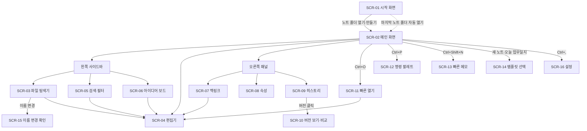

# Notevine 화면 설계서

- 문서 버전: v0.1 (2026-10-28)
- 기준 문서: `docs/개발계획서.md`, `docs/요구사항정의서.md`
- 대상 릴리스: v0.1 MVP
- 와이어프레임은 배치와 구성만 나타낸다. 한글은 글자 폭 때문에 편집기에 따라 선이 어긋나 보일 수 있다.

## 1. 화면 목록

| 화면 ID | 화면명 | 형태 | 관련 요구사항 | 우선순위 |
| --- | --- | --- | --- | --- |
| SCR-01 | 시작 화면 (노트 폴더 선택) | 전체 화면 | FR-VLT-01, FR-VLT-02, FR-PRS-01 | M |
| SCR-02 | 메인 화면 (기본 레이아웃) | 전체 화면 | FR-UI-01, FR-UI-02 | M |
| SCR-03 | 파일 탐색기 | 왼쪽 사이드바 탭 | FR-VLT-03, FR-VLT-04 | M |
| SCR-04 | 편집기 | 가운데 영역 | FR-EDT-01~06, FR-LNK-01~02, FR-LNK-04, FR-ATT-01~02, FR-ATT-04~05 | M |
| SCR-05 | 검색·필터 | 왼쪽 사이드바 탭 | FR-SRC-02~05 | M |
| SCR-06 | 아이디어 보드 (프리셋) | 왼쪽 사이드바 탭 | FR-PRS-05, FR-PRS-06 | M |
| SCR-07 | 백링크 패널 | 오른쪽 패널 탭 | FR-LNK-03 | M |
| SCR-08 | 속성 패널 | 오른쪽 패널 탭 | FR-PRP-01~03, FR-PRS-07 | M |
| SCR-09 | 히스토리 패널 | 오른쪽 패널 탭 | FR-HIS-03, FR-HIS-04 | M |
| SCR-10 | 버전 보기·비교 | 모달 | FR-HIS-04~06 | M (비교는 S) |
| SCR-11 | 빠른 열기 | 팝업 | FR-SRC-01 | M |
| SCR-12 | 명령 팔레트 | 팝업 | FR-UI-04, FR-EXT-01 | S |
| SCR-13 | 빠른 메모 | 팝업 | FR-PRS-04 | M |
| SCR-14 | 템플릿 선택 | 팝업 | FR-PRP-04, FR-PRS-03 | M |
| SCR-15 | 이름 변경 확인 | 대화상자 | FR-LNK-05 | S |
| SCR-16 | 설정 | 모달 | FR-UI-02~03, FR-PRS-01~02, FR-PRS-05 | M |
| SCR-17 | 알림 (토스트) | 오버레이 | NFR-REL-02, NFR-REL-03, FR-ATT-05 | M |
| SCR-18 | AI 패널 | 오른쪽 패널 아래 | FR-AI-01~02, FR-AI-06, FR-AI-08 | M |
| SCR-19 | AI 전송 확인 | 대화상자 | FR-AI-03 | M |
| SCR-20 | AI 작성 결과 미리보기 | 대화상자 | FR-AI-04~05 | M |

## 2. 화면 흐름



## 3. 공통 규칙

### 3.1 레이아웃·크기

| 항목 | 기준 |
| --- | --- |
| 최소 창 크기 | 960 × 600 px |
| 왼쪽 사이드바 | 기본 260px, 200~480px 드래그 조절, 접기 가능 |
| 오른쪽 패널 | 기본 300px, 240~520px 드래그 조절, 접기 가능 |
| 편집기 본문 폭 | 최대 760px 가운데 정렬 (설정에서 '전체 폭' 선택 가능) |
| 창 폭 1100px 미만 | 오른쪽 패널을 자동으로 접는다 |
| 간격 단위 | 4px 배수 (4·8·12·16·24) |

### 3.2 글꼴·색

| 항목 | 기준 |
| --- | --- |
| UI 글꼴 | Pretendard → 시스템 기본 산세리프 |
| 본문 글꼴 | UI 글꼴과 같음, 16px, 줄 간격 1.7 |
| 코드 글꼴 | D2Coding → JetBrains Mono → 시스템 고정폭 |
| 색 | CSS 변수(토큰)로만 지정: `--bg`, `--bg-sidebar`, `--text`, `--text-muted`, `--accent`, `--border`, `--danger`, `--success`. 라이트·다크 두 벌 |
| 강조색 | 덩굴을 연상하는 녹색 계열 1개 (예: 라이트 `#2F855A`, 다크 `#68D391`, 추정·디자인 확정 필요) |
| 대비 | 본문 글자 대비 4.5:1 이상 (WCAG AA) |

### 3.3 상호작용

- 모든 명령은 명령 레지스트리(FR-EXT-01)에 등록하고, 메뉴·단축키·명령 팔레트가 같은 명령을 호출한다.
- 파괴적 작업(삭제, 복원, 일괄 링크 변경)은 확인 대화상자를 거친다. 삭제는 v0.1에서도 OS 휴지통으로 보낸다(추정, 구현 시 확인).
- 키보드만으로 모든 화면을 쓸 수 있어야 한다. 포커스 테두리는 항상 보이게 한다.
- 단축키 표기는 Windows 기준 `Ctrl`이다. macOS를 지원하는 버전부터 `Cmd`로 바꿔 표시한다.

### 3.4 단축키

| 단축키 | 동작 | 화면 |
| --- | --- | --- |
| Ctrl+O | 빠른 열기 | SCR-11 |
| Ctrl+P | 명령 팔레트 | SCR-12 |
| Ctrl+Shift+N | 빠른 메모 | SCR-13 |
| Ctrl+N | 새 노트 (템플릿 선택) | SCR-14 |
| Ctrl+Shift+D | 오늘 업무일지 | SCR-04 |
| Ctrl+Shift+F | 검색 탭 열기 | SCR-05 |
| Ctrl+S | 수동 저장 (스냅샷 강제) | SCR-04 |
| Ctrl+\\ | 왼쪽 사이드바 접기/펴기 | SCR-02 |
| Ctrl+Shift+\\ | 오른쪽 패널 접기/펴기 | SCR-02 |
| Ctrl+, | 설정 | SCR-16 |
| Ctrl+T | 템플릿 삽입 (현재 노트) | SCR-14 |
| F1 | 마크다운 문법 도움말 | SCR-04 |
| F2 | 선택한 노트 이름 변경 | SCR-03 |
| Alt+← / Alt+→ | 지금 탭에서 이전/다음 노트로 이동 | SCR-04 |
| Ctrl+W | 탭 닫기 | SCR-04 |
| Ctrl+Tab / Ctrl+Shift+Tab | 다음/이전 탭 | SCR-04 |
| Ctrl+Shift+T | 닫은 탭 다시 열기 | SCR-04 |

단축키 조합은 확정 전이다(요구사항정의서 9장).

## 4. 화면 상세

### SCR-01 시작 화면

노트 폴더가 없거나 마지막 노트 폴더를 찾을 수 없을 때 보인다.

```
┌──────────────────────────────────────────────────────────┐
│                                                          │
│                  🌿 Notevine                             │
│          노트가 이어지는 나만의 지식 공간                  │
│                                                          │
│   ┌────────────────────────────────────────────────┐     │
│   │  📂  노트 폴더 열기                         │     │
│   ├────────────────────────────────────────────────┤     │
│   │  ➕  새 노트 폴더 만들기                             │     │
│   │      [✓] 기록 관리 프리셋 사용 (업무·아이디어·자료) │     │
│   └────────────────────────────────────────────────┘     │
│                                                          │
│   최근 노트 폴더                                               │
│   ─────────────────────────────────────────────          │
│   업무노트        D:\Notes\업무노트        2026-10-27    │
│   개인위키        C:\Users\me\wiki         2026-10-20    │
│                                                          │
│                                   한국어 ▾   ☀/🌙        │
└──────────────────────────────────────────────────────────┘
```

| 요소 | 동작 | 요구사항 |
| --- | --- | --- |
| 노트 폴더 열기 | OS 폴더 선택 창 → 선택 폴더로 SCR-02 진입. 기존 .md 폴더(Obsidian 볼트 포함)도 그대로 연다 | FR-VLT-01 |
| 새 노트 폴더 만들기 | 위치·이름 입력 → 폴더 생성. 프리셋 체크 시 기본 폴더·템플릿 생성 | FR-PRS-01~02 |
| 최근 노트 폴더 | 클릭 시 열기. 경로가 없으면 회색 처리 + "찾을 수 없음", 우클릭으로 목록에서 제거 | FR-VLT-02 |
| 언어·테마 | 바로 전환 | FR-UI-02~03 |

**상태:** 첫 인덱싱 중에는 SCR-02로 들어가되 상태바에 진행률을 표시한다(편집은 즉시 가능).

### SCR-02 메인 화면

```
┌───────────────────────────────────────────────────────────────────────────────┐
│ ◀ ▶  업무노트 / 10 업무일지 / 2026 / 2026-10-28.md            🔍  ⚙          │ 상단바
├────┬──────────────────┬───────────────────────────────────┬───────────────────┤
│ 📁 │ 파일 탐색기       │                                   │ [백링크][속성][⏱] │
│ 🔍 │                  │   # 2026-10-28 업무일지            │                   │
│ 💡 │ ▾ 00 Inbox       │                                   │  오른쪽 패널       │
│    │ ▾ 10 업무일지     │   ## 한 일                         │  (SCR-07/08/09)   │
│    │   ▾ 2026         │   - [x] 요구사항 정의서 작성        │                   │
│    │     2026-10-28   │   - [ ] [[화면 설계]] 검토          │                   │
│    │ ▸ 20 아이디어     │                                   │                   │
│    │ ▸ 30 조사자료     │        편집기 (SCR-04)             │                   │
│    │ ▸ 90 템플릿       │                                   │                   │
│    │                  │                                   │                   │
│ ⚙  │ [+ 새 노트]       │                                   │                   │
├────┴──────────────────┴───────────────────────────────────┴───────────────────┤
│ ✓ 저장됨 · 1,284 단어 · 노트 10,000개 · 인덱싱 완료                 Ln 12, Col 4 │ 상태바
└───────────────────────────────────────────────────────────────────────────────┘
```

| 영역 | 구성 | 요구사항 |
| --- | --- | --- |
| 상단바 | 뒤로/앞으로, 노트 폴더 이름 ▾(누르면 메뉴: 노트 폴더 바꾸기… → 시작 화면 SCR-01 / 탐색기에서 노트 폴더 열기), 현재 노트 경로(빵부스러기, 클릭 시 해당 폴더 선택), [기본 구조 만들기]→(만든 뒤) [오늘 업무일지], [빠른 메모], 명령 팔레트, 설정 | FR-UI-01, FR-VLT-02, FR-PRS-01 |
| 활동 막대 (맨 왼쪽 아이콘 열) | 📁 파일 탐색기 · 🔍 검색 · 💡 아이디어 보드(프리셋 켬일 때만) · ⚙ 설정 | FR-UI-01, FR-PRS-06 |
| 왼쪽 사이드바 | 활동 막대에서 고른 탭 (SCR-03/05/06) | — |
| 가운데 | 편집기 (SCR-04). 노트가 없으면 빈 상태 화면 | FR-EDT |
| 오른쪽 패널 | 백링크 · 속성 · 히스토리 탭 (SCR-07/08/09) | FR-LNK-03, FR-PRP-02, FR-HIS-04 |
| 상태바 | 저장 상태(저장 중/저장됨/충돌), 단어 수, 노트 수, 인덱싱 진행률, 커서 위치 | FR-EDT-03, FR-VLT-04 |

**빈 상태(열린 노트 없음):** 가운데에 "새 노트 (Ctrl+N) · 빠른 열기 (Ctrl+O) · 오늘 업무일지 (Ctrl+Shift+D)" 버튼 3개를 보여 준다.

### SCR-03 파일 탐색기

```
┌──────────────────────────┐
│ 파일 탐색기   ＋📄 ＋📁 ⇅ │
├──────────────────────────┤
│ ▾ 00 Inbox          (3)  │
│     아이디어 메모 1028    │
│ ▾ 10 업무일지             │
│   ▾ 2026                 │
│     2026-10-28  ●        │  ← 현재 노트 강조
│     2026-10-27           │
│ ▸ 20 아이디어       (12)  │
│ ▸ 30 조사자료       (34)  │
│ ▸ 첨부                    │
└──────────────────────────┘
```

| 요소 | 동작 | 요구사항 |
| --- | --- | --- |
| 항목 표시 | 폴더는 `>` 화살표(펼치면 아래로 회전)와 굵은 이름, 노트는 아이콘 없이 이름만, 첨부 등 그 밖의 파일은 흐린 이름(확장자 표시). 접힌 폴더에는 노트 수 | FR-UI-01 |
| 새 노트·새 폴더 | 선택된 폴더 안에 생성, 이름 입력 상태로 진입 | FR-VLT-03 |
| 정렬 (⇅) | 이름순 / 수정일순 / 생성일순 | — |
| 노트 클릭 | 편집기에서 열기 | — |
| 드래그 앤 드롭 | 노트·폴더 이동. 이동 후 링크 갱신 확인(SCR-15) | FR-VLT-03, FR-LNK-05 |
| 우클릭 메뉴 | 새 노트 · 이름 변경(F2) · 복제 · 삭제 · 탐색기에서 보기 · 경로 복사 · 히스토리 보기 | FR-VLT-03, FR-HIS-07 |
| 숨김 | `.app/` 폴더와 점(.)으로 시작하는 폴더는 표시하지 않음 | FR-VLT-05 |
| 외부 변경 | 외부에서 추가·삭제된 파일이 1초 안에 트리에 반영됨 | FR-VLT-04 |
| 개수 표시 | 폴더 오른쪽에 노트 수 (접혀 있을 때만) | — |

### SCR-04 편집기

```
┌───────────────────────────────────────────────────────┐
│  2026-10-28 업무일지                                   │ ← 제목 = 파일명 (클릭해 이름 변경)
│  H1 H2 H3 │ B I S ✎ <> A̲ Ⓐ │ • 1. ☑ ▍ │ [[ 🔗 ▦ {} ─     │ ← 서식 막대 ([편집|읽기]는 제목 줄 오른쪽)
│  ───────────────────────────────────────────────       │
│  type: journal   date: 2026-10-28                     │ ← frontmatter 요약 (접힘)
│                                                       │
│  ## 한 일                                              │
│  - [x] 요구사항 정의서 작성                            │
│  - [ ] [[화면 설계]] 검토                              │
│        ┌──────────────────────────┐                   │
│  [[화면│ 화면 설계서               │                   │ ← [[ 입력 시 자동완성
│        │ 화면 설계 회의록 1027      │                   │
│        │ ＋ "화면" 새 노트 만들기   │                   │
│        └──────────────────────────┘                   │
│  ![[첨부/구조도.png]]                                   │
│  ┌───────────────────────────┐                        │
│  │       (이미지 미리보기)      │                        │
│  └───────────────────────────┘                        │
│  📎 [[첨부/견적서.xlsx]]                               │ ← 이미지 외 첨부: 클릭 시 기본 프로그램
└───────────────────────────────────────────────────────┘
```

| 요소 | 동작 | 요구사항 |
| --- | --- | --- |
| 탭 막대 | 편집기 위에 열린 노트마다 탭 하나. 누르면 그 노트로, ×·가운데 버튼·Ctrl+W로 닫기, 오른쪽 버튼 메뉴에 '다른 탭 모두 닫기'. 노트는 기본으로 지금 탭에서 열리고, 파일 트리·검색 결과·백링크·읽기 모드 링크를 Ctrl+클릭하거나 가운데 버튼으로 누르면 새 탭에서 열린다(파일 트리 메뉴 '새 탭에서 열기'도 있음). 이미 열린 노트는 그 탭으로 옮겨 간다. 탭마다 이전/다음 기록과 커서·스크롤 위치를 따로 기억하고, 앱을 다시 켜면 탭이 돌아온다. 이름 변경·이동은 탭에 반영되고 삭제된 노트의 탭은 닫힌다 | FR-EDT-07 |
| 제목 | 파일명을 크게 표시. 클릭해 바꾸면 파일 이름 변경 + SCR-15 | FR-VLT-03, FR-LNK-05 |
| 라이브 미리보기 | 커서가 없는 줄은 서식으로, 커서가 있는 줄은 마크다운 원문으로 표시 | FR-EDT-02 |
| 서식 막대 | 제목 1~3 · 굵게(Ctrl+B) · 기울임(Ctrl+I) · 취소선(Ctrl+Shift+X) · 형광펜(Ctrl+Shift+H) · 인라인 코드(Ctrl+\`) · 글자 색 · 배경색 │ 글머리 목록 · 번호 목록 · 체크리스트(Ctrl+L) · 인용 │ 노트 링크 `[[ ]]` · 웹 링크(Ctrl+K) · 표 · 코드 블록 · 구분선. 선택 영역(없으면 커서 단어·줄)에 적용, 다시 누르면 해제. 편집기 스크롤 시 위에 고정 | FR-EDT-09 |
| 글자 색·배경색 | 버튼을 누르면 8색 팔레트와 "기본 색으로"/"배경 없애기". 마지막에 고른 색이 버튼에 표시된다. 선택(없으면 커서 단어)에 적용하고 여러 줄이면 줄마다 따로 감싸며 목록·제목 기호는 밖에 둔다. 같은 종류의 색은 바꿔 끼우고 다른 종류(글자 색 + 배경색)는 겹친다. 저장 형식은 `<span style="color: #e03131">…</span>`, 배경은 반투명 색이라 밝은·어두운 테마 모두에서 읽힌다. 편집기는 커서가 없는 줄에서 태그를 숨기고 색으로 보여 준다 | FR-EDT-09 |
| 편집/읽기 전환 | 제목 줄 오른쪽 [편집 \| 읽기], Ctrl+E. 읽기 모드는 표·형광펜·태그·체크박스·이미지까지 렌더링하고 속성은 숨김. 링크는 클릭으로 이동(읽기 모드 유지), 체크박스 클릭은 원문 수정·자동 저장. 웹 이미지는 "[그림] 설명" 링크로만 표시. 새 노트와 빈 노트는 편집 모드로 열림 | FR-EDT-10 |
| frontmatter | 본문 위에 한 줄 요약으로 접어 표시. 클릭하면 YAML 원문 편집 | FR-PRP-01 |
| 위키링크 자동완성 | `[[` 입력 시 팝업. 한글 부분 일치, ↑↓ 선택, Enter 확정, 결과 없으면 "새 노트 만들기" | FR-LNK-01 |
| 링크 클릭 | Ctrl+클릭(또는 설정에 따라 클릭)으로 이동. 없는 노트 링크는 점선 밑줄, 클릭 시 생성 | FR-LNK-02 |
| 링크 미리보기 | 링크에 마우스를 0.5초 올리면 대상 노트 앞부분 미리보기 | (C, v0.2) |
| 체크박스 | 클릭으로 체크 상태 토글 | FR-EDT-01 |
| 코드 블록 | 언어별 문법 강조 | FR-EDT-06 |
| 이미지 | `![[파일]]`, `` 모두 미리보기 | FR-ATT-02 |
| 드래그 앤 드롭 | 파일을 놓으면(형식 제한 없음) `첨부/`로 복사하고 커서 위치에 링크 삽입. 이미지는 `![[파일]]`, 그 밖의 파일은 `[[파일.확장자]]` | FR-ATT-01 |
| 이미지 붙여넣기 | 클립보드에 이미지가 있으면 Ctrl+V 시 `첨부/이미지 YYYYMMDD-HHmmss.png`로 저장하고 `![[...]]` 삽입. 텍스트는 일반 붙여넣기 | FR-ATT-04 |
| 첨부 링크 클릭 | 이미지가 아닌 첨부(PDF·xlsx·hwp 등)는 파일 아이콘과 함께 표시. 링크 클릭 방식에 따라 OS 기본 프로그램으로 열기. 파일이 없으면 토스트(SCR-17) | FR-ATT-05 |
| 자동 저장 | 입력을 멈추고 1초 후 저장. 상태바에 "저장 중…" → "✓ 저장됨" | FR-EDT-03 |
| IME | 한글 조합 중에는 자동완성·단축키 처리를 보류 | FR-EDT-05 |

### SCR-05 검색·필터

```
┌──────────────────────────────┐
│ 🔍 [ 무개                  ] │
│ 필터  ＋조건                  │
│ ┌──────────────────────────┐ │
│ │ status = 검토         ✕  │ │
│ │ type   = idea         ✕  │ │
│ │ 수정일  최근 7일        ✕  │ │
│ └──────────────────────────┘ │
│ 결과 12개 · 38ms              │
├──────────────────────────────┤
│ 📄 업무개선 아이디어           │
│    …반복 보고를 줄이는 업무개선 │
│    20 아이디어 · 10-27         │
│ 📄 자동화 도구 조사            │
│    …업무개선 효과가 큰 영역은… │
└──────────────────────────────┘
```

| 요소 | 동작 | 요구사항 |
| --- | --- | --- |
| 검색창 | 입력 후 200ms 디바운스로 검색. 한글 부분 일치 | FR-SRC-02 |
| 검색 문법 | `#태그`, `status:검토`, `"정확한 구"` 를 검색창에서 바로 쓸 수 있음 | FR-SRC-03~04 |
| 조건 추가 | 속성 이름 목록(인덱스에 있는 모든 key) → 연산자(=, ≠, 포함, 비어 있음) → 값 선택. 조건끼리는 AND | FR-SRC-04 |
| 날짜 조건 | 생성일·수정일 × 오늘 / 최근 7일 / 최근 30일 / 기간 지정 | FR-SRC-03 |
| 결과 | 제목, 일치 부분 강조 문맥 1줄, 폴더·수정일. 클릭 시 해당 위치로 이동 | FR-SRC-05 |
| 결과 요약 | 결과 수와 응답 시간(ms) 표시 | NFR-PRF-02 |
| 빈 결과 | "결과 없음 · 조건을 줄여 보세요" | — |

### SCR-06 아이디어 보드 (프리셋)

프리셋이 켜져 있을 때만 활동 막대에 나타난다.

```
┌──────────────────────────────┐
│ 💡 아이디어      ＋ 빠른 메모 │
│ 정렬: 수정일 ▾  태그: 전체 ▾  │
├──────────────────────────────┤
│ ▾ 아이디어 (5)                │
│    회의록 자동 요약     10-28 │
│    주간보고 템플릿화    10-26 │
│ ▾ 검토 (3)                    │
│    업무개선 아이디어    10-27 │
│ ▸ 진행 (2)                    │
│ ▸ 완료 (8)                    │
│ ▸ 보류 (1)                    │
│ ▸ Inbox 미분류 (3)            │
└──────────────────────────────┘
```

| 요소 | 동작 | 요구사항 |
| --- | --- | --- |
| 상태 그룹 | 프리셋에 정의된 `status` 값 순서대로 묶어 표시. 개수 표시 | FR-PRS-05~06 |
| 상태 변경 | 항목을 다른 그룹으로 드래그하거나 우클릭 → 상태 변경. frontmatter에 즉시 반영 | FR-PRS-06, FR-PRP-02 |
| Inbox 미분류 | `00 Inbox`의 노트 중 status가 없는 것 | FR-PRS-04 |
| 빠른 메모 | SCR-13 열기 | FR-PRS-04 |

### SCR-07 백링크 패널

```
┌───────────────────────────┐
│ 백링크 (3)                 │
├───────────────────────────┤
│ 📄 2026-10-28 업무일지      │
│    - [ ] [[화면 설계]] 검토 │
│ 📄 회의록 1027              │
│    결정: [[화면 설계]]는 …  │
├───────────────────────────┤
│ 연결되지 않은 언급 (v0.2)   │
└───────────────────────────┘
```

| 요소 | 동작 | 요구사항 |
| --- | --- | --- |
| 목록 | 현재 노트를 가리키는 노트와 링크가 있는 문장 | FR-LNK-03 |
| 클릭 | 해당 노트의 링크 위치로 이동 | FR-LNK-03 |
| 갱신 | 다른 노트에서 링크를 추가·삭제하면 1초 안에 갱신 | FR-LNK-03 |
| 빈 상태 | "이 노트를 가리키는 링크가 없습니다" | — |

### SCR-08 속성 패널

```
┌──────────────────────────────┐
│ 속성                          │
├──────────────────────────────┤
│ type     [ idea           ▾] │
│ status   [ 검토           ▾] │
│ tags     [업무개선✕][자동화✕]＋│
│ source   https://example… ↗  │
│ created  📅 2026-10-27       │
│                              │
│ ＋ 속성 추가                  │
└──────────────────────────────┘
```

| 요소 | 동작 | 요구사항 |
| --- | --- | --- |
| 속성 행 | 이름 · 값. 값 유형별 입력: 텍스트, 날짜(날짜 선택기), 목록(칩), URL(↗로 브라우저 열기) | FR-PRP-02~03, FR-PRS-07 |
| 값 제안 | 같은 속성 이름에 쓰인 기존 값을 드롭다운으로 제안 (예: status 값) | FR-PRP-02 |
| 속성 추가 | 이름 입력(기존 이름 자동완성) → 유형 자동 추정 | FR-PRP-02 |
| 동기화 | 패널에서 바꾸면 frontmatter에 반영, YAML을 직접 고치면 패널에 반영 | FR-PRP-02 |
| YAML 오류 | frontmatter 문법 오류 시 패널 상단에 경고, 편집기에서 해당 줄 강조 | — |

### SCR-09 히스토리 패널

```
┌───────────────────────────────┐
│ 히스토리 (24)                  │
├───────────────────────────────┤
│ 오늘                           │
│  ● 14:32  현재 버전             │
│  ○ 14:05  +120 −8 단어          │
│  ○ 13:40  +34 단어   외부 변경  │
│  ○ 09:12  수동 저장             │
│ 어제                           │
│  ○ 18:20  +410 단어             │
│ 2026-10-25                     │
│  ○ 11:03  처음 생성             │
└───────────────────────────────┘
```

| 요소 | 동작 | 요구사항 |
| --- | --- | --- |
| 버전 목록 | 날짜별로 묶어 시간 역순. 각 항목에 변경량(단어 수 증감), 표식(수동 저장 / 외부 변경 / 복원 / 처음 생성) | FR-HIS-03~04 |
| 클릭 | SCR-10 버전 보기 열기 | FR-HIS-04 |
| 삭제된 노트 | 파일 탐색기 우클릭 또는 명령 팔레트 "삭제된 노트 히스토리"에서 접근 | FR-HIS-07 |
| 안내 | 패널 하단에 "히스토리는 .app/history.db에 저장됩니다. 노트 폴더와 함께 백업하세요" | DR-03 |

### SCR-10 버전 보기·비교

```
┌──────────────────────────────────────────────────────────────────┐
│ 2026-10-28 업무일지 · 버전 기록                                 ✕ │
│ 보기: (●) 이 버전만   ( ) 현재와 비교   ( ) 이전 버전과 비교       │
├───────────────┬──────────────────────────────────────────────────┤
│ 14:05  ◀ 선택  │  ## 한 일                                         │
│ 13:40         │  - [x] 요구사항 정의서 작성                        │
│ 09:12         │+ - [ ] [[화면 설계]] 검토                          │ ← 추가(녹색)
│ 어제 18:20     │- - [ ] 화면 설계 시작                              │ ← 삭제(빨강)
│               │                                                  │
├───────────────┴──────────────────────────────────────────────────┤
│                         [ 내용 복사 ]   [ 이 버전으로 복원 ]       │
└──────────────────────────────────────────────────────────────────┘
```

| 요소 | 동작 | 요구사항 |
| --- | --- | --- |
| 버전 목록 (왼쪽) | SCR-09와 같은 목록, ↑↓로 이동 | FR-HIS-04 |
| 보기 모드 | 이 버전만(읽기 전용) / 현재와 비교 / 이전 버전과 비교. 비교는 줄 단위 diff, 추가 녹색·삭제 빨강 | FR-HIS-04, FR-HIS-06 |
| 내용 복사 | 선택한 버전 전체(또는 드래그한 부분)를 클립보드로 | — |
| 이 버전으로 복원 | 확인 대화상자 "현재 내용은 새 버전으로 저장된 뒤 복원됩니다" → 복원 → 히스토리에 '복원' 표식 | FR-HIS-05 |

diff 보기(FR-HIS-06)가 v0.2로 넘어가면 보기 모드는 '이 버전만'만 남긴다.

### SCR-11 빠른 열기

```
┌──────────────────────────────────────────┐
│ 🔍 [ 화면                              ] │
├──────────────────────────────────────────┤
│ ▶ 화면 설계서            docs            │
│   화면 설계 회의록 1027  30 조사자료      │
│   ＋ "화면" 새 노트 만들기  (Shift+Enter) │
└──────────────────────────────────────────┘
```

| 요소 | 동작 | 요구사항 |
| --- | --- | --- |
| 입력 | 파일명 퍼지 검색(한글 부분 일치), 최근 연 노트를 위로 | FR-SRC-01 |
| Enter | 선택 노트 열기 | FR-SRC-01 |
| Shift+Enter | 입력한 이름으로 새 노트 생성 | FR-VLT-03 |
| Esc | 닫기 | — |

### SCR-12 명령 팔레트

SCR-11과 같은 모양. 입력창 앞에 `>` 표시, 결과는 "명령 이름 · 단축키". 명령 레지스트리(FR-EXT-01)에 등록된 모든 명령을 보여 준다. (FR-UI-04, S)

### SCR-13 빠른 메모

```
┌────────────────────────────────────────────┐
│ 💡 빠른 메모 → 00 Inbox                     │
├────────────────────────────────────────────┤
│ 회의록을 자동으로 요약해 업무일지에 붙이기   │
│ #자동화                                     │
│                                            │
├────────────────────────────────────────────┤
│ Ctrl+Enter 저장 · Esc 취소       [ 저장 ]  │
└────────────────────────────────────────────┘
```

| 요소 | 동작 | 요구사항 |
| --- | --- | --- |
| 열기 | Ctrl+Shift+N, 아이디어 보드의 "＋ 빠른 메모" | FR-PRS-04 |
| 입력 | 여러 줄 입력. 첫 줄이 제목(파일명), 비어 있으면 `메모 YYYY-MM-DD HHmm` | FR-PRS-04 |
| 저장 | `00 Inbox/`에 아이디어 템플릿으로 저장(`type: idea`, `status: 아이디어`), 창 닫힘, 토스트 "Inbox에 저장됨 · 열기" | FR-PRS-04~05 |
| 프리셋 꺼짐 | 노트 폴더 루트(또는 설정한 폴더)에 일반 노트로 저장 | FR-PRS-01 |

### SCR-14 템플릿 선택

```
┌────────────────────────────────────┐
│ 새 노트                             │
├────────────────────────────────────┤
│ ▶ 빈 노트                           │
│   업무일지                          │
│   회의록                            │
│   아이디어                          │
│   조사 자료                         │
│   (90 템플릿 폴더의 사용자 템플릿…) │
├────────────────────────────────────┤
│ 이름 [ 자동화 도구 조사          ] │
│ 위치 [ 30 조사자료             ▾ ] │
└────────────────────────────────────┘
```

| 요소 | 동작 | 요구사항 |
| --- | --- | --- |
| 템플릿 목록 | 빈 노트 + 템플릿 폴더의 모든 노트 | FR-PRP-04 |
| 위치 | 템플릿 frontmatter의 `folder` 값을 기본 위치로 제안 (예: 조사 자료 → `30 조사자료`) | FR-PRS-02 |
| 생성 | `{{date}}`, `{{time}}`, `{{title}}` 치환 후 생성하고 편집기로 열기 | FR-PRP-04 |
| 오늘 업무일지 | Ctrl+Shift+D는 이 화면 없이 바로 열거나 생성 | FR-PRS-03 |
| 템플릿 삽입 | 명령 팔레트 '템플릿 삽입'(Ctrl+T)은 빈 노트 없이 같은 목록을 보여 주고, 고른 템플릿을 열린 노트의 커서 위치에 넣는다. `{{title}}`은 현재 노트 이름. 템플릿 속성은 노트에 없는 것만 더하고 기존 값은 바꾸지 않는다 | FR-PRP-04 |

### SCR-15 이름 변경 확인

```
┌──────────────────────────────────────────────┐
│ 이름 변경: 화면 설계 → 화면 설계서              │
├──────────────────────────────────────────────┤
│ 이 노트를 가리키는 링크 5개(노트 3개)를         │
│ 함께 고칩니다.                                │
│                                              │
│  ☑ 2026-10-28 업무일지   (2곳)               │
│  ☑ 회의록 1027           (2곳)               │
│  ☑ 요구사항 메모         (1곳)               │
│                                              │
│              [ 취소 ]  [ 링크도 바꾸고 변경 ] │
└──────────────────────────────────────────────┘
```

| 요소 | 동작 | 요구사항 |
| --- | --- | --- |
| 목록 | 바뀔 노트와 링크 개수. 체크 해제한 노트는 바꾸지 않음 | FR-LNK-05 |
| 실행 | 파일 이름 변경 + 링크 일괄 치환. 바뀐 노트마다 스냅샷 생성 | FR-LNK-05, FR-HIS-01 |
| 링크 없음 | 대화상자 없이 바로 이름 변경 | — |
| v0.2로 넘어갈 경우 | 이름만 바꾸고 "링크 N개는 수동으로 고쳐야 합니다" 경고 | — |

### SCR-16 설정

```
┌──────────────────────────────────────────────────────────┐
│ 설정                                                   ✕ │
├──────────────┬───────────────────────────────────────────┤
│ 일반          │ 언어          [ 한국어 ▾ ]                │
│ 편집기        │ 테마          ( ) 라이트 ( ) 다크 (●) 시스템│
│ 파일·링크     │ 시작 시       [✓] 마지막 노트 폴더 열기          │
│ 프리셋        │                                           │
│ 히스토리      │                                           │
│ 단축키 (v0.2) │                                           │
│ 정보          │                                           │
└──────────────┴───────────────────────────────────────────┘
```

| 탭 | 항목 | 요구사항 |
| --- | --- | --- |
| 일반 | 언어, 테마(라이트/다크/시스템), 시작 시 마지막 노트 폴더 열기 | FR-UI-02~03, FR-VLT-02 |
| 편집기 | 글꼴 크기, 본문 최대 폭/전체 폭, 링크 클릭 방식(클릭/Ctrl+클릭), 자동 저장 지연(기본 1초) | FR-EDT-02~03 |
| 파일·링크 | 새 노트 기본 위치, 첨부 폴더 위치, 이름 변경 시 링크 자동 갱신 켬/끔 | FR-ATT-01, FR-LNK-05 |
| 프리셋 | 기록 관리 프리셋 켬/끔, 폴더 이름, 아이디어 상태 값 목록(순서 변경 가능), 업무일지 경로 규칙, 템플릿 폴더 | FR-PRS-01~05 |
| 히스토리 | 스냅샷 묶음 간격(기본 5분), history.db 위치 표시·폴더 열기 | FR-HIS-02, DR-03 |
| 정보 | 버전, 라이선스(MIT), GitHub 링크, 인덱스 다시 만들기 버튼 | NFR-MNT-02, NFR-REL-03 |

### SCR-17 알림 (토스트)

화면 오른쪽 아래에 4초간 표시한다. 오류·충돌은 사용자가 닫을 때까지 남긴다.

| 종류 | 문구 예시 | 동작 버튼 | 요구사항 |
| --- | --- | --- | --- |
| 정보 | "Inbox에 저장됨" | 열기 | FR-PRS-04 |
| 충돌 | "다른 프로그램이 이 노트를 동시에 고쳤습니다. 내 변경은 '이름 (충돌 2026-10-28 1432).md'로 저장했습니다" | 두 파일 비교 | NFR-REL-02 |
| 복구 | "검색 인덱스를 다시 만들고 있습니다 (35%)" | — | NFR-REL-03 |
| 오류 | "저장하지 못했습니다: 파일이 읽기 전용입니다" | 다시 시도 | NFR-REL-01 |
| 첨부 없음 | "첨부 파일을 찾을 수 없음: 첨부/견적서.xlsx" | 폴더 열기 | FR-ATT-05 |

### SCR-18 AI 패널

오른쪽 패널 아래쪽에 항상 보인다(위쪽은 속성·백링크·히스토리). Ctrl+J를 누르면 질문 칸으로 이동한다. AI 기능을 켜지 않았으면 켜는 방법과 감지된 CLI를 보여 준다.

```
┌──────────────────────────────┐
│ 속성 · 백링크 · 히스토리 (위)  │
├──────────────────────────────┤
│ AI 도우미  Claude Code ▾ 새 대화│
│                              │
│ 나: 지난주 회의에서 결정한 것? │
│ AI: 세 가지를 정했습니다.      │
│   1. … ([[회의록 1027]])      │
│   [새 노트로 저장] [복사]      │
│                              │
│ [ 질문을 입력하세요…      ] ▶ │
└──────────────────────────────┘
```

| 요소 | 동작 | 요구사항 |
| --- | --- | --- |
| 연결 선택 | 감지된 CLI(Claude Code / Codex) 중 선택 | FR-AI-01 |
| 연결 안 됨 | 쓸 수 있는 AI가 없으면 CLI별 상태를 보여 준다. 로그아웃이면 [로그인] → 공식 로그인 창(브라우저에서 로그인)이 열리고 버튼은 "로그인 창에서 진행 중…". 창이 닫히면 다시 확인해 성공 시 "○○에 연결했습니다", 실패 시 [다시 로그인]. 미설치면 PowerShell 설치 명령과 [복사]. [다시 찾기]는 캐시 없이 다시 확인 | FR-AI-01 |
| 로그인 오류 | 질문·작성 중 로그인 만료 오류가 나면 오류 아래(또는 미리보기 창 안)에 [로그인] 버튼 | FR-AI-01 |
| 모델 선택 | CLI별 모델 목록(Claude: 기본·Opus·Sonnet·Haiku·Fable 5.1, Codex: 기본·gpt-6.1-sol) + 직접 입력. 답변 아래에 실제로 답한 모델 이름 표시. 쓸 수 없는 모델이면 기본 모델로 다시 보냄 | FR-AI-01 |
| 질문 | Enter 전송, Shift+Enter 줄바꿈. 보내기 전 SCR-19 | FR-AI-02~03 |
| 노트·웹 함께 | 입력 칸 하나. 보내기 전 SCR-19에서 관련 노트와 '웹에서도 찾아보기'를 고른다. 답을 기다리는 동안 "웹 검색: …", "페이지 읽기: …" 단계를 보여 준다. 답의 웹 출처는 ↗ 링크(브라우저로 열기), 노트 근거는 `[[링크]]`. 웹을 쓴 답을 새 노트로 저장하면 조사자료 폴더로 | FR-AI-08 |
| 답변 | 실시간 표시(Claude Code), 출처 `[[링크]]`는 클릭하면 노트 열기, 중지 버튼 | FR-AI-02 |
| 새 노트로 저장 | 질문·답변·출처를 `AI 답변 YYYY-MM-DD HHmm` 노트로 저장 | FR-AI-06 |

### SCR-19 AI 전송 확인

| 요소 | 동작 | 요구사항 |
| --- | --- | --- |
| 보낼 노트 | 관련 노트 목록(제목·분량·일치 문맥)과 체크박스. 현재 노트 포함 여부 선택. `#비공개` 노트는 목록에 없고 "#비공개 태그가 있는 노트 N개는 보내지 않도록 뺐습니다" 표시 | FR-AI-03 |
| 보낼 곳 | "Claude Code(Anthropic)로 보냅니다"처럼 전송 대상과 총 글자 수 | FR-AI-03, NFR-SEC-02 |
| 웹에서도 찾아보기 | 질문일 때 체크박스(기본 켬, 마지막 선택 기억). 켜면 노트로 부족할 때 AI가 웹을 검색·열람한다. "노트 내용은 검색어에 넣지 말라고 지시하지만, 질문과 관련된 표현이 검색에 쓰일 수 있습니다" 안내. 끄면 보낸 노트만으로 답한다 | FR-AI-08 |
| 보내기 / 취소 | 취소하면 아무것도 보내지 않는다 | FR-AI-03 |

### SCR-20 AI 작성 결과 미리보기

| 요소 | 동작 | 요구사항 |
| --- | --- | --- |
| 실행 | 명령 팔레트 "AI: 요약 / 다듬기 / 이어 쓰기 / 영어로 번역" (선택한 글, 없으면 현재 문단) | FR-AI-04 |
| 미리보기 | 원문과 결과를 나란히. 결과는 고쳐 쓸 수 있다 | FR-AI-04 |
| 적용 | 바꾸기 / 아래에 넣기 / 취소. 적용은 Ctrl+Z로 되돌린다 | FR-AI-04 |
| 주간 회고 | "AI: 이번 주 업무일지로 주간 회고 만들기" → SCR-19 → 결과를 새 노트로 | FR-AI-05 |

## 5. 요구사항 대응 확인

화면이 필요한 v0.1 기능 요구사항(M·S) 중 화면에 대응하지 않는 것이 없는지 확인한다. 화면이 필요 없는 요구사항(FR-VLT-05 일부, FR-EDT-04 등 내부 동작)은 해당 화면의 동작 설명에 포함했다.

| 영역 | 요구사항 | 대응 화면 |
| --- | --- | --- |
| 노트 폴더 | FR-VLT-01~05 | SCR-01, SCR-02, SCR-03 |
| 편집기 | FR-EDT-01~06 | SCR-04 |
| 링크 | FR-LNK-01~06 | SCR-04, SCR-07, SCR-15 |
| 속성·템플릿 | FR-PRP-01~04 | SCR-04, SCR-08, SCR-14 |
| 검색 | FR-SRC-01~05 | SCR-05, SCR-11 |
| 히스토리 | FR-HIS-01~07 | SCR-09, SCR-10, SCR-15 |
| 프리셋 | FR-PRS-01~07 | SCR-01, SCR-06, SCR-08, SCR-13, SCR-14, SCR-16 |
| 첨부 | FR-ATT-01~02, FR-ATT-04~05 | SCR-04, SCR-17 |
| 화면 | FR-UI-01~04 | SCR-02, SCR-12, SCR-16 |
| 확장 | FR-EXT-01 | SCR-12 |
| AI 도우미 | FR-AI-01~06 | SCR-16, 18, 19, 20 |

## 6. 확인이 필요한 사항

- [ ] 강조색과 로고(🌿는 임시)를 포함한 시각 디자인 확정
- [ ] 단축키 조합 확정 (특히 Ctrl+Shift+N이 다른 앱과 겹치는지)
- [ ] 링크 이동 기본값: 클릭 또는 Ctrl+클릭
- [ ] 삭제 시 OS 휴지통 사용 가능 여부(v0.1은 Windows 휴지통만 확인)
- [ ] 아이디어 보드를 목록형으로 둘지, v0.2에서 칸반형으로 바꿀지
